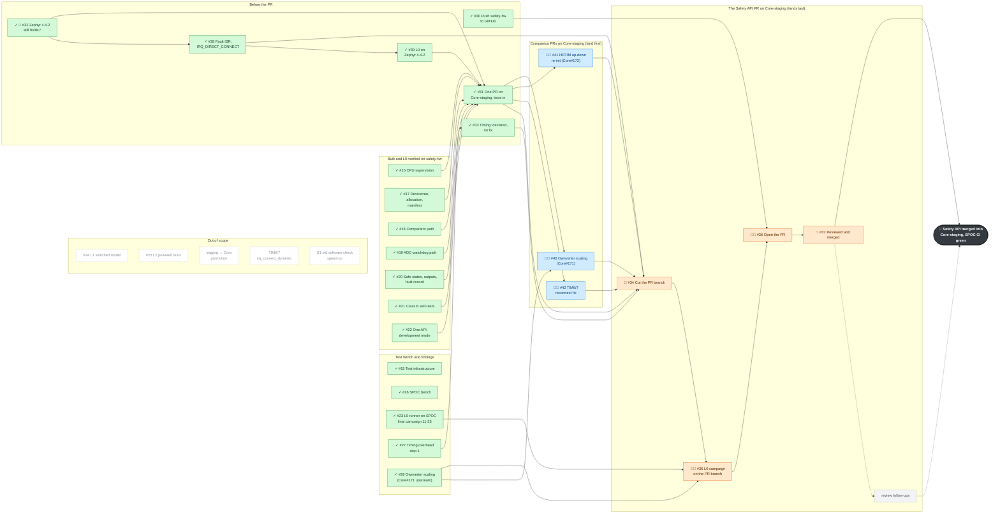

# Safety API dev map

Copy of the visual map on [Map: Safety API as an upstream PR](https://github.com/luizvilla/Core/issues/29), the canonical one. Redrawn whenever a ticket opens, closes, is claimed or goes stale.

**Destination:** the Safety API of ADR 0009 and its safety tests merged into `owntech-foundation/Core-staging` as one pull request, passing staging's SPOC CI and L0-verified on Twist and Ownverter (redrawn on 2026-11-26 by [What goes into the Safety API PR](https://github.com/luizvilla/Core/issues/31)).

Green done · blue takeable · purple in progress · orange blocked · red ⏳ stale (3 days without activity) · grey dashed fog · white dashed out of scope · 🔨 build · 🔎 research · 👤 can't move without Luiz.
