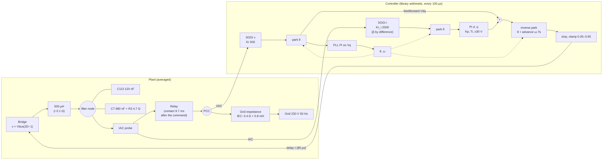
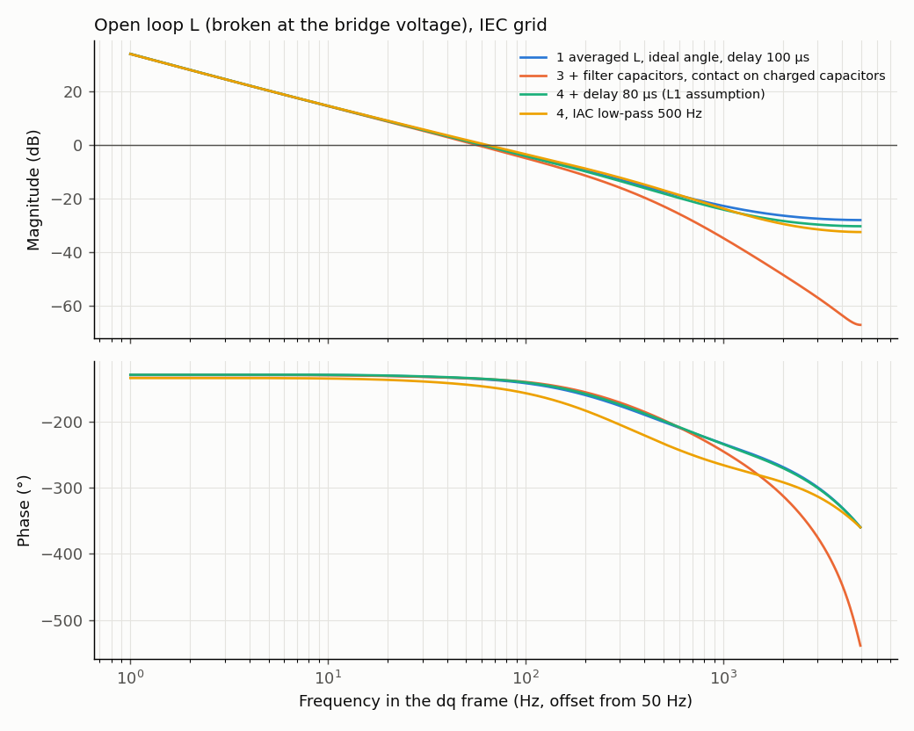
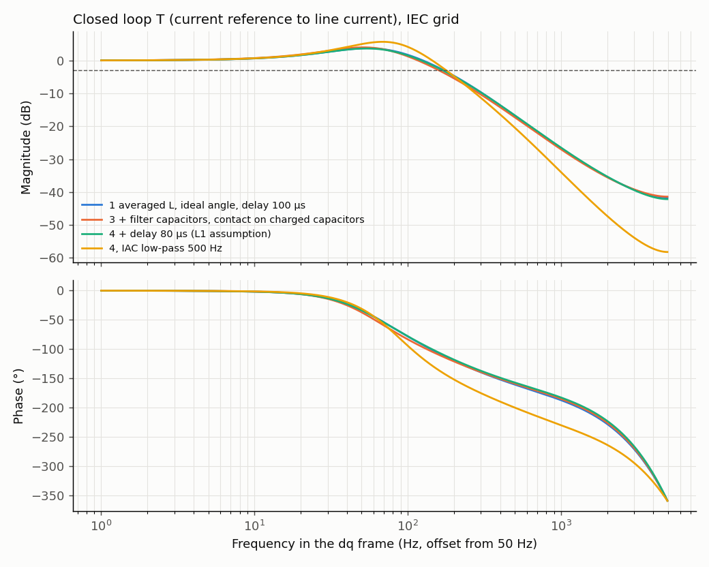

# D-GFL-01: connection fidelity ladder, IEC grid

Design test (ADR 0004): averaged model, INFO only, no verdict. Candidate C (Kp 1 V/A, Ti 5 ms, current SOGI 2000 rad/s, advance 0.5 period), current PI active from the relay command unless stated. Grid: 0.4 Ω, 0.8 mH. Generated by `tests/l1/design/ladder.py --report`.

## Plant and loop

## Margins and bandwidth (linear model, relay closed, ideal angle)

Margins are open-loop properties; the closed loop is described by its bandwidth and its resonance peak. Frequencies in the dq frame. Rung 2 (PLL) has no linear row: the linear model uses the ideal angle.

| Case | Open loop: crossover (Hz) | Open loop: phase margin (°) | Open loop: gain margin (dB) | Closed loop: bandwidth −3 dB (Hz) | Closed loop: peak (dB) | Closed loop: peak at (Hz) |
|---|---|---|---|---|---|---|
| 1 averaged L, ideal angle, delay 100 µs | 60.6 | 44.5 | 13.7 | 172 | 3.7 | 55 |
| 3 + filter capacitors, contact on charged capacitors | 56.6 | 45.5 | 18.3 | 160 | 3.97 | 51.4 |
| 4 + delay 80 µs (L1 assumption) | 59.9 | 45.3 | 14.6 | 170 | 3.64 | 53.8 |
| 4, IAC low-pass 500 Hz | 63.7 | 32.9 | 8.27 | 178 | 5.66 | 68.6 |
| 4, no output advance | 60 | 43.8 | 13.5 | 173 | 3.92 | 55.5 |
| 4, Kp 0.5 | 30.4 | 31.5 | 12.4 | 82.7 | 5.08 | 32.6 |

## Connection transient (time domain, trip disabled)

Contact on a voltage zero crossing; the 1.5 A bench trip is reported, not applied, so the whole transient is visible.

| Case | Peak line current, first 10 ms (A) | Would trip at 1.5 A | Line current, first 5 ms (A) | \|I_dq\| seen by the controller, first 5 ms (A) | Transient above 0.15 A (ms) | I_d after the 0.1 A step (A) |
|---|---|---|---|---|---|---|
| 1 averaged L, ideal angle, delay 100 µs | 1.29 | no | 1.29 | 2.41 | 21.8 | 0.1 |
| 2 + library PLL | 3.32 | yes | 1.26 | 3.54 | 98.2 | 0.101 |
| 3 + filter capacitors, contact on charged capacitors | 11.7 | yes | 4.36 | 11.7 | 159 | 0.1 |
| 4 + delay 80 µs (L1 assumption) | 1.65 | yes | 1.33 | 2.6 | 81.9 | 0.1 |
| 4, PI from the feedback (library today) | 7.73 | yes | 3.84 | 3.97 | 93 | 0.0998 |
| 4, IAC low-pass 500 Hz | 2.02 | yes | 1.53 | 3.32 | 80.9 | 0.1 |
| 4, no output advance | 2.61 | yes | 2.61 | 6.35 | 91.9 | 0.1 |
| 4, Kp 0.5 | 4.01 | yes | 1.93 | 3.5 | 190 | 2 |
