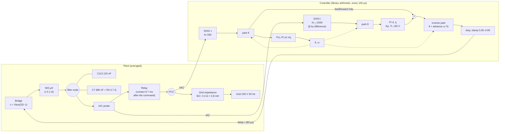
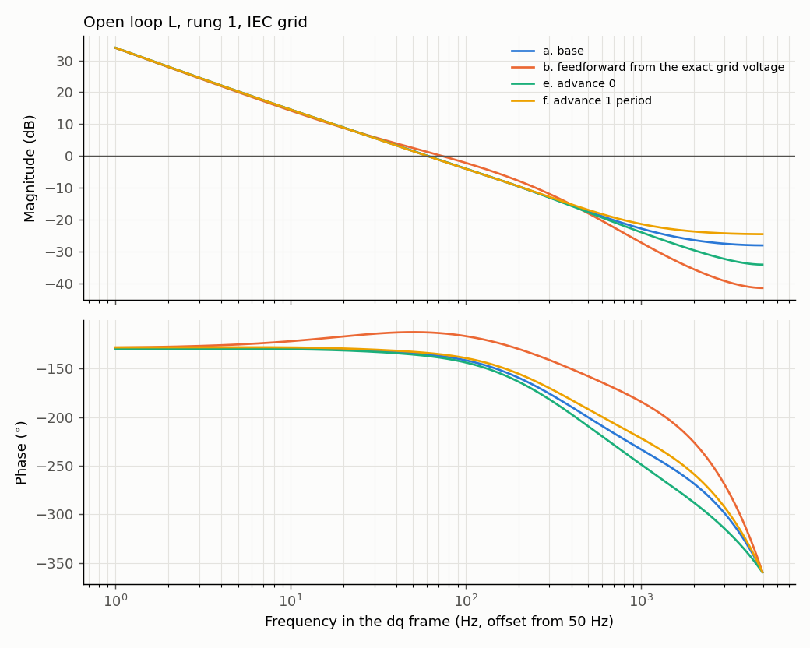
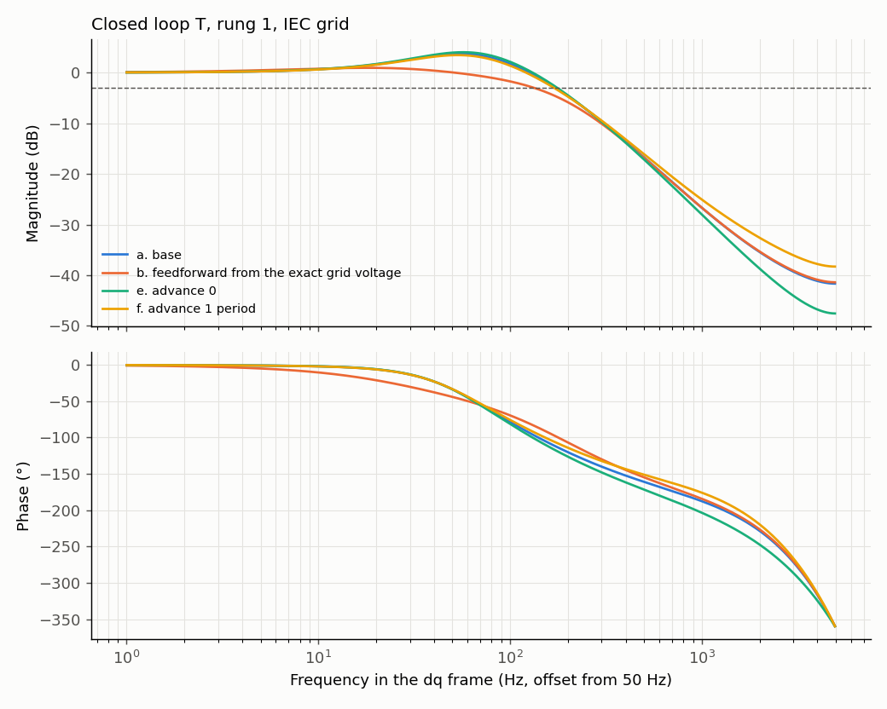
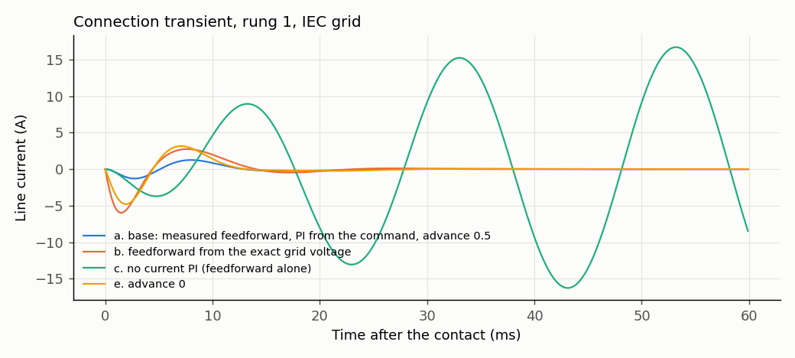

# D-GFL-02: source of the connection disturbance in the ideal case, IEC grid

Design test ([ADR 0004](../../../adr/0004-averaged-model-for-fast-evaluation.md)): averaged model, INFO only, no verdict. Rung 1 of D-GFL-01 (averaged L, ideal angle, no filter capacitors, delay one control period), candidate C, contact on a voltage zero crossing; one factor changed at a time. Grid: 0.4 Ω, 0.8 mH. Trip disabled so the whole transient is visible; "would trip" compares with the 1.5 A bench trip. Provisional target for the ideal case (proposed, to be confirmed): peak below 0.3 A over 10 ms and settling within ±0.05 A in under 20 ms. Generated by `tests/l1/design/connection.py`.

## Plant and loop

## Margins and bandwidth (linear model, relay closed)

Margins are open-loop properties; the closed loop is described by its bandwidth and resonance peak. Frequencies in the dq frame. With exact feedforward the loop is the current PI alone; without the PI it is the feedforward alone.

| Case | Open loop: crossover (Hz) | Open loop: phase margin (°) | Open loop: gain margin (dB) | Closed loop: bandwidth −3 dB (Hz) | Closed loop: peak (dB) | Closed loop: peak at (Hz) |
|---|---|---|---|---|---|---|
| a. base: measured feedforward, PI from the command, advance 0.5 | 60.6 | 44.5 | 13.7 | 172 | 3.7 | 55 |
| b. feedforward from the exact grid voltage | 73.4 | 66.3 | 25.8 | 131 | 0.85 | 18.1 |
| c. no current PI (feedforward alone) | — | — | — | — | — | 1 |
| e. advance 0 | 60.7 | 42.9 | 12.7 | 176 | 4 | 56.7 |
| f. advance 1 period | 60.2 | 46.1 | 14.7 | 169 | 3.43 | 53.2 |
| g. exact feedforward, advance 0 | 74.1 | 64.2 | 22.2 | 141 | 0.905 | 19 |
| h. exact feedforward, advance 1 period | 73 | 68.4 | 27.5 | 122 | 0.799 | 17.2 |
| j. exact feedforward, advance 1.5 periods (delay + half a period of hold) | 72.6 | 70.4 | 27.2 | 115 | 0.75 | 16.5 |
| k. advance 1.5 periods | 60 | 47.7 | 15.5 | 166 | 3.17 | 51.5 |

## Connection transient (time domain)

| Case | Peak, 10 ms (A) | Peak, 20 ms (A) | Settling ±0.05 A (ms) | Meets target | Would trip | Line current, 5 ms (A) | \|I_dq\| seen, 5 ms (A) | PLL angle excursion (°) | PLL frequency excursion (Hz) |
|---|---|---|---|---|---|---|---|---|---|
| a. base: measured feedforward, PI from the command, advance 0.5 | 1.29 | 1.29 | 25.9 | no | no | 1.29 | 2.41 | 1.63e-12 | 0 |
| b. feedforward from the exact grid voltage | 5.97 | 5.97 | 31.2 | no | yes | 5.97 | 14.8 | 1.63e-12 | 0 |
| c. no current PI (feedforward alone) | 4.38 | 8.95 | 180 | no | yes | 3.71 | 3.89 | 1.63e-12 | 0 |
| d. no current PI, exact feedforward | 12.1 | 16 | 180 | no | yes | 11.6 | 17.2 | 1.63e-12 | 0 |
| e. advance 0 | 4.79 | 4.79 | 36.2 | no | yes | 4.79 | 9.71 | 1.63e-12 | 0 |
| f. advance 1 period | 2.8 | 2.8 | 22.4 | no | yes | 2.8 | 7.21 | 1.63e-12 | 0 |
| g. exact feedforward, advance 0 | 9.17 | 9.17 | 31.9 | no | yes | 9.17 | 22.6 | 1.63e-12 | 0 |
| h. exact feedforward, advance 1 period | 2.92 | 2.92 | 28.7 | no | yes | 2.92 | 7.29 | 1.63e-12 | 0 |
| i. PI from the relay feedback (library today) | 4.38 | 5.49 | 44.8 | no | yes | 3.71 | 3.89 | 1.63e-12 | 0 |
| j. exact feedforward, advance 1.5 periods (delay + half a period of hold) | 0.0159 | 0.0159 | 0 | yes | no | 0.0159 | 0.0428 | 1.63e-12 | 0 |
| k. advance 1.5 periods | 6.27 | 6.27 | 26.2 | no | yes | 6.27 | 15.3 | 1.63e-12 | 0 |

## Findings

1. **The connection disturbance is the inverter-grid voltage mismatch at the contact.** With the relay open no current flows whatever the mismatch; at the contact the mismatch drives current through only 500 µH plus the grid impedance (0.41 Ω at 50 Hz on the IEC grid), so a 1° phase error (about 5 V) gives amps.
2. **The mismatch comes from the timing of the output, not from the PI.** The bridge applies each command one control period later and holds it for one period: 1.5 periods of delay on average. With the voltage feedforward exact and the output advanced by 1.5 periods (case j) the transient vanishes: 0.016 A, no settling needed.
3. **Today's configuration works by partial compensation.** The measured feedforward (SOGI on VAC) leads by about one sample, and the 0.5-period advance adds the rest. Its best advance is 0.7 (sweep: 0.78 A at 0.7, 1.29 A at 0.5, 2.8 A at 1.0); it never reaches the ideal case, because VAC itself moves at the contact and the SOGI passes that back.
4. **The PI does not cause the disturbance; it removes it.** Without the PI the feedforward alone leaves 4–12 A and does not settle (cases c, d); starting the PI only at the relay feedback (the library today) gives 4.4 A.
5. Implementable form of case j: **a synthesized feedforward**, the averaged Vd (already computed by the library for the synchronization check) rotated by the PLL angle, with the advance set from the measured actuation delay. See D-GFL-03 for its behaviour with the PLL.
