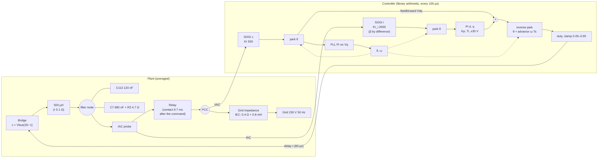
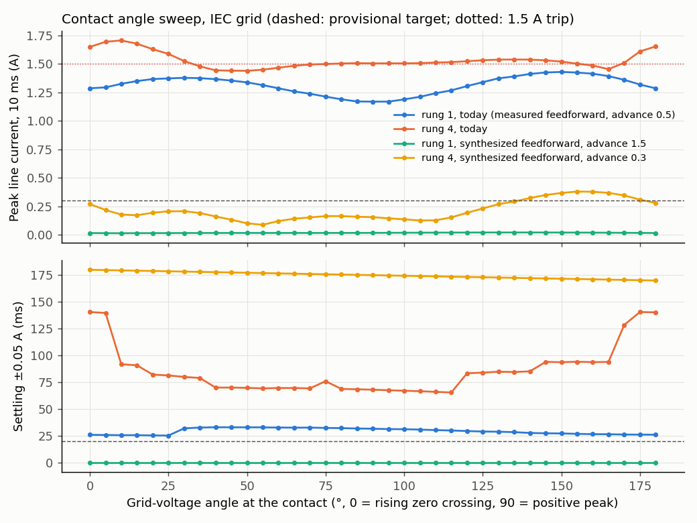

# D-GFL-03: contact angle, IEC grid

Design test ([ADR 0004](../../../adr/0004-averaged-model-for-fast-evaluation.md)): averaged model, INFO only, no verdict. Relay contact swept over 0–180° of the grid-voltage angle in 5° steps (the command 9.7 ms earlier), candidate C, current PI from the relay command; today's configuration and the synthesized feedforward found by D-GFL-02 (case j: amplitude and PLL angle; advance 1.5 periods on rung 1, 0.3 on rung 4 where the PLL angle already leads by one sample). 180–360° mirrors 0–180° (negative half-cycle). The contact angle does not change the linear loop: its margins are those of [D-GFL-01](../D-GFL-01_IEC/report.md) rung 1 and rung 4. Grid: 0.4 Ω, 0.8 mH. Trip disabled so the whole transient is visible; "would trip" compares with the 1.5 A bench trip. Provisional target for the ideal case (proposed, to be confirmed): peak below 0.3 A over 10 ms and settling within ±0.05 A in under 20 ms. Generated by `tests/l1/design/connection.py`.

## Plant and loop

## rung 1, today (measured feedforward, advance 0.5)

Smallest peak at 90°: 1.17 A, settling 31.6 ms. Angles meeting the provisional target: none.

| Case | Peak, 10 ms (A) | Peak, 20 ms (A) | Settling ±0.05 A (ms) | Meets target | Would trip | Line current, 5 ms (A) | \|I_dq\| seen, 5 ms (A) | PLL angle excursion (°) | PLL frequency excursion (Hz) |
|---|---|---|---|---|---|---|---|---|---|
| 0° | 1.29 | 1.29 | 25.9 | no | no | 1.29 | 2.41 | 1.63e-12 | 0 |
| 15° | 1.35 | 1.35 | 25.6 | no | no | 1.09 | 2.4 | 1.63e-12 | 0 |
| 30° | 1.38 | 1.38 | 31.9 | no | no | 0.856 | 2.26 | 1.63e-12 | 0 |
| 45° | 1.35 | 1.35 | 32.9 | no | no | 0.707 | 2.01 | 1.63e-12 | 0 |
| 60° | 1.29 | 1.29 | 32.7 | no | no | 0.939 | 1.69 | 1.63e-12 | 0 |
| 75° | 1.21 | 1.21 | 32.3 | no | no | 1.09 | 1.43 | 1.63e-12 | 0 |
| 90° | 1.17 | 1.17 | 31.6 | no | no | 1.16 | 1.29 | 1.22e-12 | 0 |
| 105° | 1.21 | 1.21 | 30.8 | no | no | 1.21 | 1.43 | 1.22e-12 | 0 |
| 120° | 1.3 | 1.3 | 29.4 | no | no | 1.3 | 1.7 | 1.22e-12 | 0 |
| 135° | 1.39 | 1.39 | 28.4 | no | no | 1.39 | 1.96 | 1.22e-12 | 0 |
| 150° | 1.43 | 1.43 | 27.2 | no | no | 1.43 | 2.16 | 1.22e-12 | 0 |
| 165° | 1.39 | 1.39 | 26.4 | no | no | 1.39 | 2.29 | 1.22e-12 | 0 |
| 180° | 1.29 | 1.29 | 26 | no | no | 1.29 | 2.41 | 1.22e-12 | 0 |

## rung 4, today

Smallest peak at 50°: 1.44 A, settling 69.7 ms. Angles meeting the provisional target: none.

| Case | Peak, 10 ms (A) | Peak, 20 ms (A) | Settling ±0.05 A (ms) | Meets target | Would trip | Line current, 5 ms (A) | \|I_dq\| seen, 5 ms (A) | PLL angle excursion (°) | PLL frequency excursion (Hz) |
|---|---|---|---|---|---|---|---|---|---|
| 0° | 1.65 | 1.65 | 140 | no | yes | 1.32 | 2.58 | 0.388 | 0.236 |
| 15° | 1.68 | 1.68 | 90.8 | no | yes | 1.1 | 2.48 | 0.355 | 0.206 |
| 30° | 1.52 | 1.52 | 79.9 | no | yes | 0.844 | 2.16 | 0.273 | 0.25 |
| 45° | 1.44 | 1.44 | 70 | no | no | 1.03 | 1.88 | 0.23 | 0.287 |
| 50° | 1.44 | 1.44 | 69.7 | no | no | 1.13 | 1.81 | 0.225 | 0.283 |
| 60° | 1.47 | 1.47 | 69.6 | no | no | 1.33 | 1.74 | 0.23 | 0.245 |
| 75° | 1.5 | 1.5 | 75.9 | no | no | 1.48 | 1.7 | 0.242 | 0.142 |
| 90° | 1.5 | 1.5 | 68 | no | yes | 1.5 | 1.7 | 0.246 | 0.0904 |
| 105° | 1.51 | 1.51 | 66.6 | no | yes | 1.51 | 1.84 | 0.243 | 0.146 |
| 120° | 1.52 | 1.52 | 83.3 | no | yes | 1.52 | 2.12 | 0.242 | 0.242 |
| 135° | 1.54 | 1.54 | 84.5 | no | yes | 1.54 | 2.41 | 0.252 | 0.279 |
| 150° | 1.52 | 1.52 | 93.7 | no | yes | 1.52 | 2.63 | 0.291 | 0.236 |
| 165° | 1.45 | 1.45 | 93.9 | no | no | 1.45 | 2.69 | 0.351 | 0.218 |
| 180° | 1.65 | 1.65 | 140 | no | yes | 1.33 | 2.6 | 0.392 | 0.237 |

## rung 1, synthesized feedforward, advance 1.5

Smallest peak at 10°: 0.0142 A, settling 0 ms. Angles meeting the provisional target: 0, 5, 10, 15, 20, 25, 30, 35, 40, 45, 50, 55, 60, 65, 70, 75, 80, 85, 90, 95, 100, 105, 110, 115, 120, 125, 130, 135, 140, 145, 150, 155, 160, 165, 170, 175, 180°.

| Case | Peak, 10 ms (A) | Peak, 20 ms (A) | Settling ±0.05 A (ms) | Meets target | Would trip | Line current, 5 ms (A) | \|I_dq\| seen, 5 ms (A) | PLL angle excursion (°) | PLL frequency excursion (Hz) |
|---|---|---|---|---|---|---|---|---|---|
| 0° | 0.0159 | 0.0159 | 0 | yes | no | 0.0159 | 0.0428 | 1.63e-12 | 0 |
| 10° | 0.0142 | 0.0142 | 0 | yes | no | 0.0134 | 0.0375 | 1.63e-12 | 0 |
| 15° | 0.0148 | 0.0148 | 0 | yes | no | 0.012 | 0.0343 | 1.63e-12 | 0 |
| 30° | 0.0159 | 0.0159 | 0 | yes | no | 0.0144 | 0.025 | 1.63e-12 | 0 |
| 45° | 0.0164 | 0.0164 | 0 | yes | no | 0.016 | 0.0218 | 1.63e-12 | 0 |
| 60° | 0.0165 | 0.0165 | 0 | yes | no | 0.0165 | 0.0192 | 1.63e-12 | 0 |
| 75° | 0.0165 | 0.0165 | 0 | yes | no | 0.0165 | 0.0197 | 1.63e-12 | 0 |
| 90° | 0.0171 | 0.0171 | 0 | yes | no | 0.0171 | 0.0267 | 1.22e-12 | 0 |
| 105° | 0.0187 | 0.0187 | 0 | yes | no | 0.0187 | 0.0364 | 1.22e-12 | 0 |
| 120° | 0.0201 | 0.0201 | 0 | yes | no | 0.0201 | 0.0433 | 1.22e-12 | 0 |
| 135° | 0.0206 | 0.0206 | 0 | yes | no | 0.0206 | 0.0477 | 1.22e-12 | 0 |
| 150° | 0.0201 | 0.0201 | 0 | yes | no | 0.0201 | 0.0492 | 1.22e-12 | 0 |
| 165° | 0.0185 | 0.0185 | 0 | yes | no | 0.0185 | 0.0475 | 1.22e-12 | 0 |
| 180° | 0.0159 | 0.0159 | 0 | yes | no | 0.0159 | 0.0428 | 1.22e-12 | 0 |

## rung 4, synthesized feedforward, advance 0.3

Smallest peak at 55°: 0.0879 A, settling 177 ms. Angles meeting the provisional target: none.

| Case | Peak, 10 ms (A) | Peak, 20 ms (A) | Settling ±0.05 A (ms) | Meets target | Would trip | Line current, 5 ms (A) | \|I_dq\| seen, 5 ms (A) | PLL angle excursion (°) | PLL frequency excursion (Hz) |
|---|---|---|---|---|---|---|---|---|---|
| 0° | 0.27 | 0.421 | 180 | no | no | 0.195 | 0.857 | 0.249 | 0.0915 |
| 15° | 0.172 | 0.579 | 179 | no | no | 0.168 | 0.807 | 0.276 | 0.242 |
| 30° | 0.207 | 0.631 | 178 | no | no | 0.162 | 0.712 | 0.298 | 0.399 |
| 45° | 0.133 | 0.516 | 177 | no | no | 0.128 | 0.574 | 0.266 | 0.457 |
| 55° | 0.0879 | 0.397 | 177 | no | no | 0.0879 | 0.448 | 0.228 | 0.427 |
| 60° | 0.121 | 0.352 | 177 | no | no | 0.0741 | 0.379 | 0.211 | 0.389 |
| 75° | 0.164 | 0.328 | 176 | no | no | 0.0577 | 0.183 | 0.203 | 0.226 |
| 90° | 0.155 | 0.367 | 175 | no | no | 0.0798 | 0.193 | 0.213 | 0.0583 |
| 105° | 0.126 | 0.431 | 174 | no | no | 0.107 | 0.308 | 0.231 | 0.234 |
| 120° | 0.193 | 0.488 | 173 | no | no | 0.154 | 0.512 | 0.25 | 0.389 |
| 135° | 0.293 | 0.534 | 172 | no | no | 0.194 | 0.691 | 0.267 | 0.447 |
| 150° | 0.367 | 0.54 | 172 | no | no | 0.216 | 0.827 | 0.275 | 0.379 |
| 165° | 0.368 | 0.487 | 171 | no | no | 0.213 | 0.875 | 0.266 | 0.216 |
| 180° | 0.279 | 0.41 | 170 | no | no | 0.194 | 0.856 | 0.249 | 0.089 |

## Findings

1. **The contact angle is a second-order effect with today's feedforward.** On rung 1 the peak moves between 1.17 A (90°, the voltage peak) and 1.43 A; on rung 4 between 1.44 A (50°) and 1.70 A (10°). No angle meets the target. The voltage peak is slightly better than the zero crossing on rung 1, as expected from the dv/dt argument, but the gain is small.
2. **With the synthesized feedforward the angle barely matters on the ideal case** (0.014 A at every angle, no settling).
3. **On rung 4 the synthesized feedforward cuts the contact peak from about 1.5 A to 0.09–0.38 A** (best 55°, 0.09 A; below 0.3 A from 0° to about 130°), but leaves a slow oscillation of about 0.4 A that is still there 150 ms later (settling never reached). Mechanism: the feedforward now follows the PLL angle, and the PLL follows VAC, which moves with the current through the grid inductance; that coupling is poorly damped.
4. **The PLL locks with a steady +1.8° (one sample) angle offset**, because it tracks the SOGI output, which leads its input by one sample. A synthesized feedforward must subtract that sample from its advance: 0.8 + 0.5 − 1 = 0.3 period on rung 4 (with 1.5 instead, 6.4 A).
5. **The two feedforwards are complementary:** the synthesized one avoids the contact spike, the measured one settles cleanly (0.007 A after 150 ms). Next: synthesized feedforward during a blank time around the contact, then the measured one (D-GFL-04), and the actual delay to be measured on the bench, since the result depends on it to within a tenth of a period.
