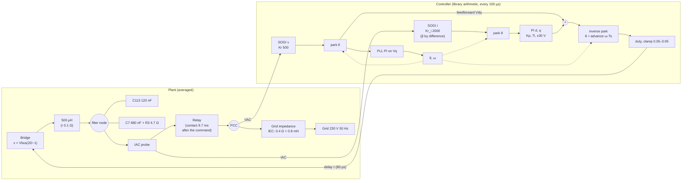
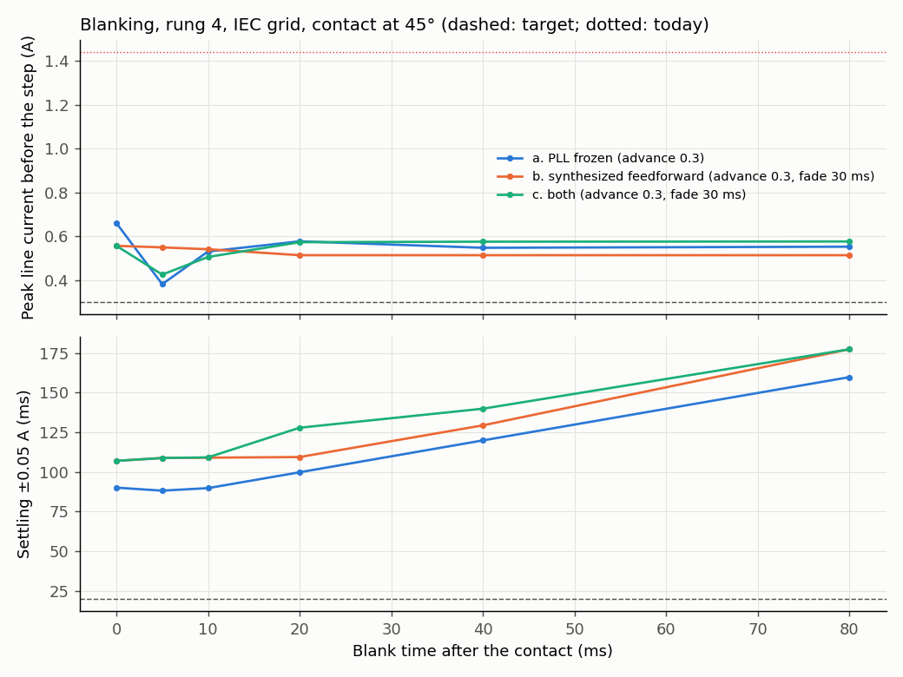
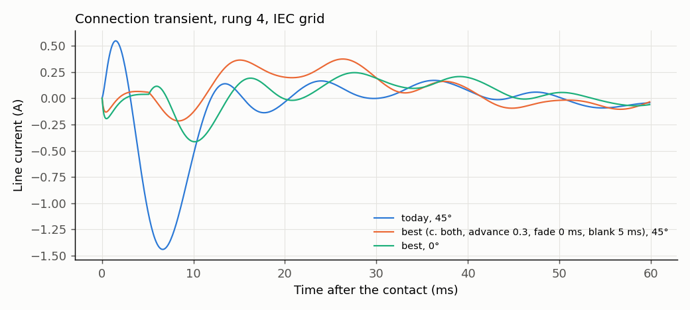

# D-GFL-04: blanking time after the contact, IEC grid

Design test ([ADR 0004](../../../adr/0004-averaged-model-for-fast-evaluation.md)): averaged model, INFO only, no verdict. Rung 4 of D-GFL-01 (library PLL, filter capacitors, 80 µs delay), candidate C, current PI from the relay command, contact at 45° (D-GFL-03). Variants: (a) PLL integrator held and ω latched from the contact for the blank time; (b) feedforward synthesized from the pre-command period average of Vd and the PLL angle (advance 0.3 period) from the relay command to the end of the blank time, then faded to the measured feedforward; (c) both. Swept: blank time 0–80 ms, fade 0 / 10 / 30 ms, advance of the measured feedforward and the PI 0.5 (today) or 0.3. Grid: 0.4 Ω, 0.8 mH. Trip disabled so the whole transient is visible; "would trip" compares with the 1.5 A bench trip. Provisional target for the ideal case (proposed, to be confirmed): peak below 0.3 A over 10 ms and settling within ±0.05 A in under 20 ms. Generated by `tests/l1/design/connection.py`.

## Plant and loop

## Margins and bandwidth (linear model, relay closed, ideal angle)

During the blank time the synthesized feedforward does not depend on the plant, so the loop is the current PI alone; after it, the measured feedforward adds its own path. Margins are open-loop properties; the closed loop is described by its bandwidth and resonance peak.

| Loop | Open loop: crossover (Hz) | Open loop: phase margin (°) | Open loop: gain margin (dB) | Closed loop: bandwidth −3 dB (Hz) | Closed loop: peak (dB) | Closed loop: peak at (Hz) |
|---|---|---|---|---|---|---|
| during the blank (synthesized feedforward), advance 0.3 | 73.7 | 66.3 | 25.4 | 132 | 0.846 | 18 |
| after the blank (measured feedforward), advance 0.3 | 59.9 | 44.7 | 14.2 | 171 | 3.75 | 54.4 |

## Best cases (time domain)

Ranked: meets the target first, then peak before the step plus settling/100 ms.

| Case | Peak before the step (A) | Peak, 10 ms (A) | Settling ±0.05 A (ms) | Meets target | Would trip | \|I_dq\| seen, 5 ms (A) | PLL angle excursion (°) |
|---|---|---|---|---|---|---|---|
| today, contact at 45° | 1.44 | 1.44 | 70 | no | no | 1.88 | 0.23 |
| today, contact at 0° (zero crossing) | 1.65 | 1.65 | 140 | no | yes | 2.58 | 0.388 |
| c. both, advance 0.3, fade 0 ms, blank 5 ms | 0.374 | 0.216 | 88.5 | no | no | 0.604 | 0.204 |
| a. PLL frozen, advance 0.3, fade 0 ms, blank 5 ms | 0.381 | 0.274 | 88.2 | no | no | 0.893 | 0.206 |
| c. both, advance 0.3, fade 10 ms, blank 5 ms | 0.507 | 0.139 | 89.7 | no | no | 0.604 | 0.226 |
| a. PLL frozen, advance 0.3, fade 0 ms, blank 10 ms | 0.53 | 0.268 | 89.8 | no | no | 0.893 | 0.256 |
| b. synthesized feedforward, advance 0.3, fade 0 ms, blank 5 ms | 0.545 | 0.14 | 89.2 | no | no | 0.596 | 0.243 |
| b. synthesized feedforward, advance 0.3, fade 10 ms, blank 0 ms | 0.604 | 0.139 | 90.3 | no | no | 0.596 | 0.253 |
| c. both, advance 0.3, fade 10 ms, blank 0 ms | 0.604 | 0.139 | 90.3 | no | no | 0.596 | 0.253 |
| c. both, advance 0.3, fade 30 ms, blank 5 ms | 0.425 | 0.132 | 109 | no | no | 0.604 | 0.229 |
| b. synthesized feedforward, advance 0.3, fade 10 ms, blank 10 ms | 0.62 | 0.126 | 89.3 | no | no | 0.596 | 0.268 |
| a. PLL frozen, advance 0.3, fade 0 ms, blank 0 ms | 0.66 | 0.305 | 90.1 | no | no | 0.901 | 0.267 |
| best case with the contact at 0° | 0.414 | 0.411 | 90.4 | no | no | 0.858 | 0.191 |

## All cases

| Variant | Advance | Fade (ms) | Blank (ms) | Peak before the step (A) | Settling (ms) | Meets target |
|---|---|---|---|---|---|---|
| a. PLL frozen | 0.5 | 0 | 0 | 1.44 | 70 | no |
| a. PLL frozen | 0.5 | 0 | 5 | 1.27 | 60 | no |
| a. PLL frozen | 0.5 | 0 | 10 | 1.26 | 107 | no |
| a. PLL frozen | 0.5 | 0 | 20 | 1.26 | 100 | no |
| a. PLL frozen | 0.5 | 0 | 40 | 1.26 | 120 | no |
| a. PLL frozen | 0.5 | 0 | 80 | 1.26 | 160 | no |
| a. PLL frozen | 0.3 | 0 | 0 | 0.66 | 90.1 | no |
| a. PLL frozen | 0.3 | 0 | 5 | 0.381 | 88.2 | no |
| a. PLL frozen | 0.3 | 0 | 10 | 0.53 | 89.8 | no |
| a. PLL frozen | 0.3 | 0 | 20 | 0.577 | 99.8 | no |
| a. PLL frozen | 0.3 | 0 | 40 | 0.547 | 120 | no |
| a. PLL frozen | 0.3 | 0 | 80 | 0.552 | 160 | no |
| b. synthesized feedforward | 0.5 | 0 | 0 | 1.37 | 68.5 | no |
| b. synthesized feedforward | 0.5 | 0 | 5 | 1.58 | 88.8 | no |
| b. synthesized feedforward | 0.5 | 0 | 10 | 2.15 | 148 | no |
| b. synthesized feedforward | 0.5 | 0 | 20 | 1.26 | 111 | no |
| b. synthesized feedforward | 0.5 | 0 | 40 | 1.91 | 121 | no |
| b. synthesized feedforward | 0.5 | 0 | 80 | 2.09 | 175 | no |
| b. synthesized feedforward | 0.5 | 10 | 0 | 1.04 | 99.5 | no |
| b. synthesized feedforward | 0.5 | 10 | 5 | 1.79 | 100 | no |
| b. synthesized feedforward | 0.5 | 10 | 10 | 1.5 | 109 | no |
| b. synthesized feedforward | 0.5 | 10 | 20 | 0.655 | 99.1 | no |
| b. synthesized feedforward | 0.5 | 10 | 40 | 1.36 | 140 | no |
| b. synthesized feedforward | 0.5 | 10 | 80 | 1.44 | 177 | no |
| b. synthesized feedforward | 0.5 | 30 | 0 | 0.94 | 107 | no |
| b. synthesized feedforward | 0.5 | 30 | 5 | 0.952 | 88.7 | no |
| b. synthesized feedforward | 0.5 | 30 | 10 | 0.829 | 110 | no |
| b. synthesized feedforward | 0.5 | 30 | 20 | 0.729 | 110 | no |
| b. synthesized feedforward | 0.5 | 30 | 40 | 0.702 | 130 | no |
| b. synthesized feedforward | 0.5 | 30 | 80 | 0.748 | 177 | no |
| b. synthesized feedforward | 0.3 | 0 | 0 | 0.663 | 106 | no |
| b. synthesized feedforward | 0.3 | 0 | 5 | 0.545 | 89.2 | no |
| b. synthesized feedforward | 0.3 | 0 | 10 | 0.685 | 90.2 | no |
| b. synthesized feedforward | 0.3 | 0 | 20 | 0.513 | 107 | no |
| b. synthesized feedforward | 0.3 | 0 | 40 | 0.513 | 110 | no |
| b. synthesized feedforward | 0.3 | 0 | 80 | 0.639 | 160 | no |
| b. synthesized feedforward | 0.3 | 10 | 0 | 0.604 | 90.3 | no |
| b. synthesized feedforward | 0.3 | 10 | 5 | 0.686 | 90.3 | no |
| b. synthesized feedforward | 0.3 | 10 | 10 | 0.62 | 89.3 | no |
| b. synthesized feedforward | 0.3 | 10 | 20 | 0.513 | 109 | no |
| b. synthesized feedforward | 0.3 | 10 | 40 | 0.513 | 129 | no |
| b. synthesized feedforward | 0.3 | 10 | 80 | 0.542 | 158 | no |
| b. synthesized feedforward | 0.3 | 30 | 0 | 0.556 | 107 | no |
| b. synthesized feedforward | 0.3 | 30 | 5 | 0.549 | 109 | no |
| b. synthesized feedforward | 0.3 | 30 | 10 | 0.54 | 109 | no |
| b. synthesized feedforward | 0.3 | 30 | 20 | 0.513 | 109 | no |
| b. synthesized feedforward | 0.3 | 30 | 40 | 0.513 | 129 | no |
| b. synthesized feedforward | 0.3 | 30 | 80 | 0.513 | 177 | no |
| c. both | 0.5 | 0 | 0 | 1.37 | 68.5 | no |
| c. both | 0.5 | 0 | 5 | 1.7 | 87.6 | no |
| c. both | 0.5 | 0 | 10 | 2.12 | 137 | no |
| c. both | 0.5 | 0 | 20 | 2.21 | 158 | no |
| c. both | 0.5 | 0 | 40 | 2.22 | 177 | no |
| c. both | 0.5 | 0 | 80 | 2.22 | 171 | no |
| c. both | 0.5 | 10 | 0 | 1.04 | 99.5 | no |
| c. both | 0.5 | 10 | 5 | 1.61 | 100 | no |
| c. both | 0.5 | 10 | 10 | 1.48 | 110 | no |
| c. both | 0.5 | 10 | 20 | 1.53 | 120 | no |
| c. both | 0.5 | 10 | 40 | 1.53 | 140 | no |
| c. both | 0.5 | 10 | 80 | 1.53 | 177 | no |
| c. both | 0.5 | 30 | 0 | 0.94 | 107 | no |
| c. both | 0.5 | 30 | 5 | 0.82 | 88.6 | no |
| c. both | 0.5 | 30 | 10 | 0.798 | 109 | no |
| c. both | 0.5 | 30 | 20 | 0.856 | 120 | no |
| c. both | 0.5 | 30 | 40 | 0.858 | 139 | no |
| c. both | 0.5 | 30 | 80 | 0.859 | 177 | no |
| c. both | 0.3 | 0 | 0 | 0.663 | 106 | no |
| c. both | 0.3 | 0 | 5 | 0.374 | 88.5 | no |
| c. both | 0.3 | 0 | 10 | 0.667 | 106 | no |
| c. both | 0.3 | 0 | 20 | 0.76 | 100 | no |
| c. both | 0.3 | 0 | 40 | 0.763 | 120 | no |
| c. both | 0.3 | 0 | 80 | 0.764 | 160 | no |
| c. both | 0.3 | 10 | 0 | 0.604 | 90.3 | no |
| c. both | 0.3 | 10 | 5 | 0.507 | 89.7 | no |
| c. both | 0.3 | 10 | 10 | 0.589 | 108 | no |
| c. both | 0.3 | 10 | 20 | 0.649 | 99.7 | no |
| c. both | 0.3 | 10 | 40 | 0.651 | 120 | no |
| c. both | 0.3 | 10 | 80 | 0.652 | 160 | no |
| c. both | 0.3 | 30 | 0 | 0.556 | 107 | no |
| c. both | 0.3 | 30 | 5 | 0.425 | 109 | no |
| c. both | 0.3 | 30 | 10 | 0.505 | 109 | no |
| c. both | 0.3 | 30 | 20 | 0.573 | 128 | no |
| c. both | 0.3 | 30 | 40 | 0.575 | 140 | no |
| c. both | 0.3 | 30 | 80 | 0.576 | 177 | no |

## Findings

1. **The advance alone does half the work.** Setting the output advance to 0.3 period (80 µs delay + half a period of hold − the one-sample lead of the PLL angle) cuts the contact peak from 1.44 A to 0.66 A with nothing else changed ("a. PLL frozen, blank 0"). This is a parameter of the existing setter (`setOutputPhaseAdvance`), no new code.
2. **A short blank does the rest of what blanking can do.** Best: synthesized feedforward and PLL frozen for 5 ms after the contact, advance 0.3, no fade: **peak 0.37 A** (4× below the 1.5 A trip), against 1.44 A today at 45° and 1.65 A at the zero crossing (which trips). Longer blank times are worse: when the PLL and the measured feedforward take over again, VAC has moved with the current and the handover becomes a second disturbance.
3. **No variant meets the provisional target.** The peak gets close (0.32–0.37 A), but every case keeps a tail of 0.1–0.4 A that decays over 80–90 ms.
4. **The tail is the PLL, not the current loop.** Longer integral times damp the current loop (Ti 10 / 20 ms: phase margin 61° / 75°, closed-loop peak 1.9 / 0.9 dB) without shortening the tail (settling 158 / 177 ms at Kp 1). Kp 2 V/A with Ti 20 ms (phase margin 67°, bandwidth 312 Hz) gives the smallest peak, 0.32 A, settling 80 ms. The same tail appears in D-GFL-01 as soon as the PLL is added (rung 2: 22 → 98 ms).
5. Open questions for the next design step: either the PLL is made insensitive to the current through the grid impedance (a slower PLL once connected, or a PLL on an estimate of the grid-side voltage), or the settling target is relaxed to the PLL's time scale (about 100 ms) while keeping the peak below 0.3–0.4 A.
