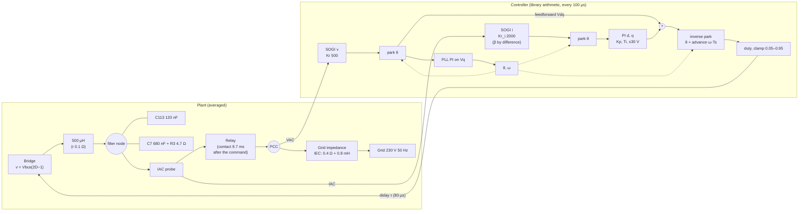
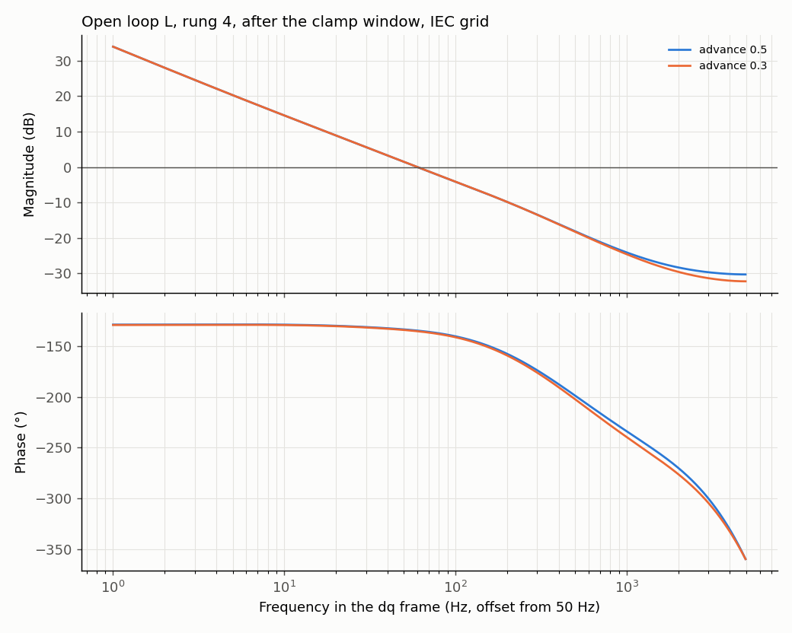
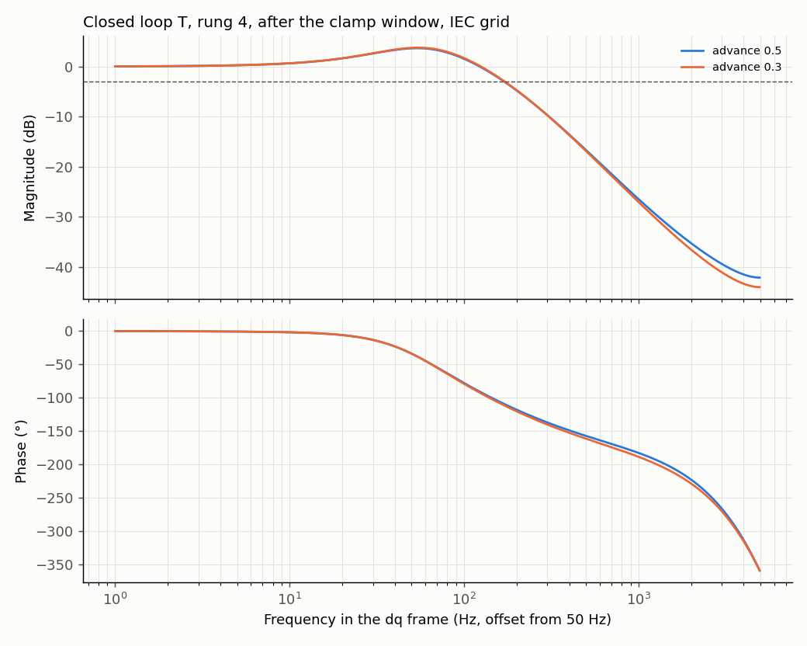

# D-GFL-05: clamp after the park transform, IEC grid

Design test ([ADR 0004](../../../adr/0004-averaged-model-for-fast-evaluation.md)): averaged model, INFO only, no verdict. Rung 4 of D-GFL-01 (library PLL, filter capacitors as up to D-GFL-04, 80 µs delay), candidate C, current PI from the relay command, contact at 45°. From the relay command to the end of a window after the contact, the park outputs are clamped around their pre-command values: (a) the feedforward Vd, Vq; (b) also the Vq fed to the PLL; (c) also the measured I_d, I_q. Swept: clamp level, window 10 / 40 / 100 ms, output advance 0.5 (today) or 0.3 (D-GFL-04). Grid: 0.4 Ω, 0.8 mH. Trip disabled so the whole transient is visible; "would trip" compares with the 1.5 A bench trip. Provisional target for the ideal case (proposed, to be confirmed): peak below 0.3 A over 10 ms and settling within ±0.05 A in under 20 ms. Generated by `tests/l1/design/connection.py`.

## Plant and loop

## Margins and bandwidth (linear model, relay closed)

The clamp is nonlinear and only active in its window; once it releases, the loop is the base loop below.

| Loop | Open loop: crossover (Hz) | Open loop: phase margin (°) | Open loop: gain margin (dB) | Closed loop: bandwidth −3 dB (Hz) | Closed loop: peak (dB) | Closed loop: peak at (Hz) |
|---|---|---|---|---|---|---|
| advance 0.5 | 59.9 | 45.3 | 14.6 | 170 | 3.64 | 53.8 |
| advance 0.3 | 59.9 | 44.7 | 14.2 | 171 | 3.75 | 54.4 |

## Best cases (time domain)

Ranked: meets the target first, then peak before the step plus settling/100 ms.

| Case | Peak before the step (A) | Peak, 10 ms (A) | Settling ±0.05 A (ms) | Meets target | Would trip |
|---|---|---|---|---|---|
| reference: no clamp, advance 0.5 | 1.44 | 1.44 | 70 | no | no |
| reference: no clamp, advance 0.3 | 0.66 | 0.305 | 90.1 | no | no |
| reference: D-GFL-04 best (advance 0.3, synthesized feedforward and PLL frozen 5 ms) | 0.374 | 0.216 | 88.5 | no | no |
| b. feedforward and PLL input clamp ±0.5 V, advance 0.3, window 40 ms | 0.462 | 0.204 | 88.6 | no | no |
| b. feedforward and PLL input clamp ±0.5 V, advance 0.3, window 100 ms | 0.462 | 0.204 | 88.6 | no | no |
| a. feedforward clamp ±0.5 V, advance 0.3, window 40 ms | 0.5 | 0.203 | 89 | no | no |
| a. feedforward clamp ±0.5 V, advance 0.3, window 100 ms | 0.5 | 0.203 | 89 | no | no |
| b. feedforward and PLL input clamp ±0.5 V, advance 0.3, window 10 ms | 0.505 | 0.204 | 89.3 | no | no |
| a. feedforward clamp ±0.5 V, advance 0.3, window 10 ms | 0.584 | 0.203 | 89.2 | no | no |
| a. feedforward clamp ±1 V, advance 0.3, window 10 ms | 0.627 | 0.266 | 89.7 | no | no |
| a. feedforward clamp ±1 V, advance 0.3, window 40 ms | 0.627 | 0.266 | 89.7 | no | no |
| board network: no clamp, advance 0.3 | 4.9 | 4.9 | 160 | no | yes |
| board network: best clamp case | 2.06 | 0.561 | 158 | no | yes |

## All cases

| Case | Advance | Window (ms) | Peak before the step (A) | Settling (ms) | Would trip |
|---|---|---|---|---|---|
| a. feedforward clamp ±0.5 V | 0.5 | 10 | 1.44 | 70 | no |
| b. feedforward and PLL input clamp ±0.5 V | 0.5 | 10 | 1.38 | 68.5 | no |
| a. feedforward clamp ±1 V | 0.5 | 10 | 1.46 | 70.1 | no |
| b. feedforward and PLL input clamp ±1 V | 0.5 | 10 | 1.48 | 70.1 | no |
| a. feedforward clamp ±2 V | 0.5 | 10 | 1.44 | 70 | no |
| b. feedforward and PLL input clamp ±2 V | 0.5 | 10 | 1.44 | 69.9 | no |
| a. feedforward clamp ±5 V | 0.5 | 10 | 1.44 | 70 | no |
| b. feedforward and PLL input clamp ±5 V | 0.5 | 10 | 1.44 | 70 | no |
| c. as b (±2 V) plus measured current clamp ±0.5 A | 0.5 | 10 | 5.61 | 128 | yes |
| c. as b (±2 V) plus measured current clamp ±1 A | 0.5 | 10 | 4.2 | 126 | yes |
| c. as b (±2 V) plus measured current clamp ±2 A | 0.5 | 10 | 1.44 | 69.9 | no |
| a. feedforward clamp ±0.5 V | 0.5 | 40 | 1.44 | 69.7 | no |
| b. feedforward and PLL input clamp ±0.5 V | 0.5 | 40 | 1.38 | 69.6 | no |
| a. feedforward clamp ±1 V | 0.5 | 40 | 1.46 | 70.1 | no |
| b. feedforward and PLL input clamp ±1 V | 0.5 | 40 | 1.48 | 70.1 | no |
| a. feedforward clamp ±2 V | 0.5 | 40 | 1.44 | 70 | no |
| b. feedforward and PLL input clamp ±2 V | 0.5 | 40 | 1.44 | 69.9 | no |
| a. feedforward clamp ±5 V | 0.5 | 40 | 1.44 | 70 | no |
| b. feedforward and PLL input clamp ±5 V | 0.5 | 40 | 1.44 | 70 | no |
| c. as b (±2 V) plus measured current clamp ±0.5 A | 0.5 | 40 | 13.9 | 177 | yes |
| c. as b (±2 V) plus measured current clamp ±1 A | 0.5 | 40 | 4.2 | 177 | yes |
| c. as b (±2 V) plus measured current clamp ±2 A | 0.5 | 40 | 1.44 | 69.9 | no |
| a. feedforward clamp ±0.5 V | 0.5 | 100 | 1.44 | 69.7 | no |
| b. feedforward and PLL input clamp ±0.5 V | 0.5 | 100 | 1.38 | 69.6 | no |
| a. feedforward clamp ±1 V | 0.5 | 100 | 1.46 | 70.1 | no |
| b. feedforward and PLL input clamp ±1 V | 0.5 | 100 | 1.48 | 70.1 | no |
| a. feedforward clamp ±2 V | 0.5 | 100 | 1.44 | 70 | no |
| b. feedforward and PLL input clamp ±2 V | 0.5 | 100 | 1.44 | 69.9 | no |
| a. feedforward clamp ±5 V | 0.5 | 100 | 1.44 | 70 | no |
| b. feedforward and PLL input clamp ±5 V | 0.5 | 100 | 1.44 | 70 | no |
| c. as b (±2 V) plus measured current clamp ±0.5 A | 0.5 | 100 | 16.1 | 177 | yes |
| c. as b (±2 V) plus measured current clamp ±1 A | 0.5 | 100 | 6.79 | 177 | yes |
| c. as b (±2 V) plus measured current clamp ±2 A | 0.5 | 100 | 1.44 | 69.9 | no |
| a. feedforward clamp ±0.5 V | 0.3 | 10 | 0.584 | 89.2 | no |
| b. feedforward and PLL input clamp ±0.5 V | 0.3 | 10 | 0.505 | 89.3 | no |
| a. feedforward clamp ±1 V | 0.3 | 10 | 0.627 | 89.7 | no |
| b. feedforward and PLL input clamp ±1 V | 0.3 | 10 | 0.692 | 90.3 | no |
| a. feedforward clamp ±2 V | 0.3 | 10 | 0.647 | 90.1 | no |
| b. feedforward and PLL input clamp ±2 V | 0.3 | 10 | 0.709 | 90.3 | no |
| a. feedforward clamp ±5 V | 0.3 | 10 | 0.66 | 90.1 | no |
| b. feedforward and PLL input clamp ±5 V | 0.3 | 10 | 0.66 | 90.1 | no |
| c. as b (±2 V) plus measured current clamp ±0.5 A | 0.3 | 10 | 0.746 | 90.4 | no |
| c. as b (±2 V) plus measured current clamp ±1 A | 0.3 | 10 | 0.709 | 90.3 | no |
| c. as b (±2 V) plus measured current clamp ±2 A | 0.3 | 10 | 0.709 | 90.3 | no |
| a. feedforward clamp ±0.5 V | 0.3 | 40 | 0.5 | 89 | no |
| b. feedforward and PLL input clamp ±0.5 V | 0.3 | 40 | 0.462 | 88.6 | no |
| a. feedforward clamp ±1 V | 0.3 | 40 | 0.627 | 89.7 | no |
| b. feedforward and PLL input clamp ±1 V | 0.3 | 40 | 0.692 | 90.3 | no |
| a. feedforward clamp ±2 V | 0.3 | 40 | 0.647 | 90.1 | no |
| b. feedforward and PLL input clamp ±2 V | 0.3 | 40 | 0.709 | 90.3 | no |
| a. feedforward clamp ±5 V | 0.3 | 40 | 0.66 | 90.1 | no |
| b. feedforward and PLL input clamp ±5 V | 0.3 | 40 | 0.66 | 90.1 | no |
| c. as b (±2 V) plus measured current clamp ±0.5 A | 0.3 | 40 | 1.55 | 108 | yes |
| c. as b (±2 V) plus measured current clamp ±1 A | 0.3 | 40 | 0.709 | 90.3 | no |
| c. as b (±2 V) plus measured current clamp ±2 A | 0.3 | 40 | 0.709 | 90.3 | no |
| a. feedforward clamp ±0.5 V | 0.3 | 100 | 0.5 | 89 | no |
| b. feedforward and PLL input clamp ±0.5 V | 0.3 | 100 | 0.462 | 88.6 | no |
| a. feedforward clamp ±1 V | 0.3 | 100 | 0.627 | 89.7 | no |
| b. feedforward and PLL input clamp ±1 V | 0.3 | 100 | 0.692 | 90.3 | no |
| a. feedforward clamp ±2 V | 0.3 | 100 | 0.647 | 90.1 | no |
| b. feedforward and PLL input clamp ±2 V | 0.3 | 100 | 0.709 | 90.3 | no |
| a. feedforward clamp ±5 V | 0.3 | 100 | 0.66 | 90.1 | no |
| b. feedforward and PLL input clamp ±5 V | 0.3 | 100 | 0.66 | 90.1 | no |
| c. as b (±2 V) plus measured current clamp ±0.5 A | 0.3 | 100 | 1.55 | 108 | yes |
| c. as b (±2 V) plus measured current clamp ±1 A | 0.3 | 100 | 0.709 | 90.3 | no |
| c. as b (±2 V) plus measured current clamp ±2 A | 0.3 | 100 | 0.709 | 90.3 | no |

## Findings

1. **The clamp adds nothing to the advance.** Best case: feedforward and PLL input clamped at ±0.5 V for 40 ms, advance 0.3: 0.46 A, against 0.66 A for the advance alone and 0.37 A for D-GFL-04. The park outputs do not make large excursions at the contact (a ±2 V clamp changes nothing at advance 0.5: 1.44 A); the disturbance is a phase mismatch, which a clamp around the pre-command values cannot correct.
2. **Clamping the measured current is harmful** (variant c: up to 14 A): the controller no longer sees the current it must hold.
3. With the board's capacitor network the best clamp gives 2.1 A (trips), as for every strategy in D-GFL-06.

## Other feedforward variants (asked 2026-11-10, same plant, contact at 45°)

| Variant | IEC 80 µs (A / ms) | IEC 60 µs | IEC 100 µs | Cold bulb | Board network |
|---|---|---|---|---|---|
| today (advance 0.5) | 1.44 / 70 | 9.8 ⚠ | 7.2 ⚠ | 3.8 ⚠ | 4.6 ⚠ |
| D-GFL-04 best | 0.37 / 89 | 7.0 ⚠ | 7.3 ⚠ | 3.8 ⚠ | 5.0 ⚠ |
| feedforward from the period-averaged Vd and Vq, always, advance 0.3 | 3.9 / never ⚠ | 77 ⚠ | 70 ⚠ | 7.7 ⚠ | 53 ⚠ |
| feedforward from the period-averaged Vd (Vq 0), always, advance 0.3 | 0.63 / never | 10 ⚠ | 10 ⚠ | 4.5 ⚠ | 6.7 ⚠ |
| as the first, plus PLL frozen 5 ms | 2.8 / never ⚠ | 75 ⚠ | 68 ⚠ | 7.7 ⚠ | 60 ⚠ |

Peak before the step / settling; ⚠ would trip at 1.5 A. Switching the measured feedforward off around the contact (from the relay command, or for 1–5 ms after the contact) gives 357–449 A: without a voltage reference the bridge falls to the PI's few volts while the grid is at up to 325 V.

- **Averaging rejects the step but never settles.** A feedforward that follows the PLL angle (averaged or synthesized) moves the output phase with any PLL error, and the PLL follows VAC, which moves with the current: the loop PLL → output phase → current → VAC → PLL is poorly damped. The measured feedforward is immune (rotated by θ and back). Feeding the averaged Vq forward makes it worse (it fights the PLL integrator).
- Hence the D-GFL-04 form: synthesized reference only around the contact, then the measured feedforward.
