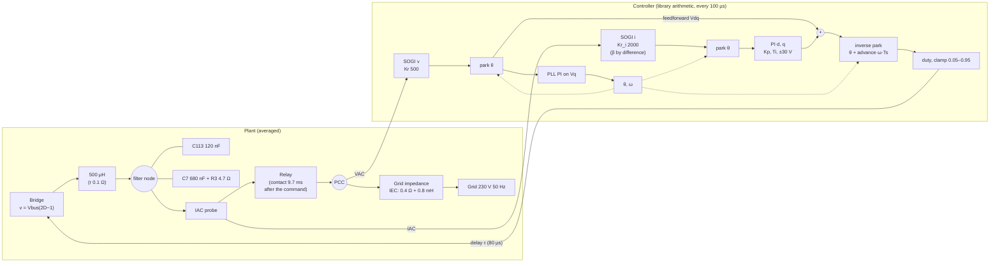
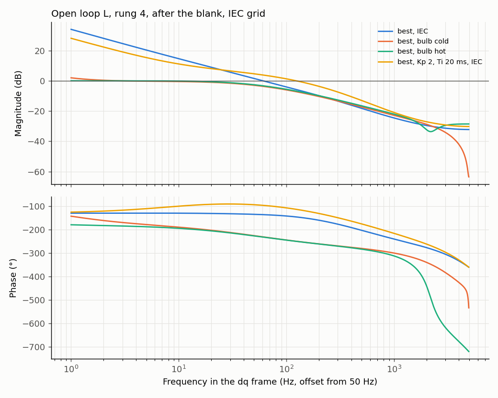
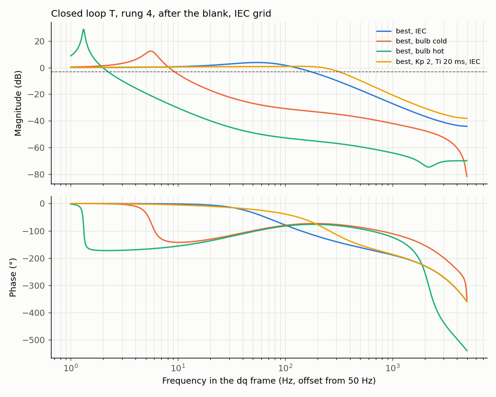

# D-GFL-06: robustness of the best connection strategy

Design test ([ADR 0004](../../../adr/0004-averaged-model-for-fast-evaluation.md)): averaged model, INFO only, no verdict. Best strategy from D-GFL-04 (advance 0.3 period, synthesized feedforward and PLL frozen for 5 ms after the contact), with candidate C (Kp 1 V/A, Ti 5 ms) and with Kp 2 V/A, Ti 20 ms, against today (advance 0.5, nothing frozen). Rung 4 on the IEC grid at 45° unless the row says otherwise. Every row changes one condition; the advance stays at 0.3 (tuned for 80 µs) so the delay rows show the cost of a wrong delay estimate. D-GFL-05 (clamp) did not improve on D-GFL-04 and is not included. Grid: 0.4 Ω, 0.8 mH. Trip disabled so the whole transient is visible; "would trip" compares with the 1.5 A bench trip. Provisional target for the ideal case (proposed, to be confirmed): peak below 0.3 A over 10 ms and settling within ±0.05 A in under 20 ms. Generated by `tests/l1/design/connection.py`.

## Plant and loop

## Margins and bandwidth (linear model, relay closed, after the blank)

| Loop | Open loop: crossover (Hz) | Open loop: phase margin (°) | Open loop: gain margin (dB) | Closed loop: bandwidth −3 dB (Hz) | Closed loop: peak (dB) | Closed loop: peak at (Hz) |
|---|---|---|---|---|---|---|
| best, IEC | 59.9 | 44.7 | 14.2 | 171 | 3.75 | 54.4 |
| best, bulb cold | 2.81 | 12.3 | 0.324 | 9.08 | 12 | 5.58 |
| best, bulb hot | — | — | — | 1.69 | 19.9 | 1.32 |
| best, Kp 2, Ti 20 ms, IEC | 123 | 67.5 | 14 | 312 | 0.848 | 131 |

## Peak before the step and settling

Each cell: peak line current before the step (A) / settling within ±0.05 A (ms); ✓ meets the provisional target, ⚠ would trip at 1.5 A.

| Condition | today | best (D-GFL-04) | best, Kp 2 V/A, Ti 20 ms |
|---|---|---|---|
| IEC | 1.44 / 70 | 0.374 / 88.5 | 0.318 / 79.5 |
| bulb cold | 3.81 / 177 ⚠ | 3.76 / 177 ⚠ | 2.48 / 177 ⚠ |
| bulb hot | 0.619 / 177 | 0.74 / 177 | 0.874 / 177 |
| rung 2 (PLL, no capacitors, delay 100 µs) | 2.19 / 145 ⚠ | 2.79 / 137 ⚠ | 2.18 / 139 ⚠ |
| rung 3 (capacitors, delay 100 µs) | 7.2 / 161 ⚠ | 7.27 / 161 ⚠ | 6.58 / 177 ⚠ |
| rung 4 | 1.44 / 70 | 0.374 / 88.5 | 0.318 / 79.5 |
| delay 60 µs (advance kept for 80 µs) | 9.77 / 151 ⚠ | 7.01 / 152 ⚠ | 6.44 / 177 ⚠ |
| delay 80 µs (advance kept for 80 µs) | 1.44 / 70 | 0.374 / 88.5 | 0.318 / 79.5 |
| delay 100 µs (advance kept for 80 µs) | 7.2 / 161 ⚠ | 7.27 / 161 ⚠ | 6.58 / 177 ⚠ |
| delay 120 µs (advance kept for 80 µs) | 5.55 / 160 ⚠ | 5.72 / 160 ⚠ | 4.73 / 177 ⚠ |
| contact at 0° | 1.65 / 140 ⚠ | 0.414 / 90.4 | 0.252 / 79.9 |
| contact at 45° | 1.44 / 70 | 0.374 / 88.5 | 0.318 / 79.5 |
| contact at 90° | 1.5 / 68 ⚠ | 0.559 / 87.3 | 0.388 / 78.4 |
| contact at 135° | 1.54 / 84.5 ⚠ | 0.702 / 85.1 | 0.458 / 75.7 |
| board network (with C122) | 4.58 / 160 ⚠ | 5.02 / 160 ⚠ | 4.21 / 177 ⚠ |

## Findings

1. **The D-GFL-04 strategy only works at its design point.** On the IEC grid at 80 µs it holds the peak at 0.32–0.37 A (0.25–0.46 A over contact angles 0–135° with Kp 2 / Ti 20 ms, so the relay-timing spread is tolerated), against 1.44–1.65 A today.
2. **It is fragile to the actuation delay.** With the delay 20 µs off (60 or 100 µs) every setting, today's included, gives 6–10 A; at 120 µs, 5–6 A. The delay is set by the computation time rounded up to the next 20 µs carrier period, so 60 µs and 80 µs are both plausible, and the bench must measure it before any of these settings can be trusted.
3. **It does not help through the cold bulb** (2.5–3.8 A, trips), where the PLL locks onto the inverter's own voltage (D-GFL-01 §6.1), nor with the board's full capacitor network (4.2–5.0 A).
4. **Common cause, per D-GFL-07:** the filter resonance with the relay closed sits at 9.5–10.1 kHz, at the 10 kHz control and update rate. The delay, the grid inductance and the capacitance all move where it folds, and the connection transient follows. The contact strategies (advance, blank time, clamp) act on the voltage mismatch, not on this resonance, so they help only where the resonance happens to fold harmlessly.
5. The averaged model's fidelity on exactly this point is limited (D-GFL-07 finding 4), so the size of the effect needs the switched model. Proposed switched runs: the D-GFL-04 strategy at 80 µs on the IEC grid and through the cold bulb, and today's settings and the D-GFL-04 strategy at 60 µs on the IEC grid. If the switched model confirms the delay sensitivity, the next design step is the resonance itself on the control side (active damping, or a filter on the measured current tuned to it), and the bench measures the delay.
