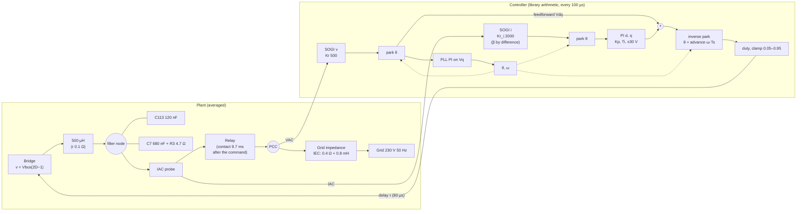
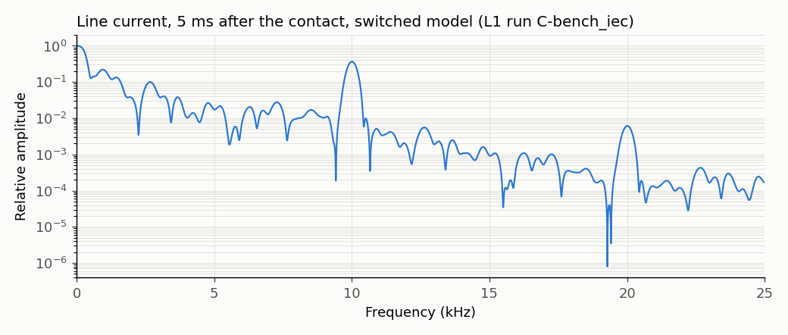
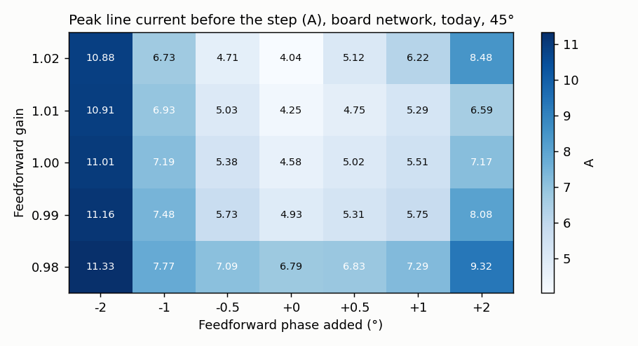

# D-GFL-07: voltage mismatch at the contact and the output capacitors, IEC grid

Design test ([ADR 0004](../../../adr/0004-averaged-model-for-fast-evaluation.md)): averaged model, INFO only, no verdict. Rung 4 of D-GFL-01 (library PLL, filter capacitors, 80 µs delay), candidate C, current PI from the relay command. The capacitor network now follows the board ([output_filter.png](../../../../tests/l1/plant/reference/output_filter.png)): C120 1 nF, C113 120 nF and C7 680 nF + R3 4.7 Ω on the filter node, and C122 120 nF on the grid side of the relay (charged by the grid while the relay is open, sharing its charge with the filter node at the contact). IAC and VAC are measured on the grid side of the relay. Grid: 0.4 Ω, 0.8 mH. Trip disabled so the whole transient is visible; "would trip" compares with the 1.5 A bench trip. Provisional target for the ideal case (proposed, to be confirmed): peak below 0.3 A over 10 ms and settling within ±0.05 A in under 20 ms. Generated by `tests/l1/design/connection.py`.

## Plant and loop

## 1. Voltage across the relay before the contact

Fundamental phasors over the last grid period before the contact. "Bridge" is the commanded bridge voltage (duty × bus), not delayed.

| Model | Filter node (V peak) | Grid side (V peak) | Node − grid amplitude | Node − grid phase (°) | Mismatch (V peak) | Node / bridge command |
|---|---|---|---|---|---|---|
| switched model (L1 run C-bench_iec) | 328.97 | 325.27 | +1.14 % | +0.332 | 4.15 | +1.14 %, -1.65° |
| switched model (L1 run F-bench_iec) | 328.97 | 325.27 | +1.14 % | +0.332 | 4.15 | +1.14 %, -1.65° |
| averaged, network up to D-GFL-04 | 325.25 | 325.27 | -0.01 % | -0.599 | 3.40 | -0.00 %, -3.30° |
| averaged, board network (with C122) | 325.25 | 325.27 | -0.01 % | -0.594 | 3.37 | -0.00 %, -3.30° |
| averaged, board network + bridge error +1.14 %, +0.93° | 328.96 | 325.27 | +1.13 % | +0.336 | 4.15 | +1.14 %, -2.37° |

## 2. Fidelity: first crossing of the 1.5 A trip after the contact (zero crossing)

| Model | Time (ms) |
|---|---|
| switched model (C-bench_iec) | 5.66 |
| switched model (F-bench_iec) | 5.98 |
| averaged, network up to D-GFL-04 | 6.8 |
| averaged, board network | 2.4 |
| averaged, board network + bridge error | 0.3 |

## 3. Resonances of the capacitor network

Eigenvalues of the averaged network; "folds to" is the frequency the 10 kHz sampling shows it at.

| Network | Relay | Resonances |
|---|---|---|
| network up to D-GFL-04 | open | 7.95 kHz (ζ 0.070, folds to 2049 Hz) |
| network up to D-GFL-04 | closed | 10.13 kHz (ζ 0.089, folds to 131 Hz) |
| board network | open | 7.95 kHz (ζ 0.070, folds to 2054 Hz), 16.24 kHz (ζ 0.002, folds to 3756 Hz) |
| board network | closed | 9.46 kHz (ζ 0.073, folds to 538 Hz) |

Switched model, line current in the 5 ms after the contact, strongest peaks above 300 Hz: 0.95 kHz (0.22), 1.44 kHz (0.13), 2.67 kHz (0.10), 3.17 kHz (0.04), 10.00 kHz (0.37).

## 4. Feedforward amplitude and phase error (averaged, indicative)

## 5. Capacitor ablation (averaged, indicative)

Today: advance 0.5, no blank. D-GFL-04 best: advance 0.3, synthesized feedforward and PLL frozen for 5 ms. Contact at 45°. Margins of the loop with the relay closed, today's settings.

| Network | Today: peak before the step (A) | Today: settling (ms) | D-GFL-04 best: peak (A) | D-GFL-04 best: settling (ms) | Phase margin (°) | Gain margin (dB) | Bandwidth (Hz) |
|---|---|---|---|---|---|---|---|
| board network | 4.58 | 160 | 5.02 | 160 | 46.1 | 18.7 | 161 |
| without C122 | 1.4 | 69.4 | 0.322 | 87.8 | 45.4 | 14.7 | 170 |
| without C113 | 1.46 | 78.3 | 0.32 | 76.9 | 45.4 | 14.7 | 170 |
| without the C7 branch | 603 | 177 | 34.2 | 177 | -31 | — | 167 |
| R3 1 Ω | 9.51 | 177 | 11.3 | 177 | 46.4 | 19.3 | 153 |
| R3 10 Ω | 1.22 | 137 | 1.05 | 139 | 45.6 | 15.5 | 167 |
| R3 22 Ω | 2.36 | 99.3 | 0.89 | 98.6 | 45.3 | 14.5 | 170 |
| 4.7 Ω in series with C113 | 4.44 | 160 | 4.82 | 159 | 46.1 | 18.5 | 162 |
| 10 Ω in series with C113 | 4.25 | 160 | 4.6 | 159 | 46.1 | 18.2 | 162 |

## Findings

1. **The filter does not lower the inverter voltage before the contact.** The capacitor current (about 0.08 A peak) through 500 µH changes the node voltage by about 0.01 V. In the switched model the inverter side is in fact **higher** than the grid: +1.14 % (+3.7 V peak) and +0.33°, a 4.15 V peak mismatch across the open relay. The VAC measurement is exact in the model (0.00 %); the excess is produced by the bridge itself at no load (node 1.14 % above the commanded voltage). The averaged model does not have it (−0.01 %). Suspected source: dead time with a current dominated by the switching ripple (L1-MOD-04 measured +0.2 % at m = 0.8 with the chokes fitted). **On the bench, this mismatch is measurable directly**: in step 1 (PWM_SETTLE, relay open), a mains-rated differential probe across the relay contacts shows the voltage that drives the connection transient.
2. **The capacitors matter through a resonance close to the control rate, not through a voltage drop.** With the relay closed on the IEC grid, the filter resonates at 9.5–10.1 kHz (lightly damped, ζ 0.07–0.09). The duty updates every 100 µs drive it (the switched model's line current after the contact has its strongest component at exactly 10.00 kHz), and the 10 kHz sampling folds it to 130–540 Hz, where the current loop and the SOGI act. Where it folds depends on the capacitance and on the grid inductance, so the bench bulb (no inductance, about 8 kHz) and the real grid behave differently.
3. **The C7 + R3 branch is the essential damping.** Without it the averaged loop is unstable (phase margin −31°); R3 at 1 Ω is worse (9.5 A), 10 Ω better (1.2 A). Removing C113 or C122 (120 nF of undamped capacitance either way) brings the averaged model back to about 1.4 A today and 0.32 A with the D-GFL-04 settings.
4. **Fidelity limit.** With the board's full network (C122 included), the averaged model crosses the 1.5 A trip 2.4 ms after the contact against about 6 ms in the switched model, and the waveforms differ after 0.7 ms; the earlier network (without C122) matches the switched model's timing better (6.8 ms). The averaged model is therefore indicative only for capacitor questions: the outcome depends on exactly where the resonance folds, which the averaged bridge does not reproduce. Sections 4 and 5 rank ideas; they do not size hardware. Per ADR 0004 the capacitor questions go to the switched model.
5. **Extra feedforward voltage (the amplitude idea).** In the averaged map, amplitude errors of ±2 % change the peak by 10–30 %; phase errors of ±1° double it. Adding amplitude is not a main lever, and the switched model says the inverter side is already 1.1 % high. If an amplitude correction is wanted, it should come from the bench measurement of finding 1 (and would then be a reduction).
6. **Proposed switched-model runs** (about 80 minutes, in parallel), to settle findings 2–4: the IEC grid with C122 removed, with R3 = 10 Ω, and with the D-GFL-04 settings (advance 0.3, synthesized feedforward and PLL frozen for 5 ms); plus the cold bulb with the D-GFL-04 settings.
