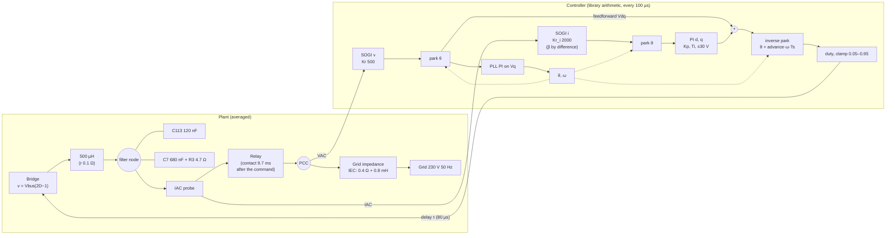
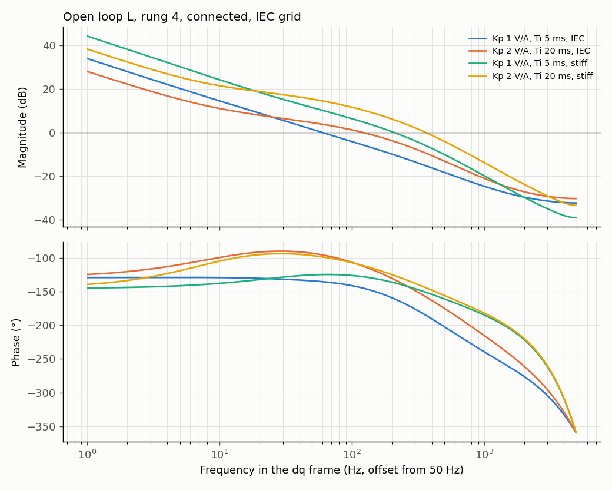
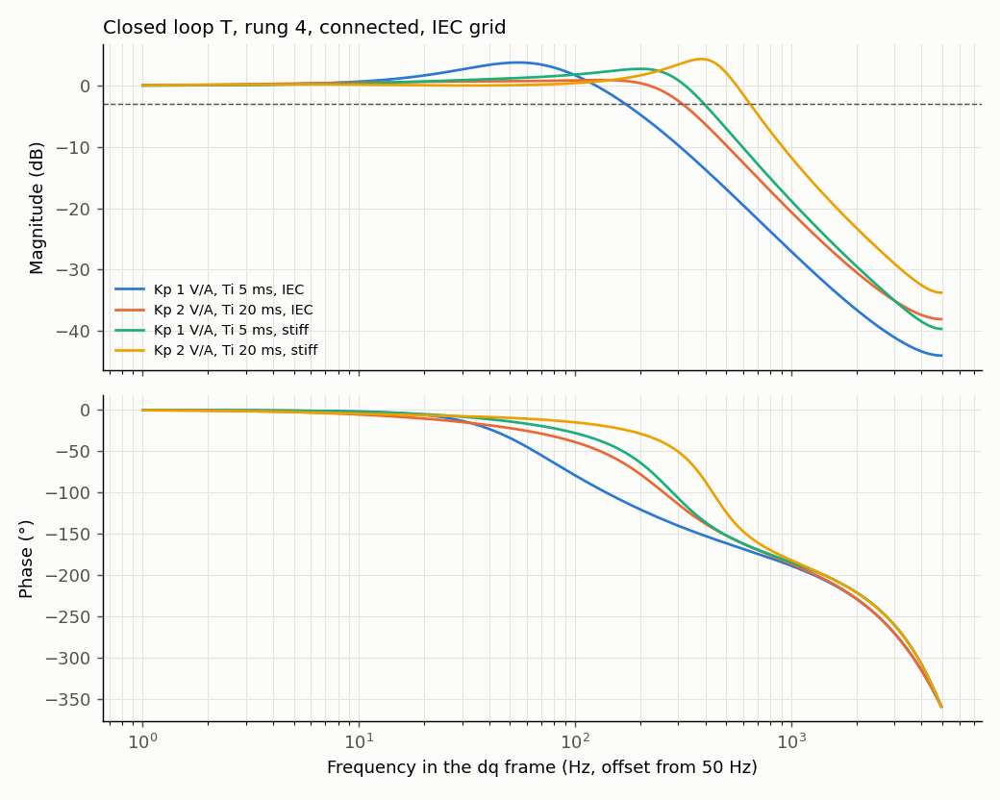
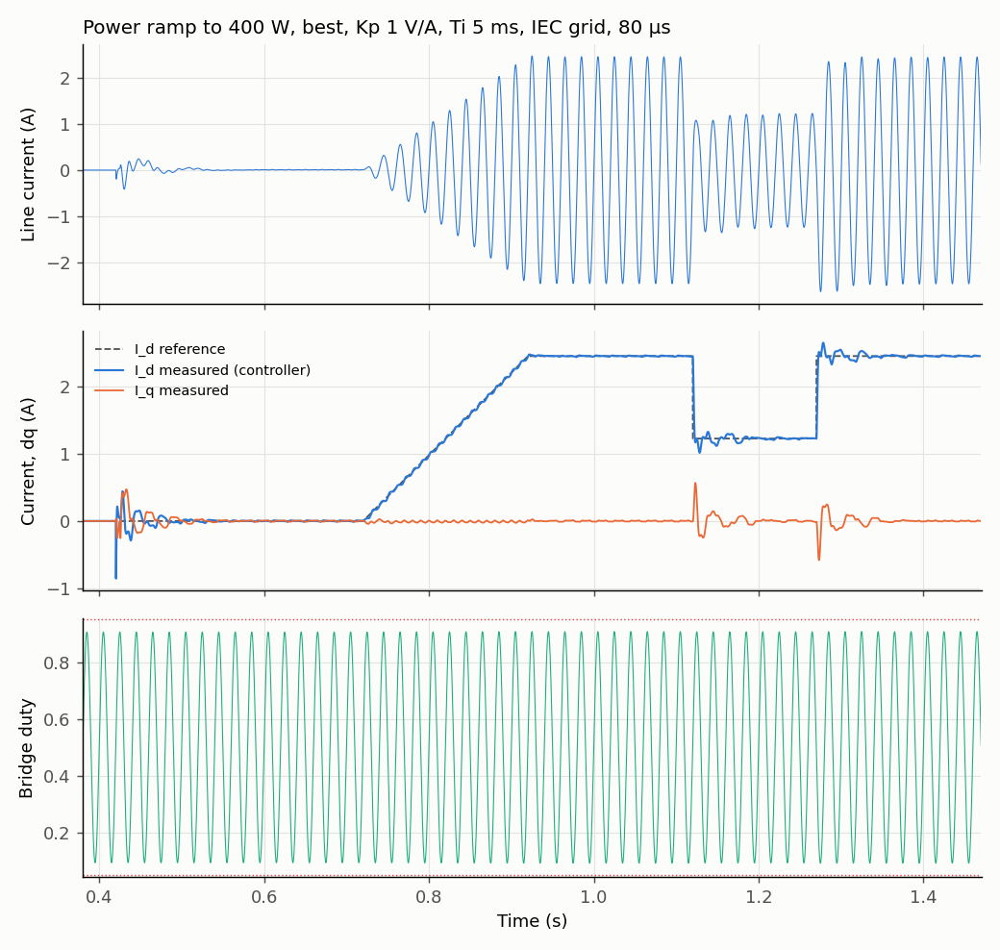

# D-GFL-08: current PI at nominal power, ramp to 400 W

Design test ([ADR 0004](../../../adr/0004-averaged-model-for-fast-evaluation.md)): averaged model, INFO only, no verdict. Best connection strategy (D-GFL-04: advance 0.3, synthesized feedforward and PLL frozen 5 ms), rung 4, contact at the zero crossing. The 20 ms settling target is relaxed: the I_d reference stays at 0 for 300 ms after the contact, then ramps to 2.46 A peak (400 W at 230 V) over 200 ms, holds 200 ms, steps to 50 % for 150 ms and back to 100 %. The 1.5 A bench trip is not applied (nominal power is far above it). The grid voltage is a pure sine: the THD is the control's own distortion. Grid: 0.4 Ω, 0.8 mH. Trip disabled so the whole transient is visible; "would trip" compares with the 1.5 A bench trip. Provisional target for the ideal case (proposed, to be confirmed): peak below 0.3 A over 10 ms and settling within ±0.05 A in under 20 ms. Generated by `tests/l1/design/connection.py`.

## Plant and loop

## Margins and bandwidth (linear model, relay closed)

The linear loop does not depend on the operating point; what changes at power is the room left in the duty (0.05–0.95) and in the PI output (±30 V).

| Loop | Open loop: crossover (Hz) | Open loop: phase margin (°) | Open loop: gain margin (dB) | Closed loop: bandwidth −3 dB (Hz) | Closed loop: peak (dB) | Closed loop: peak at (Hz) |
|---|---|---|---|---|---|---|
| Kp 1 V/A, Ti 5 ms, IEC | 59.9 | 44.7 | 14.2 | 171 | 3.75 | 54.4 |
| Kp 2 V/A, Ti 20 ms, IEC | 123 | 67.5 | 14 | 312 | 0.848 | 131 |
| Kp 1 V/A, Ti 5 ms, stiff | 210 | 43 | 17.9 | 396 | 2.72 | 200 |
| Kp 2 V/A, Ti 20 ms, stiff | 363 | 35.7 | 13 | 643 | 4.29 | 384 |

## At 400 W (last 100 ms of the hold)

| Condition | Settings | Power at the PCC (W) | Line current (A RMS) | I_d true / measured (A) | I_q true / measured (A) | THD (%) | Modulation index | Duty clipped (%) | PI output max (V of ±30) |
|---|---|---|---|---|---|---|---|---|---|
| IEC grid, 80 µs | best, Kp 1 V/A, Ti 5 ms | 401 | 1.74 | 2.46 / 2.46 | +0.01 / +0.00 | 0.18 | 0.816 | 0.0 | 0.2 |
| IEC grid, 80 µs | best, Kp 2 V/A, Ti 20 ms | 401 | 1.74 | 2.46 / 2.46 | +0.01 / +0.00 | 0.10 | 0.816 | 0.0 | 0.2 |
| stiff grid, 80 µs | best, Kp 1 V/A, Ti 5 ms | 400 | 1.74 | 2.46 / 2.46 | -0.00 / -0.00 | 0.19 | 0.814 | 0.0 | 0.7 |
| stiff grid, 80 µs | best, Kp 2 V/A, Ti 20 ms | 400 | 1.74 | 2.46 / 2.46 | -0.00 / -0.00 | 0.10 | 0.814 | 0.0 | 0.7 |
| IEC grid, 60 µs | best, Kp 1 V/A, Ti 5 ms | 402 | 1.74 | 2.46 / 2.46 | +0.09 / +0.00 | 0.20 | 0.816 | 0.0 | 12.9 |
| IEC grid, 60 µs | best, Kp 2 V/A, Ti 20 ms | 402 | 1.74 | 2.46 / 2.46 | +0.09 / +0.00 | 0.10 | 0.816 | 0.0 | 12.9 |
| IEC grid, 100 µs | best, Kp 1 V/A, Ti 5 ms | 401 | 1.74 | 2.46 / 2.46 | -0.08 / +0.00 | 0.16 | 0.816 | 0.0 | 13.5 |
| IEC grid, 100 µs | best, Kp 2 V/A, Ti 20 ms | 401 | 1.74 | 2.46 / 2.46 | -0.08 / +0.00 | 0.09 | 0.816 | 0.0 | 13.5 |
| IEC grid, board network | best, Kp 1 V/A, Ti 5 ms | 401 | 1.74 | 2.46 / 2.46 | -0.05 / +0.00 | 0.22 | 0.816 | 0.0 | 8.1 |
| IEC grid, board network | best, Kp 2 V/A, Ti 20 ms | 401 | 1.74 | 2.46 / 2.46 | -0.05 / +0.00 | 0.11 | 0.816 | 0.0 | 8.1 |

## Ramp and steps at power

| Condition | Settings | Contact peak (A) | Ramp: largest I_d error (A) | 100 → 50 %: settling 5 % (ms) / overshoot (%) | 50 → 100 %: settling 5 % (ms) / overshoot (%) |
|---|---|---|---|---|---|
| IEC grid, 80 µs | best, Kp 1 V/A, Ti 5 ms | 0.41 | 0.046 | 58.2 / 17.2 | 57.3 / 16.1 |
| IEC grid, 80 µs | best, Kp 2 V/A, Ti 20 ms | 0.25 | 0.044 | 6.7 / 5.6 | 7.1 / 5.8 |
| stiff grid, 80 µs | best, Kp 1 V/A, Ti 5 ms | 0.26 | 0.037 | 2.6 / 21.7 | 2.6 / 22.3 |
| stiff grid, 80 µs | best, Kp 2 V/A, Ti 20 ms | 0.21 | 0.037 | 2.7 / 29.1 | 2.7 / 29.4 |
| IEC grid, 60 µs | best, Kp 1 V/A, Ti 5 ms | 9.95 | 0.045 | 57.9 / 12.0 | 29.7 / 10.2 |
| IEC grid, 60 µs | best, Kp 2 V/A, Ti 20 ms | 7.38 | 0.037 | 7.4 / 6.2 | 7.7 / 6.5 |
| IEC grid, 100 µs | best, Kp 1 V/A, Ti 5 ms | 10.03 | 0.043 | 59.8 / 22.9 | 58.7 / 22.5 |
| IEC grid, 100 µs | best, Kp 2 V/A, Ti 20 ms | 7.48 | 0.043 | 6.1 / 5.4 | 6.3 / 5.7 |
| IEC grid, board network | best, Kp 1 V/A, Ti 5 ms | 6.50 | 0.042 | 59.7 / 20.1 | 58.6 / 19.8 |
| IEC grid, board network | best, Kp 2 V/A, Ti 20 ms | 4.66 | 0.043 | 6.3 / 4.5 | 6.6 / 4.8 |

## Findings

1. **The current PI works at nominal power.** In every condition, 400 W is delivered (400–402 W at the PCC, 1.74 A RMS), I_d is tracked exactly (2.46 A), I_q stays within ±0.09 A, and the ramp is followed within 0.05 A. The contact transient is the only problem; once it has passed, power operation is clean.
2. **Room left at 400 W:** modulation index 0.816 against 0.9 at the duty limit of 0.95 (about 10 % of margin, at a 230 V grid and a 400 V bus; at 253 V it shrinks to about 1 %), no clipping. The PI output uses 0.2–0.7 V of its ±30 V at the design delay, and 13 V when the delay is 20 µs off (60 / 100 µs): the PI then compensates the phase error of the feedforward, still within its limit.
3. **Kp 2 V/A, Ti 20 ms is the better tuning at power** on the IEC grid: power steps settle in 6–8 ms with 5–6 % overshoot, against 57–60 ms and 16–23 % for Kp 1, Ti 5 ms (the integral corner close to the crossover leaves a slow ring). On a stiff grid both settle in under 3 ms, with 22–29 % overshoot.
4. **The delay sensitivity is a connection problem, not a power problem.** At 60 / 100 µs the contact peak is 7–10 A (it would trip), but once settled the PI delivers 400 W with the same accuracy.
5. Limits of this model: pure-sine grid (grid harmonics not modelled, so the THD of 0.1–0.2 % is only the control's own), ideal 400 V bus (no 100 Hz ripple from the boost; to be studied once the boost of 02701523 is integrated), averaged bridge (no dead time, whose distortion is largest at low current).
