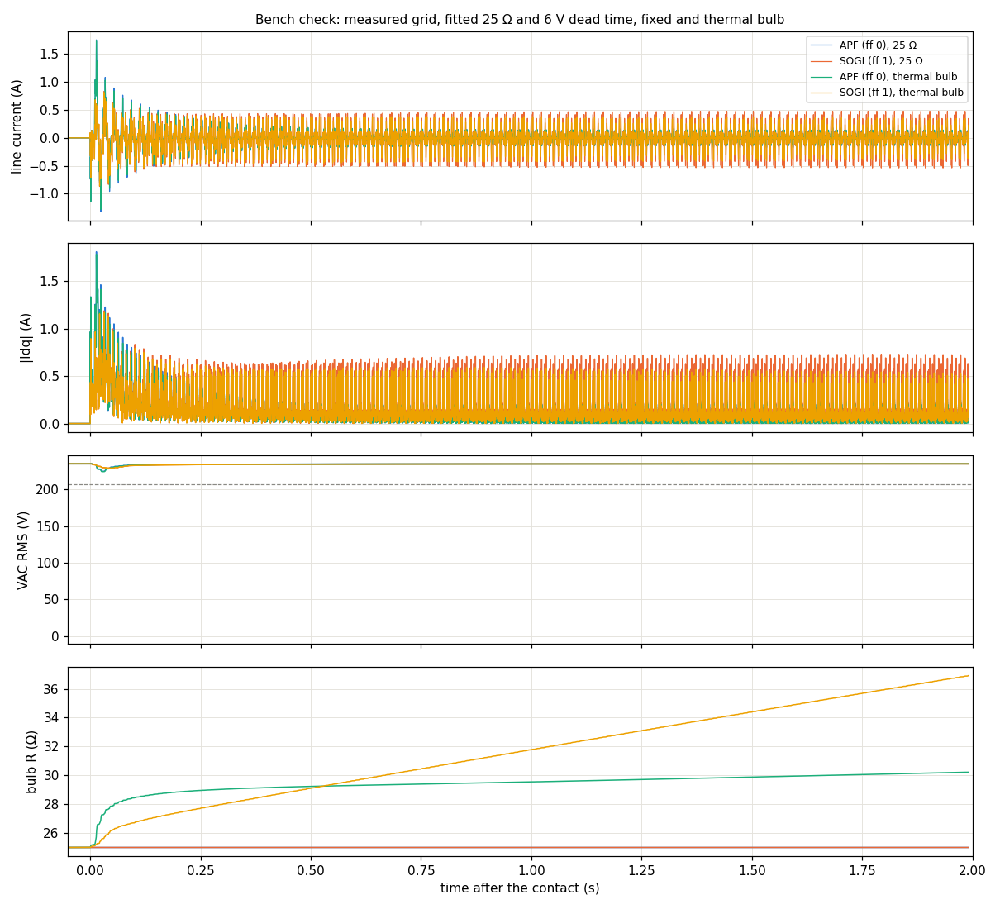
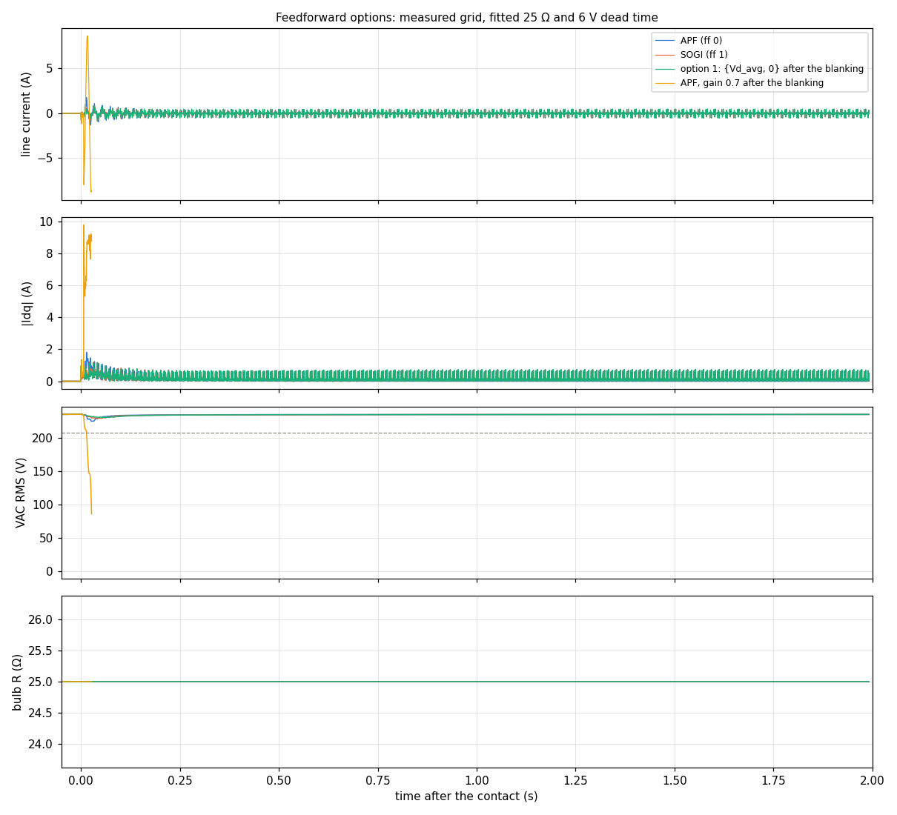

# D-GFL-09: step 2b with each feedforward source, averaged model, measured grid, 80 W bulb

Design test ([ADR 0004](../../../adr/0004-averaged-model-for-fast-evaluation.md)), run at Luiz Villa's request on 2026-11-13: averaged model, **INFO only, no verdict**. It decides which feedforward option is worth a bench or switched run. Generated by `tests/l1/design/connection_apf.py --report docs/testing/design/D-GFL-09_bench`.

## Model

- **Controller** as library `b9e8829` computes it every 50 µs: float32 SOGI (Kr 500), prewarped APF, park, PLL PI (ωn 150 rad/s, ζ 0.7), SOGI/APF tuning low-passed 10 ms and clamped ±5 %, current park(IAC, APF(IAC)) with PI 3.5 V/A, 20 ms, ±30 V, output advance 0.3, duty 0.05–0.95 applied one period later; VAC and IAC the means of the period (averaged ADC reads).
- **Step 2b**: PI from the relay command, PLL frozen 15 ms at the period-averaged ω, feedforward held {Vd_avg, 0} from the predicted contact (9.7 ms) to 15 ms; the contact itself at 8.7 ms (bench 8.3–9 ms).
- **Feedforward sources**: APF (VAC, APF(VAC)), the firmware default; SOGI (the PLL pair, key F); option 1 = {Vd_avg, 0} kept after the blanking (Vd along the PLL angle); APF with gain 0.7 after the blanking.
- **Plant**, averaged bridge (no 50 kHz ripple): 500 µH + 0.1 Ω, C113 120 nF, C7 680 nF + 4.7 Ω; VAC between the relay and the bulb; 0.1 mH of grid behind it. The bridge fundamental scaled ×0.976 and rotated −0.3° so the step 1 mismatch matches the bench (−2.4 %, −1.4°). **Fitted to the bench (section 0):** 25 Ω behind the relay and a dead-time voltage of 6 V opposing the inductor current (about 150 ns at 400 V and 50 kHz); contact 8.35 ms after the command, as on the scope.
- **Grid: measured** on CH2 with the relay open (step 1 capture 18:32:41, 100 ms at 12.5 MS/s), fitted over 4 periods: 50.006 Hz, fundamental 331.9 V pk, THD 3.4 % (5th 7.6 V at +62°, 7th 5.7 V at -108°, 9th 2.6 V at -128°, 11th 1.6 V at +80°, 15th 3.0 V at -144°, 17th 3.1 V at +6°, 21th 2.2 V at +96°, 23th 1.9 V at -103°; phases against the fundamental).
- **Bulb** (80 W): 25 Ω (fitted); or a tungsten filament from 25 Ω cold to 661 Ω hot, heated by i²R and cooled by radiation (heat capacity 0.015 J/K, an estimate).
- **Grid observer** reduced to its windows (207–253 V on the VAC RMS of one period, ±5 % on the period-averaged PLL frequency) with the application's 100 ms delay; the 3 A current trip applied as in the firmware (on the period-mean IAC).

## 0. Fit to the bench

The resistance behind the relay and the losses of the bridge were not measured, so they are fitted to the 18:33 ff 0 run, whose firmware dump gives IAC and the PLL frequency sample by sample. A grid impedance alone cannot match both: a low resistance reproduces the PLL swing but leaves the current about 1.7× too high, and the grid inductance hardly matters below 1 mH. A loss in the bridge is needed. A dead-time voltage (a fixed voltage opposing the current, so an effective resistance that falls as the current grows) fits about as well as a fixed series resistance and reproduces the late wander better (|Idq| 0.31 A against 0.68 A; bench 0.3–0.5 A), so it is kept. The 17:24 ff 1 run is not used in the fit: it is the check.

Bench: IAC 0.470 A RMS, ω_avg 309.3–318.7 rad/s. Score = normalized RMS error of IAC + that of ω_avg (0 = identical). Best 12 of 34, then the worst:

| Bridge loss | Grid R (Ω) | Score | IAC error | ω error | IAC RMS (A) | Correlation | ω_avg (rad/s) |
|---|---|---|---|---|---|---|---|
| series 5 Ω | 22 | 0.58 | 0.47 | 0.11 | 0.524 | +0.91 | 309.3–318.3 |
| series 8 Ω | 30 | 0.62 | 0.47 | 0.15 | 0.444 | +0.89 | 308.9–318.2 |
| dead time 6 V | 25 | 0.67 | 0.49 | 0.18 | 0.383 | +0.87 | 309.9–318.7 |
| dead time 6 V | 30 | 0.70 | 0.49 | 0.21 | 0.373 | +0.87 | 309.1–319.5 |
| series 2 Ω | 15 | 0.76 | 0.61 | 0.15 | 0.657 | +0.93 | 309.7–318.7 |
| series 8 Ω | 22 | 0.76 | 0.48 | 0.28 | 0.452 | +0.89 | 310.3–317.2 |
| dead time 4 V | 20 | 0.76 | 0.50 | 0.27 | 0.509 | +0.89 | 309.2–319.7 |
| dead time 6 V | 20 | 0.79 | 0.50 | 0.29 | 0.395 | +0.87 | 310.7–317.9 |
| dead time 4 V | 15 | 0.80 | 0.52 | 0.28 | 0.523 | +0.89 | 310.5–318.4 |
| dead time 8 V | 40 | 0.81 | 0.62 | 0.19 | 0.257 | +0.84 | 310.1–318.0 |
| series 5 Ω | 30 | 0.84 | 0.46 | 0.38 | 0.514 | +0.91 | 307.6–319.7 |
| series 5 Ω | 15 | 0.85 | 0.50 | 0.35 | 0.536 | +0.91 | 310.9–317.0 |
| no loss | 30 | 2.79 | 0.83 | 1.97 | 0.753 | +0.90 | 301.9–327.4 |
| no loss | 42 | 4.00 | 0.83 | 3.16 | 0.732 | +0.88 | 297.3–331.6 |

## 1. Check against the bench

Bench, 2026-11-13: **ff 0** (16:39 and 18:33, identical): 12–52 ms after the contact 0.72 A RMS (0.42 A of it at 50 kHz, absent here), 50 Hz 0.71 A pk at −124° against the grid in the firmware's sign (+56° on the reversed probe), then |Idq| wandering up to 0.3–0.5 A, no trip in 30 s, bulb dark. **ff 1** (17:24): bulb lit, Iq 1.7 A pk and VAC 202 V about 1 s after the contact, grid observer trip.

| Case | Peak in 20 ms (A) | RMS 12–52 ms (A) | 50 Hz (A pk, vs grid) | 5th / 7th (A pk) | RMS 0.5–2 s (A) | |Idq| max 0.5–2 s (A) | VAC RMS min (V) | Bulb R max (Ω) | PLL max dev (Hz) | Trip after the contact |
|---|---|---|---|---|---|---|---|---|---|---|
| APF (ff 0), 25 Ω | 1.75 | 0.54 | 0.64 at -131° | 0.14 / 0.06 | 0.05 | 0.26 | 225 | 25 | 1.20 | none |
| SOGI (ff 1), 25 Ω | 0.72 | 0.36 | 0.42 at -137° | 0.19 / 0.14 | 0.17 | 0.73 | 229 | 25 | 0.51 | none |
| APF (ff 0), thermal bulb | 1.73 | 0.53 | 0.64 at -131° | 0.14 / 0.06 | 0.05 | 0.23 | 224 | 30 | 1.24 | none |
| SOGI (ff 1), thermal bulb | 0.72 | 0.36 | 0.41 at -136° | 0.18 / 0.14 | 0.14 | 0.59 | 229 | 37 | 0.51 | none |

### Model and bench on one time axis

Interactive: drag to zoom in time, double-click to reset, click a legend entry to hide a trace. The model runs with the fitted grid and dead time and the zero-crossing edge of each bench run.

### 18:33, ff 0 (APF): model with the APF feedforward, edge rise

<!-- iplot ff0 -->

First 115 ms from the relay command. Grey: scope (CH3 multiplied by −1 to the firmware's sign; 10 µs means); yellow: the firmware's own record (2 kHz dump); blue: the model. Model trip: none.

<!-- iplot ff0_long -->

Seconds after: the bench telemetry (two lines every 500 ms; aligned on the G key + 0.21 s, so within about ±0.3 s) against the model (sampled every 5 ms). The model stops 20 ms after its own trip.

### 17:24, ff 1 (SOGI): model with the SOGI feedforward, edge fall

<!-- iplot ff1 -->

First 115 ms from the relay command. Grey: scope (CH3 multiplied by −1 to the firmware's sign; 10 µs means); yellow: the firmware's own record (2 kHz dump) (none for this run); blue: the model. **CH3 overranged on 64,752 samples** (±10.24 A at 2 A/div): its peaks are cut and its values near them are not reliable. Model trip: none.

<!-- iplot ff1_long -->

Seconds after: the bench telemetry (two lines every 500 ms; aligned on the G key + 0.21 s, so within about ±0.3 s) against the model (sampled every 5 ms). The model stops 20 ms after its own trip.

**Reading.** With the fitted grid and dead time, the model reproduces the ff 0 run: the current within about 20 % and correlated 0.9 with the scope, the PLL swing, no trip, the same late wander. For ff 1 (not fitted) it reproduces the waveform shape (correlation 0.95 with the scope) and 2–3× more current than ff 0, but **not the trip about 1 s after the contact**: the model stays connected and the bulb barely warms. The 17:24 scope CH3 is 6–8× the model with the same shape, consistent with that channel being unreliable in this run (overranged; the firmware read Iq 1.2–1.7 A, the model up to about 1 A).

## 2. Options (fitted grid, 25 Ω)

| Case | Peak in 20 ms (A) | RMS 12–52 ms (A) | 50 Hz (A pk, vs grid) | 5th / 7th (A pk) | RMS 0.5–2 s (A) | |Idq| max 0.5–2 s (A) | VAC RMS min (V) | Bulb R max (Ω) | PLL max dev (Hz) | Trip after the contact |
|---|---|---|---|---|---|---|---|---|---|---|
| APF (ff 0) | 1.75 | 0.54 | 0.64 at -131° | 0.14 / 0.06 | 0.05 | 0.26 | 225 | 25 | 1.20 | none |
| SOGI (ff 1) | 0.72 | 0.36 | 0.42 at -137° | 0.19 / 0.14 | 0.17 | 0.73 | 229 | 25 | 0.51 | none |
| option 1: {Vd_avg, 0} after the blanking | 1.14 | 0.33 | 0.37 at -127° | 0.18 / 0.14 | 0.17 | 0.75 | 230 | 25 | 0.41 | none |
| APF, gain 0.7 after the blanking | 8.63 | 6.33 | 9.49 at -179° | 0.72 / 0.55 | nan | nan | 86 | 25 | 3.41 | current 0.007 s |

**Reading.** See the table: the late current and the trips per option. A gain of 0.7 cannot work with a ±30 V PI: it leaves about 100 V of fundamental for the PI to supply. Since the model does not reproduce the SOGI trip, a option that survives here is not proven to survive on the bench; one that fails here is unlikely to do better there.

## 3. Weak grid (bulb hot) and sensitivity

| Case | Peak in 20 ms (A) | RMS 12–52 ms (A) | 50 Hz (A pk, vs grid) | 5th / 7th (A pk) | RMS 0.5–2 s (A) | |Idq| max 0.5–2 s (A) | VAC RMS min (V) | Bulb R max (Ω) | PLL max dev (Hz) | Trip after the contact |
|---|---|---|---|---|---|---|---|---|---|---|
| APF, bulb hot 661 Ω | 0.27 | 0.16 | 0.23 at -146° | 0.01 / 0.01 | nan | nan | 152 | 661 | 7.07 | grid observer 0.12 s |
| SOGI, bulb hot 661 Ω | 0.06 | 0.09 | 0.12 at -118° | 0.01 / 0.01 | nan | nan | 178 | 661 | 2.02 | grid observer 0.15 s |
| option 1, bulb hot 661 Ω | 0.14 | 0.08 | 0.10 at -107° | 0.01 / 0.01 | nan | nan | 196 | 661 | 1.45 | grid observer 0.20 s |
| APF, filament 0.005 J/K | 1.67 | 0.52 | 0.62 at -132° | 0.12 / 0.05 | 0.05 | 0.22 | 223 | 42 | 1.33 | none |
| APF, ideal bridge | 1.07 | 0.26 | 0.28 at -94° | 0.10 / 0.09 | 0.05 | 0.23 | 234 | 25 | 0.79 | none |
| SOGI, ideal bridge | 0.66 | 0.19 | 0.14 at -90° | 0.14 / 0.11 | 0.17 | 0.73 | 235 | 25 | 0.43 | none |
| APF, no dead time, bulb 42 Ω (before the fit) | 2.57 | 1.07 | 1.35 at -138° | 0.10 / 0.08 | 0.16 | 0.53 | 195 | 42 | 3.71 | none |
| SOGI, no dead time, bulb 42 Ω (before the fit) | 0.74 | 0.77 | 1.02 at -134° | 0.18 / 0.14 | nan | nan | 210 | 42 | 3.47 | current 0.161 s |
| APF, synthetic grid (harmonic phases 0) | 1.30 | 0.52 | 0.63 at -130° | 0.13 / 0.10 | 0.04 | 0.14 | 220 | 25 | 1.19 | none |
| SOGI, synthetic grid | 0.80 | 0.35 | 0.40 at -131° | 0.22 / 0.13 | 0.14 | 0.53 | 225 | 25 | 0.50 | none |

## Limits

- Averaged bridge: no 50 kHz ripple, no dead time, no ADC aliasing. The bench's 0.42 A at 50 kHz is not here.
- The closing transient is about twice the bench's; the bulb's thermal parameters are estimates.
- No SYNC_LOST and no observer qualification beyond its windows and delay.
- A result here never passes or fails the firmware (ADR 0004).
