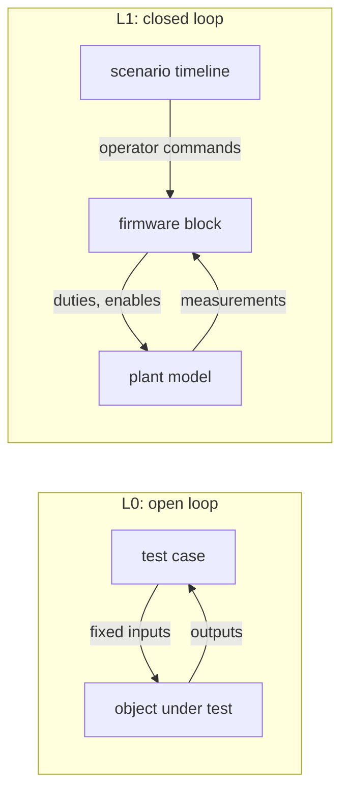
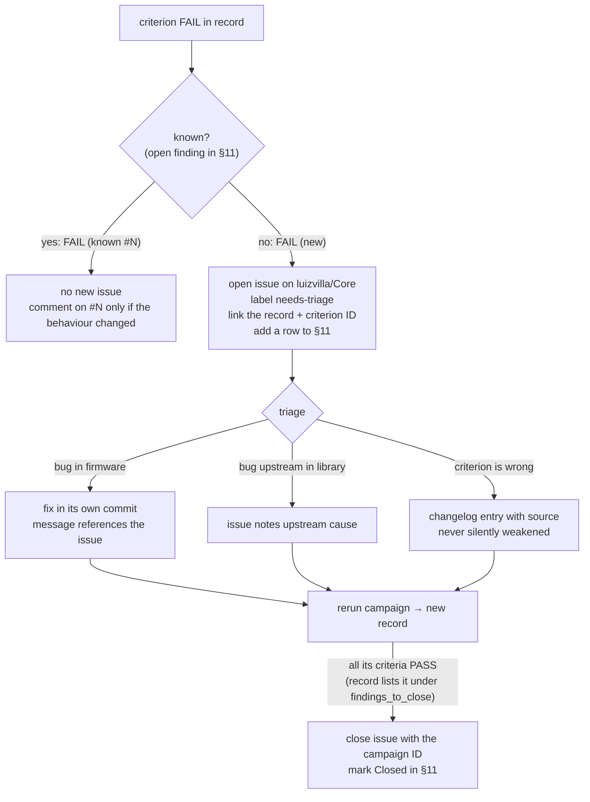

# uSolarVerter firmware test procedure

| | |
|---|---|
| Procedure version | 0.10 (draft) |
| Firmware under test | Core2 branch `test/microinverter-validation`, application in `src/` |
| Hardware target | Spin 1.2.0 + uSolarVerter 0.9.0 |
| Owner | Luiz Villa |
| Issue tracker | GitHub Issues on `luizvilla/Core` |

Terms in **bold** are defined in [GLOSSARY.md](../../GLOSSARY.md). The architecture choice for L1 is recorded in [ADR 0001](../adr/0001-firmware-in-the-loop-via-pulsim.md). Changes to production code made for testing are logged in [worklog.md](worklog.md).

---

## 1. Purpose and scope

This procedure verifies features that **already exist** in the firmware. It does not add features. A **test case** checks that the code does what its own source and documentation state.

| In scope | Out of scope |
|---|---|
| Boost converter controller (`src/boost_converter/`) | Grid-code compliance (EN 50549, VDE-AR-N 4105) |
| Grid observer (`src/grid_observer/`) | ADC scaling, sensor calibration, PWM timing, dead time |
| Grid-following inverter controller from the `single_phase_inverter` library (`jalinei/single_phase_inverter`, branch `main`, not pinned; **temporarily** `luizvilla/single_phase_inverter` branch `fix/sogi-frequency-adaptive` while finding #1 is under evaluation, see [worklog](worklog.md)) | Bench tests on hardware (L2/L3) |
| Application control logic of the critical task (`controlStep`) | Serial menu parsing, scope acquisition, telemetry printing |
| | Grid-forming controller of the same library |
| | Continuous integration |

**Pass criteria** come from values stated in the code and its documentation. Where the code states no number, the measured value is recorded with the verdict `INFO` and no limit is invented (see [§5](#5-verdicts)).

## 2. Test levels

| Level | What runs | Inputs | Plant | Tooling |
|---|---|---|---|---|
| **L0** | One object at a time, or `controlStep` | Fixed values or synthetic signals chosen by the test | None, open loop | `g++` on the host, hardware stand-in headers |
| **L1** | The **firmware block** (`controlStep` + all controllers) | Operator commands from a scenario timeline | **Plant model** in Pulsim, closed loop | Pulsim C-Block, Python |



L0 answers *"does each object do what its code claims for chosen inputs?"*. L1 answers *"does it still behave when its outputs change its own inputs?"*: dynamics, stability and interactions between the boost, the DC bus, the PLL and the observer.

### 2.1 Plant model

The plant model is provided by a colleague working in Pulsim and is imported into `tests/l1/plant/`. Two variants share one parameter file:

| Variant | Use | Status |
|---|---|---|
| **Averaged plant model** | Long test cases: startup ramp (~40 s), MPPT, observer timing, PLL | Expected first |
| **Switched plant model** | Short windows: current-loop ripple, burst pause/resume, a few grid cycles | Later |

Every parameter in the model cites its source (schematic, datasheet or measurement). Missing parameters are marked `TBD`, and test cases that depend on them report `BLOCKED`.

> **Relay.** The uSolarVerter 0.9.0 board definition has no grid relay, and the application never connects to the grid. The library already exposes a relay interface: `isGridConnectionRequested()` (close request) and `setGridConnected(bool)` (feedback). If the plant model includes a relay, the connection lifecycle can be tested end to end through the L1-GFL cases. Until then those cases are `BLOCKED`.

### 2.2 Firmware block

The control logic of `loop_critical_task` is extracted into a hardware-free function (the **control step**):

```cpp
int8_t controlInit(ControlState&);
ControlOutputs controlStep(ControlState&, const Measurements&, const OperatorCommands&);
```

`ControlState` holds the boost, inverter and grid observer and the per-tick state; `controlInit` applies the application's tuning (`app::` constants in `src/app/control_step.h`). Taking the state explicitly lets each test and the L1 firmware block hold its own instance.

`main.cpp` keeps reading sensors and writing PWM through the shield API. On the host, L0 calls `controlStep` directly. For L1, `controlStep` and the controller sources are compiled into a shared library that exports the Pulsim C-Block ABI (`pulsim_cblock_step`) and runs every 100 µs. Pulsim holds the outputs (zero-order hold) between steps.

## 3. Model ↔ firmware block contract (v1)

> **v1, to be revised when the plant model arrives.** Any change is recorded in the [changelog](#10-changelog) and the version number goes up. The order below is the wire order of the C-block; it is implemented in `tests/l1/firmware_block/firmware_block.cpp` and `contract.py`, which check each other's version at load time.

All values are physical units, sampled every 100 µs (control-task period).

| Direction | Signal | Unit | Notes |
|---|---|---|---|
| Model → block | `VLow` | V | PV-side voltage |
| Model → block | `ILow1` | A | Boost leg 1 current |
| Model → block | `ILow2` | A | Boost leg 2 current |
| Model → block | `VDCBus` | V | Shared DC bus |
| Model → block | `VAC` | V | Instantaneous grid voltage |
| Model → block | `IAC` | A | Instantaneous bridge current |
| Model → block | `relay_closed` | 0/1 | Optional; relay feedback |
| Model → block | `vac_valid` | 0/1 | 0 simulates a missing VAC sample (stale-sample detection) |
| Scenario → block | `mode` | 0–3 | IDLE, STARTUP, BUSREG, MPPT |
| Scenario → block | `sync_request` | 0/1 | Serial command `c` |
| Scenario → block | `v_bus_ref` | V | Serial commands `u` / `d` |
| Block → model | `duty_leg1`, `duty_leg2` | 0–1 | Boost leg duties |
| Block → model | `en_leg1`, `en_leg2` | 0/1 | Boost leg PWM enables |
| Block → model | `duty_bridge` | 0–1 | Inverter leg duty |
| Block → model | `en_bridge` | 0/1 | Inverter bridge PWM enable |
| Block → model | `relay_request` | 0/1 | Optional; relay close request |
| Block → log | `theta`, `w`, `obs_rms`, `obs_freq`, `trip_reason`, `inv_mode`, `sync`, `burst_paused`, `mode_changed`, `status` | — | Logged, not fed back. `status` 0 = running; negative = `controlInit` failed or wrong wire count |

**Wiring rules (Pulsim 2.0.0).**

- Every block output is a controlled voltage source to `gnd` and **must be loaded**; `contract.add_firmware_block()` adds 1 MΩ on each. An unloaded output makes the circuit matrix singular and node voltages diverge without an error.
- The firmware block is the **only C-block** in a circuit: Pulsim 2.0.0 sums the output vectors of several C-blocks with different lengths and fails. Operator commands therefore come from ordinary step sources (`contract.add_command_timeline()`), not from a scenario C-block.
- C-blocks are added **after** every other component, because Pulsim resolves their wires when they are added.
- Pulsim calls the block once at t = 0 before solving the circuit (all inputs 0). The block skips that call; the first control step runs at t = 100 µs. Inputs are sampled at the block's next run, so a command or measurement change is seen within one control period, as on the board.

## 4. Test case identification

Format: `<level>-<object>-<nn>`. A criterion inside a case adds a letter: `L1-APP-02.b`.

| Code | Object |
|---|---|
| `BST` | Boost converter controller |
| `GOB` | Grid observer |
| `GFL` | Grid-following inverter controller (library) |
| `APP` | Application control step |
| `FWB` | Firmware block in the simulator (L1 infrastructure) |

When the same criterion runs once per mode, the mode is appended: `L0-BST-07.a-startup`, `L0-BST-07.a-busreg`.

IDs are never reused. A retired case keeps its ID with status `RETIRED` in the catalogue.

## 5. Verdicts

| Verdict | Meaning | Effect on campaign |
|---|---|---|
| `PASS` | Measured value within the stated limit | — |
| `FAIL` | Measured value outside the stated limit | Campaign fails, script exits non-zero |
| `INFO` | Measured and recorded; no limit stated in the code | — |
| `BLOCKED` | Could not run (model, parameter or relay missing) | Listed at the top of the record; campaign does not fail |

A limit is added to an `INFO` criterion only through a changelog entry stating its source.

## 6. Test catalogue

The "Source" column names the symbol that states the behaviour or the limit. Symbol names are used instead of line numbers so they survive refactoring.

### 6.1 L0-BST — boost converter

| ID | Behaviour | Source | Status |
|---|---|---|---|
| L0-BST-01 | Invalid init, measurements or burst bounds never enable a leg | `BoostConverter::init`, `isLeg1Enabled`, `isLeg2Enabled` | Migrated |
| L0-BST-02 | Leg 1 takes priority up to its current limit, leg 2 takes the excess, leg 2 is cleared when its demand stops | `splitCurrentReference` | Migrated |
| L0-BST-03 | Cold-loop saturation sets the total current reference | voltage PID bounds | Migrated |
| L0-BST-04 | MPPT perturb and observe: direction, turnaround at bounds, voltage ignored | `Mppt`, `MPPT_CURRENT_STEP` = 0.1 A | Migrated |
| L0-BST-05 | STARTUP ramp starts from the measured voltage, follows the rate, does not overshoot, restarts from the measurement on re-entry | `setStartupRampRate`; `startup_ramp_rate` = 10 V/s in `main.cpp` | Migrated |
| L0-BST-06 | STARTUP current ceiling; converter 2 never enabled in STARTUP | `setStartupCurrentMax`; `startup_current_max` = 1 A | Migrated |
| L0-BST-07 | Burst hysteresis: pause at ≥ upper bound, resume at ≤ lower bound, ramp frozen, no bypass, MPPT exempt | `updateBurstState`; 395 / 405 V in `main.cpp` | Migrated |

### 6.2 L0-GOB — grid observer

| ID | Behaviour | Source | Status |
|---|---|---|---|
| L0-GOB-01 | Not operable before init; invalid config rejected | `GridObserver::init`, `canOperate` | Migrated |
| L0-GOB-02 | Qualification dwell; restart on dropout; no nuisance trip when the grid is absent at startup | `qualification_time_s` = 1 s | Migrated |
| L0-GOB-03 | RMS and frequency estimates accurate on a clean grid | `getVoltageRms`, `getFrequencyHz` | Migrated |
| L0-GOB-04 | UV, OV, UF, OF trip after their delay; shorter events do not trip | 207–253 V, 47.5–52.5 Hz, 0.1 s delays in `grid_observer_config` | Migrated |
| L0-GOB-05 | Trip latches; clearing needs a full healthy interval and open-relay feedback | `clearTrip` | Migrated |
| L0-GOB-06 | Invalid measurement trips with reason `InvalidMeasurement` | `update(..., measurements_valid)` | Migrated (already covered by the original test) |

### 6.3 L0-GFL — grid-following inverter (library)

| ID | Behaviour | Source | Verdict type | Status |
|---|---|---|---|---|
| L0-GFL-01 | Init validation; invalid config latches `VSI_FAULT_INVALID_CONFIGURATION` | library README, `init` | PASS/FAIL | Implemented |
| L0-GFL-02 | PLL locks on a clean 230 V / 50 Hz grid; synchronization only never requests PWM or relay | `getSync`, `isPwmRequested` | PASS/FAIL; lock time, phase and frequency error `INFO` | Implemented |
| L0-GFL-03 | PLL tracks a 50 → 51 Hz step (20 ms mean) and synchronizes again inside the library's ±5 % frequency window | `getw`, `synchronizationAligned` (±5 % ω, \|Vq\| < 0.1 V) | PASS/FAIL; tracking time, ripple `INFO` | Implemented; .b FAIL, [#1](https://github.com/luizvilla/Core/issues/1) |
| L0-GFL-04 | Mode lifecycle OFF → SYNC → CONNECT → CONNECTED → RUN → STOPPING → DISCONNECT → OFF with feedback; 1 s connection and disconnection timeouts; connection lost; sync lost while awaiting the relay | `vsi_mode_t`, `_connection_timeout` | PASS/FAIL | Implemented |
| L0-GFL-05 | Bad grid quality blocks SYNC and trips CONNECT/CONNECTED/RUN; `clearFault` needs good quality and an open relay | `setGridQuality`, `clearFault` | PASS/FAIL | Implemented |
| L0-GFL-06 | Non-finite measurement, non-positive bus, invalid references latch a fault with 0.5 duty and PWM off; first cause kept; requests ignored until cleared | library README (faults) | PASS/FAIL | Implemented |
| L0-GFL-07 | Duty exactly 0.5 in OFF and SYNC; duty = α / (2 · V_bus) + 0.5 otherwise, unclamped | library README (`calculateDuty`) | PASS/FAIL | Implemented |
| L0-GFL-08 | Cold-start synchronization at 47.6, 49, 50, 51 and 52.4 Hz from four grid angles (5 s horizon); settled frequency estimate within ±5 % | library README (±5 % frequency window), observer window 47.5–52.5 Hz | PASS/FAIL; worst lock time and transient `INFO` | Implemented; .a, .b, .d, .e FAIL, [#1](https://github.com/luizvilla/Core/issues/1) |

### 6.4 L0-APP — application control step (no model)

| ID | Behaviour | Source | Status |
|---|---|---|---|
| L0-APP-01 | `controlInit` applies the app tuning; a mode change is flagged on its tick only and runs the cold loop on that tick; leg enables follow the controller | critical task, mode-change block | Implemented |
| L0-APP-02 | Cold loop on the change tick, then every 10th tick; a new mode change restarts the phase | `cold_loop_divider` = 10 | Implemented |
| L0-APP-03 | VAC stale for exactly 200 periods (20 ms) trips the observer with `InvalidMeasurement`; a fresh sample restarts the count; one sample missing at boot does not latch a trip | `grid_voltage_stale_ticks` = 200; `gridObserver.cpp` (no trip latched at startup) | Implemented; .c FAIL, [#2](https://github.com/luizvilla/Core/issues/2) |
| L0-APP-04 | Bridge PWM never enabled and the inverter never requests PWM or relay, in any mode, with or without a sync request | critical task, "Synchronization only" | Implemented |
| L0-APP-05 | Synchronization only after observer qualification; an observer trip removes it on the trip tick; times to qualification and sync `INFO` | `setGridQuality(grid_observer.canOperate())` | Implemented |

### 6.5 L1-APP — application with the averaged plant model

| ID | Scenario | Criteria | Model | Status |
|---|---|---|---|---|
| L1-APP-01 | IDLE on a healthy grid | legs off; observer qualifies at 1 s ± 1 tick; PLL lock time `INFO` | averaged | BLOCKED (model) |
| L1-APP-02 | STARTUP from 0 V | bus reference follows 10 V/s; ILow1 ≤ 1 A; leg 2 never enabled | averaged | BLOCKED (model) |
| L1-APP-03 | BUSREG at 400 V | VDCBus within 395–405 V; overshoot `INFO` | averaged | BLOCKED (model) |
| L1-APP-04 | Burst cycling at light load | pause at 405 V, resume at 395 V; bus dip `INFO` | switched | BLOCKED (model) |
| L1-APP-05 | MPPT on the PV curve | settles near the maximum power point; tracking efficiency `INFO` | averaged | BLOCKED (model) |
| L1-APP-06 | Synchronization only | inverter synchronized; bridge PWM never enabled | averaged | BLOCKED (model) |
| L1-APP-07 | Grid steps out of window (UV, OV, UF, OF) | trip within 0.1 s + 1 tick; synchronization revoked | averaged | BLOCKED (model) |
| L1-APP-08 | VAC samples lost for more than 20 ms | trip with reason `InvalidMeasurement` | averaged | BLOCKED (model) |
| L1-APP-09 | Every mode → every other mode | legs stopped on the switching tick; peak current `INFO` | averaged | BLOCKED (model) |

### 6.6 L1-FWB — firmware block (infrastructure)

Checks that the simulation tooling itself is sound before any L1-APP result is trusted. Uses a stand-in circuit of fixed sources, not the plant model.

| ID | Behaviour | Status |
|---|---|---|
| L1-FWB-01 | Firmware block loads with the matching contract; runs every 100 µs and holds outputs; grid voltage arrives in volts (observer reads 230 V / 50 Hz); commands arrive within one period; an output drives a circuit element; bridge and relay never requested; inverter synchronizes; no node diverges; time to sync and wall time per simulated second `INFO` | Implemented |

### 6.7 L1-GFL — library only, through a test harness

These cases exercise library features the application does not use. They run the library through a small test-only harness, **not** through `controlStep`, so nobody reads them as application behaviour.

| ID | Scenario | Status |
|---|---|---|
| L1-GFL-01 | Connect → run (I_d step) → stop → disconnect, with relay feedback | BLOCKED (relay) |
| L1-GFL-02 | Grid fault during RUN: fault latched, PWM dropped immediately | BLOCKED (relay) |
| L1-GFL-03 | Relay never confirms closing: fault after the 1 s timeout | BLOCKED (relay) |

## 7. Running a campaign

```bash
tests/run_all.sh          # L0 then L1
tests/run_all.sh --l0     # L0 only (seconds)
tests/run_all.sh --l1     # L1 only
```

The script writes the **test record** to `tests/out/<YYYY-MM-DD>_<sha7>/`, prints the results table, and exits non-zero if any criterion is `FAIL`, if a test binary dies before reporting (build error, crash, sanitizer abort), or if the campaign reports no criteria at all. The folder name ends in `-dirty` when tracked files have uncommitted changes. `tests/out/` is git-ignored: L0 and L1 are deterministic, so any record can be regenerated from its commit.

| When | What to run |
|---|---|
| Before every commit on the test branch | `tests/run_all.sh --l0` |
| Before a merge, or when the plant model changes | `tests/run_all.sh` |

### 7.1 How an L0 test reports

Each L0 test is a host binary built by its `tests/l0/<object>/run.sh` through `tests/common/l0_build.sh`. It uses `tests/common/check.h`:

```cpp
{
    tc::Criterion c("L0-BST-02.a", "Leg 1 alone up to its current limit");
    c.near("ILow1 ref at 2 A", boost.getILow1Ref(), 2.0, 1e-5);
    c.check("leg 2 disabled", !boost.isLeg2Enabled());
}   // one result line per criterion, printed here
tc::info("L0-GFL-02.b", "PLL lock time", lock_time_s, "s");
return tc::finish();
```

A failing observation does not stop the test, so every criterion gets a verdict. Firmware sources are built with `-Wall -Wextra -Werror`; third-party library sources without `-Werror`. Undefined behaviour aborts the binary (UBSan), which the runner reports as a `FAIL`.

### 7.2 Environment

| Item | Requirement |
|---|---|
| C++ compiler | `g++` with C++17 and UBSan (`-fsanitize=undefined`) |
| Python | ≥ 3.10, in a `.venv` at the repo root |
| Pulsim | `pulsim==2.0.0`, from `tests/l1/requirements.txt`: `python3 -m venv .venv && .venv/bin/pip install -r tests/l1/requirements.txt`. Without it, every L1 case is reported `BLOCKED` |
| Inverter library | Fetched by PlatformIO into `owntech/lib/USB/single_phase_inverter` from the `lib_deps` entry in `src/app.ini` (jalinei `main`; temporarily the #1 fix branch); its remote, branch and commit are stamped in each record |

### 7.3 Test code documentation

Every test must be readable without its author. The rules below apply to all test code, current and future, and are checked in review.

| Item | Rule |
|---|---|
| Test folder | Contains a `README.md`: what is under test, how to run it, what is compiled with which flags, how the test drives the object, the criteria table, known findings with their issue links, and history |
| `tests/`, `tests/common/` | Each has a `README.md` describing layout and shared helpers |
| C/C++ file | Core license block (LGPL-2.1, SPDX line), then a Doxygen `@file` / `@brief` block whose details list the test cases in the file |
| C/C++ function, struct, constant | Doxygen `@brief`, with `@param` / `@return` where they apply; members and constants use `///<` |
| Criterion | A Doxygen `/** @test <ID>: <description> */` line right before each `tc::Criterion` or `tc::info`, so Doxygen's *Test List* page lists every criterion |
| Shell script | `##` Doxygen-style header after the shebang: SPDX line, `@file`, `@brief`, details, `@return`, `@see`, and a `@par Usage` block |
| Python script | `##` header with `@file` and `@brief`, plus a module docstring |
| Hidden constraints | Anything a reader could break without knowing (call order, shared state, tolerances chosen for exact arithmetic) is stated with `@warning` or `@note` |

This matches the Doxygen style of the Core sources (`@file`, `@brief`, `@param`, `@return`, `///<`).

## 8. Test record

Each campaign produces one Markdown file, `record.md`, plus raw data. The front-matter is machine-readable; the body is for people.

```markdown
---
campaign: 2026-11-05_4c33fb0
date: 2026-11-05T14:02:11+01:00
operator: <git user.name>
core_commit: 4c33fb0          # + "-dirty" if the tree has uncommitted changes
library_commit: 0f22378       # single_phase_inverter
plant_model: averaged@<sha7>  # or "none"
contract_version: v0
toolchain: { gcc: "13.2.0", python: "3.12.3", pulsim: "2.0.0" }
levels: [L0, L1]
verdict: FAIL                 # PASS | FAIL
new_failures: 1               # FAIL not covered by an open finding (§11)
known_failures: 5             # FAIL covered by an open finding
known_findings: [#1]
findings_to_close: []         # open findings whose criteria all pass
counts: { PASS: 41, FAIL: 6, INFO: 6, BLOCKED: 12 }
---
```

### 8.1 Setup table

| Item | Value |
|---|---|
| Core commit | `4c33fb0` |
| Library commit | `0f22378` (jalinei/single_phase_inverter `main`) |
| Plant model | averaged, parameters `params.yaml@<sha7>` |
| Contract | v0 |
| Control period | 100 µs (cold loop every 10 ticks) |
| Toolchain | gcc 13.2.0, Python 3.12.3, Pulsim 2.0.0 |

### 8.2 Results table

| Criterion | Description | Limit | Measured | Verdict |
|---|---|---|---|---|
| L0-GOB-04.a | UV trips after delay | 0.1 s ± 1 tick | 0.1001 s | PASS |
| L1-APP-02.b | ILow1 during STARTUP | ≤ 1 A | 1.07 A | FAIL (**new**) |
| L0-GFL-03.b | Synchronized again at 51 Hz | all observations hold | 2/2 failed | FAIL (known #1) |
| L1-APP-03.c | VDCBus overshoot | — | 2.3 V | INFO |
| L1-GFL-01 | Connection lifecycle | — | — | BLOCKED (relay) |

`BLOCKED` rows are listed first, then `FAIL`, then everything else in ID order. A `FAIL` on a criterion listed in an open finding of the [findings register](#11-findings-register) is marked *known* with its issue; any other `FAIL` is marked **new**. The campaign verdict still counts every `FAIL` (§5); the distinction only says which failures need a new issue.

### 8.3 Raw data and plots

| File | Content |
|---|---|
| `l0.log` | One line per criterion from the L0 binaries |
| `L1-APP-xx.csv` | Time series of all contract signals and logged values |
| `L1-APP-xx.png` | Plots generated from the CSV with matplotlib |

### 8.4 Failure follow-up



Rules:

- A failing test is never weakened to make it pass. A limit changes only through a changelog entry citing its new source.
- Fixes never go into test commits.
- The issue records the campaign ID and criterion ID so the failure can be reproduced from its commit.
- Every issue opened from a test failure gets a row in the [findings register](#11-findings-register), so later campaigns recognise it. A closed finding stays in the register with status `Closed`: if its criteria fail again, the record reports a **new** failure (a regression).
- A fix in a library is tested before merge by pointing L0 at the fix branch: `SINGLE_PHASE_INVERTER_DIR=/path/to/checkout tests/run_all.sh --l0`. The record stamps that checkout's commit.

## 9. Commit plan

On branch `test/microinverter-validation` (from `dts_uverter`), pushed to `luizvilla/Core`.

| # | Commit | Delivers | Production code touched |
|---|---|---|---|
| 1 | `docs(test)` | This procedure, glossary, ADR 0001, worklog, contract v0 | No |
| 2 | `test(infra)` | `tests/common/` (CHECK helper, hardware stand-ins, record writer), `tests/run_all.sh`, `tests/out/` ignored | No |
| 3 | `test(l0)` | Move boost and observer tests to `tests/l0/`, convert to CHECK IDs; add L0-GOB-06 | No |
| 4 | `test(l0)` | L0-GFL cases | No |
| 5 | `refactor(app)` | Extract `controlStep` into `src/app/`; worklog entry | **Yes** |
| 6 | `test(l0)` | L0-APP cases | No |
| 7 | `test(l1)` | Firmware block `.so` build, pinned Pulsim environment, L1-FWB-01 against a stand-in circuit; contract v1 | No |
| 8 | `test(l1)` | Scenario runner and all L1 case scripts (`BLOCKED`) | No |
| 9 | `test(l1)` | Import the averaged plant model (authored by the colleague); contract revised | No |
| gate | — | Findings [#1](https://github.com/luizvilla/Core/issues/1) and [#2](https://github.com/luizvilla/Core/issues/2) closed; otherwise L1-APP-01, -06, -07 and -08 cannot be judged | #1: no (library); #2: yes (firmware) |
| 10 | `test(l1)` | Unblock L1-APP; first full campaign | No |
| later | `test(l1)` | Switched model + L1-APP-04; relay + L1-GFL-* | No |


## 10. Changelog

| Version | Date | Change |
|---|---|---|
| 0.1 | 2026-11-05 | First draft: scope, levels, contract v0, catalogue, record format, commit plan |
| 0.2 | 2026-11-05 | L0-BST and L0-GOB migrated to per-criterion checks, no assertion removed. L0-GOB-06 was already covered by the original test. Criteria added to existing cases where the original test checked more than the catalogue listed: L0-GOB-04.e (opposite excursions), 04.f (negative frequency, first cause kept), 04.g (zero delays). Mode suffix for per-mode criteria. |
| 0.3 | 2026-11-05 | L0-GFL implemented. Off-nominal frequency criteria use a 20 ms mean of the PLL estimate, because the estimate carries a 100 Hz ripple away from 50 Hz. L0-GFL-03 split into frequency tracking (.a) and re-synchronization (.b). |
| 0.4 | 2026-11-05 | §7.3 test code documentation rules: README per test folder, Core license and Doxygen style in C/C++, `@test` tag per criterion, `##` Doxygen headers in shell and Python. Applied to all existing test code. L0-GFL-03.b failure filed as luizvilla/Core#1. |
| 0.5 | 2026-11-05 | Control step extracted to `src/app/control_step.{h,cpp}` with `controlInit` and an explicit `ControlState` (worklog entry of the same date). |
| 0.6 | 2026-11-05 | L0-APP implemented against `controlStep` with the application's real tuning and real-time grid delays. |
| 0.7 | 2026-11-05 | L0-GFL-08 added (cold-start synchronization across the frequency window), after an experimental fix for #1 synchronized on a 51 Hz step but diverged on a 49 Hz cold start, which L0-GFL-03 does not cover. §11 findings register; records mark known and new failures and findings ready to close. Gate on #1 before commit 10. `SINGLE_PHASE_INVERTER_DIR` tests a library branch before merge. |
| 0.8 | 2026-11-05 | `src/app.ini` temporarily fetches the #1 fix branch (worklog). Records stamp the library's remote and branch, not only its commit. |
| 0.9 | 2026-11-05 | Contract v1: outputs `sync`, `mode_changed`, `status` added; Pulsim wiring rules (loaded outputs, single C-block, blocks last, t = 0 skipped, one-period input latency). L1-FWB-01 added (§6.6); L1-GFL becomes §6.7. Pulsim environment in `tests/l1/requirements.txt`. Records read the contract version from §3. |
| 0.10 | 2026-11-05 | L0-APP-03.c added (boot with a missing first VAC sample), after L1-FWB-01 exposed it; fails, filed as #2 and registered in §11. |

## 11. Findings register

Every issue opened from a test failure, with what it blocks. `tests/common/make_record.py` reads this table: a `FAIL` on a criterion listed in an **open** row is reported as *known* with its issue; a finding whose criteria all pass is listed as ready to close. Keep the column order; a case ID (`L0-GFL-08`) covers all its criteria. Set the status to `Closed (<campaign ID>)` when the issue is closed, and keep the row.

| Issue | Criteria | Cause | Owner | Status | Blocks |
|---|---|---|---|---|---|
| [#1](https://github.com/luizvilla/Core/issues/1) | L0-GFL-03.b, L0-GFL-08 | Library: SOGI evaluated at the fixed ω_ref, so the 2ω ripple on Vq exceeds the 0.1 V sync tolerance away from 50 Hz | Jean (library) | Open: fix proposed (jalinei/single_phase_inverter#1); firmware temporarily built against it | Gate before commit 10 (L1-APP-06, -07) |
| [#2](https://github.com/luizvilla/Core/issues/2) | L0-APP-03.c | Firmware: VAC staleness counter starts stale, the observer trips `InvalidMeasurement` before qualification, and the app never calls `clearTrip()`, so one missing VAC sample at boot blocks synchronization until reset | Luiz (firmware) | Open: needs triage | Gate before commit 10 (L1-APP-01, -06, -08) |
