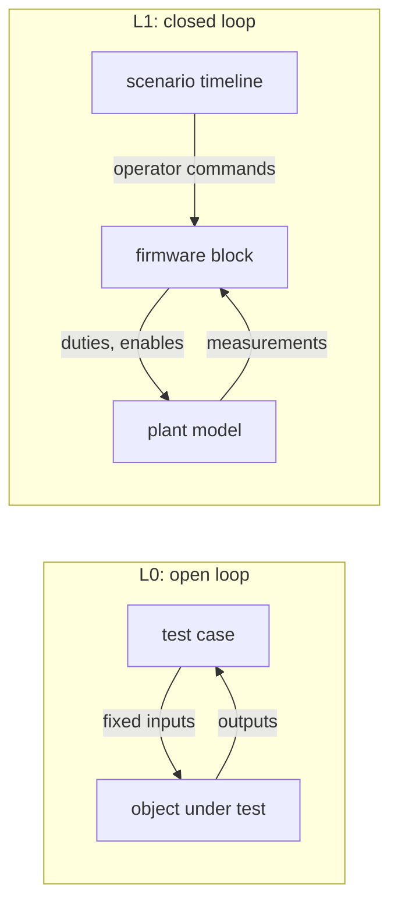
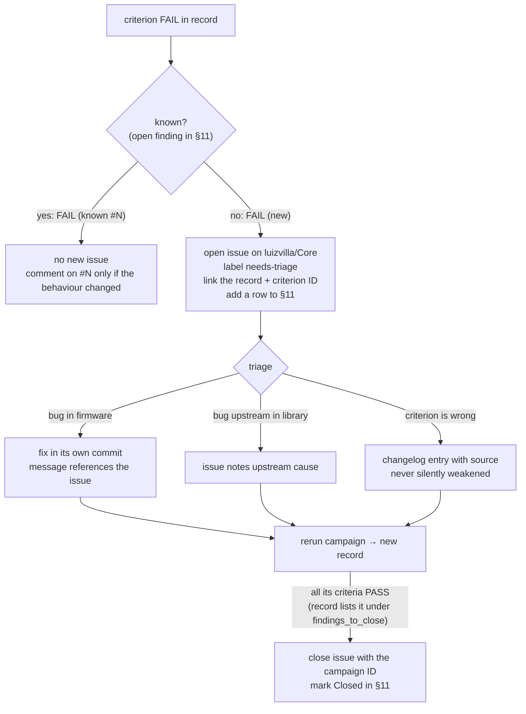
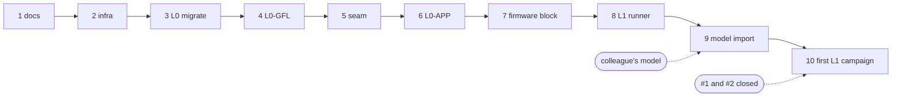

# uSolarVerter firmware test procedure

| | |
|---|---|
| Procedure version | 1.18 (draft) |
| Firmware under test | Core2 branch `test/microinverter-validation`, application in `src/` |
| Hardware target | Spin 1.2.0 + uSolarVerter 0.9.0 |
| Owner | Luiz Villa |
| Issue tracker | GitHub Issues on `luizvilla/Core` |

Terms in **bold** are defined in [GLOSSARY.md](../../GLOSSARY.md). The architecture choice for L1 is recorded in [ADR 0001](../adr/0001-firmware-in-the-loop-via-pulsim.md). Changes to production code made for testing are logged in [worklog.md](worklog.md).

---

## 1. Purpose and scope

This procedure verifies features that **already exist** in the firmware. It does not add features. A **test case** checks that the code does what its own source and documentation state.

| In scope | Out of scope |
|---|---|
| Boost converter controller (`src/boost_converter/`) | Grid-code compliance (EN 50549, VDE-AR-N 4105) |
| Grid observer (`src/grid_observer/`) | ADC scaling, sensor calibration, PWM timing, dead time |
| Grid-following inverter controller from the `single_phase_inverter` library (`jalinei/single_phase_inverter`, branch `main`, not pinned; **temporarily** `luizvilla/single_phase_inverter` branch `fix/sogi-frequency-adaptive` while finding #1 is under evaluation, see [worklog](worklog.md)) | Bench tests on hardware (L2/L3) |
| Application control logic of the critical task (`controlStep`) | Serial menu parsing, scope acquisition, telemetry printing |
| | Grid-forming controller of the same library |
| | Continuous integration |

**Pass criteria** come from values stated in the code and its documentation. Where the code states no number, the measured value is recorded with the verdict `INFO` and no limit is invented (see [§5](#5-verdicts)).

## 2. Test levels

| Level | What runs | Inputs | Plant | Tooling |
|---|---|---|---|---|
| **L0** | One object at a time, or `controlStep` | Fixed values or synthetic signals chosen by the test | None, open loop | `g++` on the host, hardware stand-in headers; **L0-TIM** (timing) on the Spin through an ST-Link, PlatformIO env `TIMING`, run only with `--target` ([ADR 0005](../adr/0005-on-target-timing-tests.md)) |
| **D** | The controller's arithmetic, re-implemented (library SOGI, PI, PLL), for fast evaluation of ideas at the user's request ([ADR 0004](../adr/0004-averaged-model-for-fast-evaluation.md)) | A scenario chosen by the design test | **Averaged** plant model in Python, closed loop; INFO only, never a verdict | `tests/l1/design/`, filed under the Model tab |
| **L1** | The **firmware block** (`controlStep` + all controllers) | Operator commands from a scenario timeline | **Plant model** in Pulsim, closed loop | Pulsim C-Block, Python |
| **L2** | The flashed firmware on the board | Serial menu commands, bench sources | The real converter on the bench | Bench sessions with a written sheet and record ([inverter session](bench/inverter-session.md)) |



L0 answers *"does each object do what its code claims for chosen inputs?"*. L1 answers *"does it still behave when its outputs change its own inputs?"*: dynamics, stability and interactions between the boost, the DC bus, the PLL and the observer. L2 answers *"does the board do it?"*: each bench step has a firmware stage tested at L0 first, a sheet with the measurements and limits, and a record kept under `docs/testing/bench/`.

### 2.1 Plant model

The plant model is provided by a colleague working in Pulsim and is imported into `tests/l1/plant/`. The user-selected plant remains switching throughout; no averaged plant is planned. Derived fixtures retain the reviewed power circuit and declare their loads and initial conditions:

| Variant | Use | Status |
|---|---|---|
| **Switched plant model** | Short windows: current-loop ripple, burst pause/resume, a few grid cycles | Switched import and integration checks implemented; formal cases still gated |

Every parameter in the model cites its source (schematic, datasheet or measurement). Missing parameters are marked `TBD`, and test cases that depend on them report `BLOCKED`.

> **Relay.** The uSolarVerter 0.9.0 board definition has no grid relay, and the application never connects to the grid. The library already exposes a relay interface: `isGridConnectionRequested()` (close request) and `setGridConnected(bool)` (feedback). If the plant model includes a relay, the connection lifecycle can be tested end to end through the L1-GFL cases. Until then those cases are `BLOCKED`.

### 2.2 Firmware block

The control logic of `loop_critical_task` is extracted into a hardware-free function (the **control step**):

```cpp
int8_t controlInit(ControlState&);
ControlOutputs controlStep(ControlState&, const Measurements&, const OperatorCommands&);
```

`ControlState` holds the boost, inverter and grid observer and the per-tick state; `controlInit` applies the application's tuning (`app::` constants in `src/app/control_step.h`). Taking the state explicitly lets each test and the L1 firmware block hold its own instance.

`main.cpp` keeps reading sensors and writing PWM through the shield API. On the host, L0 calls `controlStep` directly. For L1, `controlStep` and the controller sources are compiled into a shared library that exports the Pulsim C-Block ABI (`pulsim_cblock_step`) and runs every 100 µs. Pulsim holds the outputs (zero-order hold) between steps.

## 3. Model ↔ firmware block contract (app-v2)

> **app-v2** (2026-11-06, [ADR 0003](../adr/0003-boost-adopts-current-driven-burst.md)): the boost burst command (`burst_skip`, `burst_period`) and `boost_trip` replace app-v1's `burst_paused` and `startup_ref`; the PWM adapter models the HRTIM burst on leg 1 (a new skip count takes effect at the next burst period) and shifts the carrier so the control ticks, where the block samples, fall at the board's ADC instant (`adc_trigger_phase` 0.53, finding #3 H2, L1-MOD-08.b). `tests/l1/contract.json` is the machine-readable index/actuator contract. It supersedes the initial v0 sketch for the application path. Relay lifecycle inputs belong to a future separate library-only harness; the current application has no relay command. Changes are recorded in the [changelog](#10-changelog).

All values are physical units, sampled every 100 µs (control-task period).

| Direction | Signal | Unit | Notes |
|---|---|---|---|
| Model → block | `VLow` | V | PV-side voltage |
| Model → block | `ILow1` | A | Boost leg 1 current |
| Model → block | `ILow2` | A | Boost leg 2 current |
| Model → block | `VDCBus` | V | Shared DC bus |
| Model → block | `VAC` | V | Instantaneous grid voltage |
| Model → block | `IAC` | A | Instantaneous bridge current |
| Fixture → block | `vac_updated` | 0/1 | Maps to `Measurements::v_ac_updated`; wrapper holds last delivered VAC when false |
| Scenario → block | `mode` | 0–3 | IDLE, STARTUP, BUSREG, MPPT |
| Scenario → block | `sync_request` | 0/1 | Serial command `c` |
| Scenario → block | `v_bus_ref` | V | Serial commands `u` / `d` |
| Block → model | `duty_leg1`, `duty_leg2` | 0–1 | Boost leg duties |
| Block → model | `en_leg1`, `en_leg2` | 0/1 | Boost leg PWM enables |
| Block → model | `duty_bridge` | 0–1 | Inverter leg duty |
| Block → model | `en_bridge` | 0/1 | Always false in this application |
| Block → model | `boost_mode_changed` | 0/1 | Stop both boost legs on that tick before applying updates |
| Block → model | `boost_pwm_update` | 0/1 | Apply new duties/enables only when true; otherwise hold applied state |
| Block → model | `burst_skip`, `burst_period` | PWM periods | Leg 1 skips the first `burst_skip` of every `burst_period` PWM periods; 0: burst generator stopped |
| Block → log | `boost_trip` | 0/1 | Boost protection tripped (460 V or 8 A), latched until IDLE |
| Block → log | `relay_requested` | 0/1 | Library diagnostic only; remains false in application tests |
| Block → log | `theta`, `w`, observer RMS, observer frequency, trip reason, inverter mode | — | Logged, not fed back |

## 4. Test case identification

Format: `<level>-<object>-<nn>`. A criterion inside a case adds a letter: `L1-APP-02.b`.

| Code | Object |
|---|---|
| `BST` | Boost converter controller |
| `GOB` | Grid observer |
| `GFL` | Grid-following inverter controller (library) |
| `APP` | Application control step |
| `INT` | Native C-Block/model integration, separate from formal application/library criteria |

When the same criterion runs once per mode, the mode is appended: `L0-BST-07.a-startup`, `L0-BST-07.a-busreg`.

IDs are never reused. A retired case keeps its ID with status `RETIRED` in the catalogue.

## 5. Verdicts

| Verdict | Meaning | Effect on campaign |
|---|---|---|
| `PASS` | Measured value within the stated limit | — |
| `FAIL` | Measured value outside the stated limit | Campaign fails, script exits non-zero |
| `INFO` | Measured and recorded; no limit stated in the code | — |
| `BLOCKED` | Could not run (model, parameter or relay missing) | Listed at the top of the record; campaign does not fail |

A limit is added to an `INFO` criterion only through a changelog entry stating its source.

## 6. Test catalogue

<!-- Generated from tests/catalogue.json by tests/common/catalogue.py --procedure. Edit the catalogue, not this section. -->

Every test is defined once, in [`tests/catalogue.json`](../../tests/catalogue.json), grouped by validation stage. The [control center](#85-reviewing-a-campaign) shows the same tests with their latest results. "Status" is the implementation state; verdicts come from campaigns (§8). The "Source" names the symbol that states the behaviour or the limit (names survive refactoring, line numbers do not).

### 6.1 Test bench

Is the simulator setup trustworthy? The firmware block runs the real code at the right rate, measurements reach it, the PV panel equations agree.

These establish the execution and measurement boundary using the same Core source. They do not validate the model or the firmware, and do not override a finding. [Implementation and prerequisites](../../tests/l1/README.md).

Contract **app-v1**, in `tests/l1/contract.json`, binds six physical probes plus VAC freshness and the three existing operator commands. Outputs include the stop/update action flags as well as duties/enables; relay and bridge request telemetry stays off. Unrun criteria are reported BLOCKED; measured failures stay FAIL.

| ID | Test | Criterion and conditions | Source | Status |
|---|---|---|---|---|
| L1-INT-00 | Build/runner failure before a reported criterion must fail the campaign | Reported only when a build or runner fails before its criteria; its absence from a campaign of its level means that campaign ran. | campaign runner | Implemented: Infrastructure fallback |
| L1-INT-01 | Wrapper matches direct controlStep; independent state; invalid ABI/timing rejected |  | `controlStep`, app-v1 contract | Implemented: Implemented (.a–.c) |
| L1-INT-02 | Pulsim actually loads native C-Block, executes once per 100 us, closes an RC loop and resets independently |  | `pulsim.add_c_block`, application period | Implemented: Implemented (.a–.c) |
| L1-INT-03 | Refined switched model, nominal 50 Hz sync with inverter off, exact current-probe binding and tick-aligned STARTUP with the current clamp |  | accepted plant, `controlStep`, `app::startup_ramp_rate` | Implemented: Implemented (.a–.d) |
| L1-INT-04 | Missing VAC delivery holds last sample and invalidates at age 200; physical grid stays present |  | sensor hold contract, `grid_voltage_stale_ticks` | Implemented: Implemented (.a–.b) |
| L1-INT-05 | Native PV passive MPP load; actual Core MPPT coupling; initial 2 ms step refinement; short-run power ratio INFO |  | synthetic single-diode variant | Implemented: Implemented (.a–.c PASS checks, .d INFO) |
| L1-INT-07 | Lambert W panel equals the diode panel: explicit current vs implicit solution; same switched circuit loaded through the MPP at a fixed duty (10 mV / 10 mA); speed ratio INFO |  | `plant/pv.py` `current_lambertw`, [PV guide](pv-model-run.md#lambert-w-panel-for-long-runs) | Implemented: Implemented (.a–.b; .c INFO) |

### 6.2 Model

Does the model behave like the converter? Boost and inverter in open loop, firmware out of the loop; later compared with the same sequence on the board.

Model tests run the power stages with the firmware out of the loop (duty or modulation imposed by the test). Their simulated verdicts check the model against hand calculations; the hardware comparison (same sequence on the board) is defined later.

| ID | Test | Criterion and conditions | Source | Status |
|---|---|---|---|---|
| L1-MOD-01 | Boost open loop, leg 1 alone: gain, currents, efficiency, start-up | .a steady bus voltage within ±5 % of the analytic gain ≈ 6·VLow/(1−d) at every duty and load, d being the low switch's effective on-time (commanded duty minus the 100 ns dead time, on the step grid), the bus value extrapolated from three windows at the end of a 150 ms run and settled (PASS/FAIL). INFO: .b input current mean and ripple, .c transformer primary/secondary peaks, .d efficiency (bus power / input power), .e start-up transient from 0 V (inrush peak, time constant) *Conditions:* Ideal 40 V source; bus precharged to the analytic value of each duty (the sweep) or discharged (the start-up, .e, at duty 0.40); DC1 switched at a fixed duty, firmware out of the loop; resistive bus loads 20 / 100 / 200 W at 400 V (10 / 50 / 100 % of a leg's 200 W); duty 0.05–0.45 every 0.05, plus 0.30–0.46 every 0.02; duties whose steady bus would exceed 450 V are skipped; each run held until the bus is steady | tests/l1/plant/full_model.pulsim; transformer ratio from params.yaml | Implemented: Implemented 2026-11-06: tests/l1/model_validation/test_model_open_loop.py (runs on demand, about 20 min on 8 cores) |
| L1-MOD-02 | Boost open loop, leg 2 alone: gain, currents, efficiency, start-up | .a steady bus voltage within ±5 % of the analytic gain ≈ 6·VLow/(1−d) at every duty and load, d being the low switch's effective on-time (commanded duty minus the 100 ns dead time, on the step grid), the bus value extrapolated from three windows at the end of a 150 ms run and settled (PASS/FAIL). INFO: .b input current mean and ripple, .c transformer primary/secondary peaks, .d efficiency (bus power / input power), .e start-up transient from 0 V (inrush peak, time constant) *Conditions:* Ideal 40 V source; bus precharged to the analytic value of each duty (the sweep) or discharged (the start-up, .e, at duty 0.40); DC2 switched at a fixed duty, firmware out of the loop; resistive bus loads 20 / 100 / 200 W at 400 V; duty 0.05–0.45 every 0.05, plus 0.30–0.46 every 0.02; duties whose steady bus would exceed 450 V are skipped; each run held until the bus is steady | tests/l1/plant/full_model.pulsim; transformer ratio from params.yaml | Implemented: Implemented 2026-11-06: tests/l1/model_validation/test_model_open_loop.py (runs on demand, about 20 min on 8 cores) |
| L1-MOD-03 | Boost open loop, both legs, same duty: gain, currents, efficiency, start-up | .a steady bus voltage within ±5 % of the analytic gain ≈ 6·VLow/(1−d) at every duty and load, d being the low switch's effective on-time (commanded duty minus the 100 ns dead time, on the step grid), the bus value extrapolated from three windows at the end of a 150 ms run and settled (PASS/FAIL). INFO: .b input current mean and ripple, .c transformer primary/secondary peaks, current sharing between legs, .d efficiency (bus power / input power), .e start-up transient from 0 V (inrush peak, time constant) *Conditions:* Ideal 40 V source; bus precharged to the analytic value of each duty (the sweep) or discharged (the start-up, .e, at duty 0.40); DC1+DC2 switched at a fixed duty, firmware out of the loop; resistive bus loads 40 / 200 / 400 W at 400 V (10 / 50 / 100 % of 400 W); duty 0.05–0.45 every 0.05, plus 0.30–0.46 every 0.02; duties whose steady bus would exceed 450 V are skipped; each run held until the bus is steady | tests/l1/plant/full_model.pulsim; transformer ratio from params.yaml | Implemented: Implemented 2026-11-06: tests/l1/model_validation/test_model_open_loop.py (runs on demand, about 20 min on 8 cores) |
| L1-MOD-04 | Inverter open loop, no load: filter behaviour | INFO: .a output voltage vs modulation index, .b output spectrum peak 1–50 kHz (10 kHz lines of the 100 µs duty update excluded) vs the analytic resonance 1/(2π√(LC)) (L = AC inductors + choke differential inductance, C = C113 + damping capacitor) *Conditions:* Ideal 400 V bus (boost disconnected); fixed 50 Hz sinusoidal modulation imposed on the bridge; relay open (filter unloaded) |  | Implemented: Implemented 2026-11-06: tests/l1/model_validation/test_model_open_loop.py (runs on demand, about 20 min on 8 cores) |
| L1-MOD-05 | Inverter open loop into a resistor: modulation index sweep | .a output fundamental within ±5 % of m·Vbus/√2 minus the first-order dead-time loss, a square wave of 2·td·f·Vbus in phase with the current (PASS/FAIL). INFO: .b output THD, .c output current, .d losses (bus power − load power, and the bridge share) *Conditions:* Ideal 400 V bus; fixed 50 Hz modulation, index 0.2–1.0 every 0.2; relay closed on a resistor sized for 400 W at 230 V |  | Implemented: Implemented 2026-11-06: tests/l1/model_validation/test_model_open_loop.py (runs on demand, about 20 min on 8 cores) |
| L1-MOD-06 | Inverter open loop into the grid: amplitude and phase steps | .a P and Q within ±10 % of \|S\| of the 50 Hz phasor solution of the filter network, driven by the bridge voltage the simulation produced (fundamental of V(INV_A)−V(INV_B) over a full-resolution cycle) (PASS/FAIL, dead time 0). INFO: .b grid current THD, .c the same command with 100 ns dead time, .d the P and Q predicted from the ideal gate pattern instead, which shows how stiff the connection is: the bridge loses about 0.15 % of its voltage to second-order effects (C120 hard-switched at zero dead time), worth about 3 A at 0.17 Ω *Conditions:* Ideal 400 V bus; modulation synchronized to the 230 V / 50 Hz grid by the test, duty updated every 100 µs as on the board; relay closed; commands aimed at P = ±200, +400 W and Q = ±200 var; 10 ns step (the filter impedance is about 0.17 Ω at 50 Hz, so 400 W needs only about 0.3 V between bridge and grid) |  | Implemented: Implemented 2026-11-06: tests/l1/model_validation/test_model_open_loop.py (runs on demand, about 20 min on 8 cores) |
| L1-MOD-07 | Inverter dead-time effect | INFO: output voltage loss and distortion with dead time 0 / 100 / 200 ns, against the analytic dead-time voltage error *Conditions:* As L1-MOD-05 at index 0.8, 10 ns step |  | Implemented: Implemented 2026-11-06: tests/l1/model_validation/test_model_open_loop.py (runs on demand, about 20 min on 8 cores) |
| L1-MOD-08 | Measurement chain: what the firmware reads vs the physical quantity | .a each boost measurement (ILow1, VDCBus, VLow) equals the physical quantity in scale and sign within 1 % (PASS/FAIL); .b ILow1 sampled at the simulation's instant (control tick, middle of the low switch's off-time) within 2 % of ILow1 at the board's ADC instant (0.06·PER on the up-count, just after the middle of the on-time) (PASS/FAIL; the mismatch found in #3 H2, drives contract app-v2); .c inverter VAC and IAC at m = 0.8 into the resistor (INFO) *Conditions:* Runs of L1-MOD-03 (both legs, duty 0.40, 200 W) and L1-MOD-05 (m = 0.8); full-resolution traces over the last 2 ms | tests/l1/contract.json; board ADC trigger (HRTIM, 0.06·PER up-count) | Implemented: Implemented 2026-11-06: tests/l1/model_validation/test_model_open_loop.py (runs on demand, about 20 min on 8 cores) |
| L1-MOD-09 | Boost plant identification for PID tuning | INFO: linear models identified from small steps on the switched model: duty → input inductor current (current loop plant) and current → bus voltage (voltage loop plant), at 10 / 50 / 100 % of 400 W and 400 V, each leg and both; fitted first-order plus delay (for SIMC) and second-order transfer functions, with the fit error *Conditions:* Open loop (firmware out of the loop), bus at 400 V with the load of each operating point, duty steps of ±0.01 around the operating duty | tests/l1/plant/open_loop.py | Planned: Defined 2026-11-06 with Luiz (after discussion with Jean), not implemented |
| D-GFL-01 | Connection fidelity ladder: plant elements added one at a time (L, PLL, filter capacitors with contact on charged capacitors, 80 µs delay) | .a which rung first produces the L1 connection trip; .b linear margins per rung; .c connection transient per rung, trip disabled. Reported for every case (INFO): peak line current over 10 and 20 ms after the contact; settling within ±0.05 A of the reference; \|I_dq\| seen by the controller against the line current; PLL deviation (largest angle and frequency excursion); for linear cases the loop diagram, open- and closed-loop Bode plots, crossover, phase and gain margins, closed-loop bandwidth and peak *Conditions:* Averaged model (tests/l1/design/ladder.py, loop_linear.py): averaged bridge, 500 µH (r 0.1 Ω), library arithmetic (SOGI, park, PI, PLL, output advance), bench sequence from PWM_SETTLE, relay contact 9.7 ms after the command; candidate C (Kp 1 V/A, Ti 5 ms, current SOGI 2000 rad/s, advance 0.5) unless varied; IEC 60725 grid (0.4 Ω + 0.8 mH); current PI active from the relay command; trials: PI from the feedback, IAC low-pass 500 Hz, no advance, Kp 0.5 | ADR 0004; docs/testing/inverter-current-loop-design.md | Implemented: Run 2026-11-10 on the IEC grid: loop linearly stable (PM 45°, GM 14–18 dB, bandwidth 160–170 Hz); the trip is the connection transient (1.3 A already on rung 1, 3.3 A with the PLL, 1.65 A with capacitors and 80 µs, 11.7 A at 100 µs) |
| D-GFL-02 | Source of the connection disturbance in the ideal case (rung 1) | One factor at a time on rung 1: feedforward of the measured VAC vs the exact grid voltage; current PI on vs off; delay compensation 0 / 0.5 / 1 period. Identifies which path carries the 1.3 A transient. Reported for every case (INFO): peak line current over 10 and 20 ms after the contact; settling within ±0.05 A of the reference; \|I_dq\| seen by the controller against the line current; PLL deviation (largest angle and frequency excursion); for linear cases the loop diagram, open- and closed-loop Bode plots, crossover, phase and gain margins, closed-loop bandwidth and peak *Conditions:* Averaged model (tests/l1/design/ladder.py, loop_linear.py): averaged bridge, 500 µH (r 0.1 Ω), library arithmetic (SOGI, park, PI, PLL, output advance), bench sequence from PWM_SETTLE, relay contact 9.7 ms after the command; candidate C (Kp 1 V/A, Ti 5 ms, current SOGI 2000 rad/s, advance 0.5) unless varied; rung 1 (ideal angle, no capacitors, delay one period); IEC grid | ADR 0004; docs/testing/inverter-current-loop-design.md | Implemented: Run 2026-11-10 on the IEC grid: the disturbance is the inverter-grid voltage mismatch at the contact, set by the output timing (1.5 periods of delay); exact feedforward with a 1.5-period advance removes it (0.016 A); today 1.29 A, best advance with the measured feedforward 0.7 (0.78 A) |
| D-GFL-03 | Contact angle: relay contact swept around the grid period | Contact instant swept over 0–180° in 5° steps relative to the voltage zero crossing (the relay command shifted accordingly); best angle and flatness of the optimum against the relay closing-time spread. Hypothesis: the voltage across the contacts is the inverter-grid mismatch, proportional to dv/dt, so the voltage peak may beat the zero crossing. Reported for every case (INFO): peak line current over 10 and 20 ms after the contact; settling within ±0.05 A of the reference; \|I_dq\| seen by the controller against the line current; PLL deviation (largest angle and frequency excursion); for linear cases the loop diagram, open- and closed-loop Bode plots, crossover, phase and gain margins, closed-loop bandwidth and peak *Conditions:* Averaged model (tests/l1/design/ladder.py, loop_linear.py): averaged bridge, 500 µH (r 0.1 Ω), library arithmetic (SOGI, park, PI, PLL, output advance), bench sequence from PWM_SETTLE, relay contact 9.7 ms after the command; candidate C (Kp 1 V/A, Ti 5 ms, current SOGI 2000 rad/s, advance 0.5) unless varied; rung 1, then rung 4; IEC grid | ADR 0004; docs/testing/inverter-current-loop-design.md | Implemented: Run 2026-11-10 on the IEC grid: the angle is second order with today's feedforward (1.17–1.70 A, no angle meets the target); with the synthesized feedforward the rung-4 peak falls to 0.09–0.38 A but a slow 0.4 A oscillation remains (PLL coupling); the PLL leads by one sample (1.8°) |
| D-GFL-04 | Blanking time after the contact: PLL and/or feedforward frozen | During a blank time T_b after the contact (0–40 ms swept) freeze (a) the PLL (angle advancing at the averaged frequency), (b) the feedforward (Vd, Vq held at their pre-contact values), (c) both; time-domain judgement (time-varying), margins of the loop after the blank time. Reported for every case (INFO): peak line current over 10 and 20 ms after the contact; settling within ±0.05 A of the reference; \|I_dq\| seen by the controller against the line current; PLL deviation (largest angle and frequency excursion); for linear cases the loop diagram, open- and closed-loop Bode plots, crossover, phase and gain margins, closed-loop bandwidth and peak *Conditions:* Averaged model (tests/l1/design/ladder.py, loop_linear.py): averaged bridge, 500 µH (r 0.1 Ω), library arithmetic (SOGI, park, PI, PLL, output advance), bench sequence from PWM_SETTLE, relay contact 9.7 ms after the command; candidate C (Kp 1 V/A, Ti 5 ms, current SOGI 2000 rad/s, advance 0.5) unless varied; best contact angle from D-GFL-03; rungs 1–4; IEC grid; swept: blank 0–80 ms, fade 0/10/30 ms, advance 0.5/0.3; contact 45° and 0° | ADR 0004; docs/testing/inverter-current-loop-design.md | Implemented: Run 2026-11-10 on the IEC grid (rung 4): advance 0.3 alone 1.44 → 0.66 A; best synthesized feedforward + PLL frozen 5 ms: 0.37 A peak; no case meets the target: an 80–90 ms tail from the PLL remains (Kp 2, Ti 20 ms: 0.32 A, 80 ms) |
| D-GFL-05 | Clamp after the park transform: feedforward and measured current limited around their pre-contact values | Limit the per-period excursion of the feedforward (Vd, Vq) and of the measured current (I_d, I_q) from their pre-contact values, clamp level swept; time-domain judgement (nonlinear). Reported for every case (INFO): peak line current over 10 and 20 ms after the contact; settling within ±0.05 A of the reference; \|I_dq\| seen by the controller against the line current; PLL deviation (largest angle and frequency excursion); for linear cases the loop diagram, open- and closed-loop Bode plots, crossover, phase and gain margins, closed-loop bandwidth and peak *Conditions:* Averaged model (tests/l1/design/ladder.py, loop_linear.py): averaged bridge, 500 µH (r 0.1 Ω), library arithmetic (SOGI, park, PI, PLL, output advance), bench sequence from PWM_SETTLE, relay contact 9.7 ms after the command; candidate C (Kp 1 V/A, Ti 5 ms, current SOGI 2000 rad/s, advance 0.5) unless varied; best contact angle from D-GFL-03; rungs 1–4; IEC grid | ADR 0004; docs/testing/inverter-current-loop-design.md | Implemented: Run 2026-11-10 on the IEC grid: the clamp adds nothing to the advance (best 0.46 A vs 0.37 A for D-GFL-04); clamping the measured current is harmful; averaged feedforward (asked the same day) rejects the step but never settles; switching the feedforward off gives hundreds of amps |
| D-GFL-06 | Robustness of the best connection strategy | The best combination of D-GFL-03…05 through rungs 2–4, the actuation delay swept 60–120 µs (80 µs is an assumption), on the IEC grid and through the cold and hot bulb (bench); selects the one or two candidates validated on the switched model (L1). Reported for every case (INFO): peak line current over 10 and 20 ms after the contact; settling within ±0.05 A of the reference; \|I_dq\| seen by the controller against the line current; PLL deviation (largest angle and frequency excursion); for linear cases the loop diagram, open- and closed-loop Bode plots, crossover, phase and gain margins, closed-loop bandwidth and peak *Conditions:* Averaged model (tests/l1/design/ladder.py, loop_linear.py): averaged bridge, 500 µH (r 0.1 Ω), library arithmetic (SOGI, park, PI, PLL, output advance), bench sequence from PWM_SETTLE, relay contact 9.7 ms after the command; candidate C (Kp 1 V/A, Ti 5 ms, current SOGI 2000 rad/s, advance 0.5) unless varied; IEC grid, bulb 40 Ω and 500 Ω | ADR 0004; docs/testing/inverter-current-loop-design.md | Implemented: Run 2026-11-10: the D-GFL-04 strategy holds 0.25–0.46 A over contact angles 0–135° at 80 µs on the IEC grid, but every setting trips at 60 / 100 / 120 µs, through the cold bulb and with the board network; common cause: the filter resonance at the 10 kHz control rate (D-GFL-07). Switched validation: L1-GFL-14 |
| D-GFL-07 | Voltage mismatch at the contact and the output capacitors | .a mismatch across the open relay before the contact (amplitude, phase) in the switched runs and the averaged variants; .b fidelity: trip timing of the averaged variants against the switched model; .c resonances of the capacitor network and the switched model's spectrum after the contact; .d feedforward amplitude/phase error map; .e capacitor ablation (C122, C113, C7 branch, R3, a resistor in series with C113) with today's and the D-GFL-04 settings. INFO only *Conditions:* Averaged model with the board's capacitor network (C120 1 nF, C113 120 nF, C7 680 nF + R3 4.7 Ω on the filter node; C122 120 nF on the grid side of the relay, reference/output_filter.png); rung 4, IEC grid, contact 45° (0° for the fidelity check); switched runs C-bench_iec and F-bench_iec reused | ADR 0004; tests/l1/plant/reference/output_filter.png; docs/testing/inverter-current-loop-design.md | Implemented: Run 2026-11-10 on the IEC grid: the switched model's inverter side is +1.14 % / +0.33° above the grid before the contact (4.15 V; averaged −0.01 %); the closed-relay resonance (9.5–10.1 kHz) sits at the 10 kHz control rate and folds to 130–540 Hz; C7 + R3 is the essential damping; with C122 the averaged model disagrees with the switched one (trip 2.4 vs 6 ms), so capacitor results are indicative; switched runs proposed |
| D-GFL-08 | Current PI at nominal power: ramp to 400 W after the connection | .a power, I_d and I_q at 400 W against the reference; .b current THD; .c modulation index and duty clipping; .d PI output against its ±30 V limit; .e ramp tracking; .f power steps 100 → 50 → 100 % (settling, overshoot). INFO only *Conditions:* Averaged model, rung 4, best connection strategy (D-GFL-04), Kp 1 / Ti 5 ms and Kp 2 / Ti 20 ms; contact at the zero crossing, I_d 0 for 300 ms after the contact, ramp to 2.46 A peak (400 W) over 200 ms, hold 200 ms, 50 % step for 150 ms and back; IEC and stiff grid at 80 µs, IEC at 60 / 100 µs and with the board network; pure-sine grid, ideal 400 V bus | ADR 0004; tests/l1/design/connection.py --test 08 | Implemented: Run 2026-11-10: the PI delivers 400 W in every condition (I_d exact, I_q within ±0.09 A, ramp within 0.05 A, modulation 0.816, no clipping, PI output ≤ 13.5 V of ±30 V); Kp 2 / Ti 20 ms settles power steps in 6–8 ms (5–6 % overshoot) against 57–60 ms for Kp 1 / Ti 5 ms; the delay sensitivity is confined to the connection |

### 6.3 Boost

Does the boost object do what it should, alone? L0 logic, then the object alone on the model.

| ID | Test | Criterion and conditions | Source | Status |
|---|---|---|---|---|
| L0-BST-01 | Invalid init or measurements never enable a leg |  | `BoostConverter::init`, `isLeg1Enabled`, `isLeg2Enabled` | Implemented: Migrated |
| L0-BST-02 | Leg 1 takes priority up to its current limit, leg 2 takes the excess, leg 2 is cleared when its demand stops |  | `splitCurrentReference` | Implemented: Migrated |
| L0-BST-03 | Cold-loop saturation sets the total current reference |  | voltage PID bounds | Implemented: Migrated |
| L0-BST-04 | MPPT perturb and observe: direction, turnaround at bounds, voltage ignored |  | `Mppt`, `MPPT_CURRENT_STEP` = 0.1 A | Implemented: Migrated |
| L0-BST-05 | STARTUP current clamp; STARTUP to BUSREG resets nothing; IDLE resets all | .a STARTUP regulates toward VBusRef with the total current clamped to startupCurrentMax, leg 1 only; .b STARTUP → BUSREG keeps PID states, references and burst (leg 1 duty = an uninterrupted mirror PID); .c IDLE, and an active mode entered from IDLE, reset everything and start burst fully skipped | `setStartupCurrentMax`, `setMode`; `startup_current_max` = 0.25 A | Implemented: Implemented 2026-11-06 (ADR 0003) |
| L0-BST-06 | Current-driven burst on leg 1 | .a from full skipping the skip count falls by one per hot loop while ILow1 < reference, then the PID runs; .b at minimum duty with ILow1 > reference skipping starts and follows the current error within [0, period]; .c the PID keeps its state across burst (duty held while skipping; continuous duty = an uninterrupted mirror PID); .d no burst while leg 2 has demand; .e a zero period is rejected and without burst leg 1 never skips | `setBurst`, `hotLoop`; `boost_burst_period` = 200 | Implemented: Implemented 2026-11-06 (ADR 0003) |
| L0-BST-07 | Over-voltage full burst; over-voltage and over-current trip | .a above 440 V every period is skipped and the PID held, below it the current error drives burst again; .b above 460 V the boost trips (legs off, outputs cleared), latched until IDLE; .c a leg current above 8 A trips, exactly 8 A does not; .d inconsistent settings are rejected, unconfigured protection never trips | `setProtection`; 440 V, 460 V, 8 A | Implemented: Implemented 2026-11-06 (ADR 0003) |
| L0-BST-08 | Voltage PID gain scheduled with VBusRef / VLow | .a Kp = gain · clamp(VBusRef, 390, 410) / clamp(VLow, 24, 48) at each STARTUP/BUSREG cold loop, not in MPPT; .b scheduling does not reset the PID (total reference = an uninterrupted mirror PID with the scheduled Kp); .c inconsistent schedules are rejected | `setVoltageGainSchedule`; gain 2.6/6 (Andres) | Implemented: Implemented 2026-11-06 (ADR 0003) |
| L0-BST-09 | Leg 2 starts only above a demand threshold; below it, off and leg 1's burst kept | .a a leg-2 demand of one float step (4.8e-7 A) or 1 mA keeps leg 2 off, its duty 0, in BUSREG and MPPT; .b such a demand does not cancel leg 1's burst; .c a clear demand (1 A) still starts leg 2 with that reference; .d INFO leg-2 starts over a noisy 5.4–5.6 A ramp. Threshold value to choose (#5) | `splitCurrentReference` | Implemented: Test implemented 2026-11-06; fails until the threshold is implemented (#5) |
| L0-PWR-01 | PWM duty limits across HRTIM timing units with different frequencies | Host harness around the real Power.cpp (devicetree arrays from the uSolarVerter overlay, recording HRTIM stand-in, SPIN stubs): per-unit min/max counts from each unit's own period (200 kHz boost, 50 kHz inverter); clamps sent to the driver per leg; limits after a frequency change; a limit set before init; the ALL raw variants clamp each leg to its own limits; the inverter duty clamp; the exact setup sequence of main.cpp | zephyr/modules/owntech_shield_api/zephyr/src/Power.cpp `setDutyCycleMin`, `setDutyCycleRaw` | Planned: Defined 2026-11-06, follow-up (#6) |
| L1-BST-01 | STARTUP from 0 V to 400 V | Bus rises from 0 to 400 V with the total current reference within the 0.25 A STARTUP clamp; leg 2 never enabled; physical current below the 8 A trip *Conditions:* Ideal 40 V source; bus discharged; light bus load *Harness:* boost object alone in its own C-Block, on the boost part of the model |  | Planned: Defined 2026-11-06, not implemented |
| L1-BST-02 | BUSREG load steps | .a VDCBus stays within 380–420 V (±5 %) during every step and is back within 395–405 V within 100 ms (PASS/FAIL); INFO: overshoot, undershoot, settling time, current-reference saturation *Conditions:* BUSREG at 400 V, real firmware on the switched model; steps up and down between 10, 50 and 100 % of 400 W (10→50→100→50→10 %); through the application until the boost-object harness exists *Harness:* boost object alone in its own C-Block, on the boost part of the model |  | Planned: Defined 2026-11-06 with Luiz (after discussion with Jean), not implemented |
| L1-BST-03 | STARTUP → BUSREG hand-over | No bus sag below 395 V when BUSREG takes over at 400 V under load; nothing reset at the switch (the #3 transition, ADR 0003) *Conditions:* Real sequence from 0 V, BUSREG commanded once the ramp reaches 400 V; 50 % load *Harness:* boost object alone in its own C-Block, on the boost part of the model |  | Planned: Defined 2026-11-06, not implemented |
| L1-BST-04 | Light load: current-driven burst over a long run | Burst keeps the bus within 395–405 V at 1–10 % load over 1 s; skip count and bus ripple INFO *Conditions:* Bus at 400 V; load 1–2 % of rated; 1 s or more *Harness:* boost object alone in its own C-Block, on the boost part of the model |  | Planned: Defined 2026-11-06, not implemented |
| L1-BST-05 | Current split between legs | Leg 1 takes the demand up to its limit, leg 2 the excess; leg 2 off when its demand stops *Conditions:* BUSREG at 400 V; load ramp 0 → 400 W → 0 *Harness:* boost object alone in its own C-Block, on the boost part of the model |  | Planned: Defined 2026-11-06, not implemented |
| L1-BST-06 | MPPT on the PV panel | Settles within 2 % of the panel's maximum power; tracking efficiency and settling time INFO *Conditions:* Lambert W panel at 100 % light; bus load sized for the MPP *Harness:* boost object alone in its own C-Block, on the boost part of the model |  | Planned: Defined 2026-11-06, not implemented |
| L1-BST-07 | MPPT under light changes | Recovers the MPP within 2 % after a cloud step (100 → 30 %) and a recovery ramp; INFO: energy lost during the transient *Conditions:* Lambert W panel; light step and ramp *Harness:* boost object alone in its own C-Block, on the boost part of the model |  | Planned: Defined 2026-11-06, not implemented |
| L1-BST-08 | Every boost mode → every other mode | Legs stopped on the switching tick; no current above the limits; peak currents INFO *Conditions:* All pairs of IDLE / STARTUP / BUSREG / MPPT at representative operating points *Harness:* boost object alone in its own C-Block, on the boost part of the model |  | Planned: Defined 2026-11-06, not implemented |
| L1-BST-09 | PID tuning comparison | INFO: for each tuning, gain and phase margins and crossover on the identified plants (L1-MOD-09), then L1-BST-02 load steps, L1-BST-03 STARTUP → BUSREG hand-over (the #3 transition) and L1-BST-01 start-up on the switched model with the real firmware: overshoot, undershoot, settling, duty and reference saturation *Conditions:* Tunings: today's firmware (voltage Kp 0.05, Ti 0.1 s; current Kp 0.000215, Ti 75.2 µs); Jean's AI fit (voltage Kp 0.18, Ti 60 ms; current Kp 0.0005, Ti 33.3 µs); Andres Vazquez Sieber's bench-tested values (core-micro-verter-boost 43e249e: current Kp 0.002712, Ti 341.3 µs, plus a 100 Hz PR, Kr 0.91; voltage Kp 0.433·Vbus/Vin ≈ 4.8 A/V at 36 V, Ti 4.57 ms), run with today's output bounds and, separately, with his (duty 0.05–0.60, current reference ±0.25 A); Skogestad SIMC on the identified plants; a crossover / phase-margin tuner in two settings (robust, fast), as MATLAB's pidTuner slider. Same PID form and output bounds as the firmware; constants overridden in the test build only (production unchanged until one is chosen) | src/app/control_step.h boost_voltage_params, boost_current_params | Planned: Defined 2026-11-06 with Luiz (after discussion with Jean), not implemented |

### 6.4 Grid observer

Does the grid observer judge the grid correctly, alone? L0 logic, then the object alone through the model's grid sensing.

| ID | Test | Criterion and conditions | Source | Status |
|---|---|---|---|---|
| L0-GOB-01 | Not operable before init; invalid config rejected |  | `GridObserver::init`, `canOperate` | Implemented: Migrated |
| L0-GOB-02 | Qualification dwell; restart on dropout; no nuisance trip when the grid is absent at startup |  | `qualification_time_s` = 1 s | Implemented: Migrated |
| L0-GOB-03 | RMS and frequency estimates accurate on a clean grid |  | `getVoltageRms`, `getFrequencyHz` | Implemented: Migrated |
| L0-GOB-04 | UV, OV, UF, OF trip after their delay; shorter events do not trip |  | 207–253 V, 47.5–52.5 Hz, 0.1 s delays in `grid_observer_config` | Implemented: Migrated |
| L0-GOB-05 | Trip latches; clearing needs a full healthy interval and open-relay feedback |  | `clearTrip` | Implemented: Migrated |
| L0-GOB-06 | Invalid measurement trips with reason `InvalidMeasurement` |  | `update(..., measurements_valid)` | Implemented: Migrated (already covered by the original test) |
| L1-GOB-01 | Clean grid: estimates and qualification | RMS within ±1 %, frequency within ±0.05 Hz of the grid; qualified after 1 s ± 1 tick *Conditions:* 230 V / 50 Hz, then 210 / 250 V and 49 / 51 Hz steady *Harness:* grid observer alone in its own C-Block, fed through the model's VAC sensing |  | Planned: Defined 2026-11-06, not implemented |
| L1-GOB-02 | Window limits | Steps just inside each limit (UV 207, OV 253 V, UF 47.5, OF 52.5 Hz) never trip; just outside they trip within 0.1 s + 1 tick with the right reason *Conditions:* Steps from nominal to ±1 % of each limit, both sides *Harness:* grid observer alone in its own C-Block, fed through the model's VAC sensing |  | Planned: Defined 2026-11-06, not implemented |
| L1-GOB-03 | Short events do not trip | Out-of-window events shorter than the 0.1 s delay never trip *Conditions:* Each fault for 50 and 90 ms *Harness:* grid observer alone in its own C-Block, fed through the model's VAC sensing |  | Planned: Defined 2026-11-06, not implemented |
| L1-GOB-04 | Trip latch and recovery | Trip stays latched while the grid recovers; clearTrip succeeds only after a full healthy interval with the relay open *Conditions:* Fault, recovery, clearTrip at several times *Harness:* grid observer alone in its own C-Block, fed through the model's VAC sensing |  | Planned: Defined 2026-11-06, not implemented |
| L1-GOB-05 | Waveform quality | RMS and frequency stay within the L1-GOB-01 tolerances and no trip with 3rd/5th harmonics at grid-standard levels, a DC offset and measurement noise *Conditions:* Distorted 230 V / 50 Hz grids *Harness:* grid observer alone in its own C-Block, fed through the model's VAC sensing |  | Planned: Defined 2026-11-06, not implemented |
| L1-GOB-06 | Phase jumps, frequency ramps, sags and swells | No nuisance trip on phase jumps of 10–60°; frequency ramps (ROCOF) and sag/swell profiles trip only when they leave the window; frequency transient INFO *Conditions:* Profiles applied from nominal *Harness:* grid observer alone in its own C-Block, fed through the model's VAC sensing |  | Planned: Defined 2026-11-06, not implemented |
| L1-GOB-07 | Grid-code interface-protection sequence | Passes the chosen standard's interface-protection test sequence *Conditions:* Standard to be chosen (e.g. EN 50549-1 or VDE-AR-N 4105) *Harness:* grid observer alone in its own C-Block, fed through the model's VAC sensing |  | Planned: Defined 2026-11-06; standard not chosen yet |

### 6.5 Inverter

Does the grid-following inverter library work, alone? L0 logic, then the library alone with a relay model.

The L1 cases exercise library features the application does not use. They run the library through a small test-only harness, **not** through `controlStep`, so nobody reads them as application behaviour.

| ID | Test | Criterion and conditions | Source | Status |
|---|---|---|---|---|
| L0-GFL-01 | Init validation; invalid config latches `VSI_FAULT_INVALID_CONFIGURATION` |  *Verdict:* PASS/FAIL | library README, `init` | Implemented |
| L0-GFL-02 | PLL locks on a clean 230 V / 50 Hz grid; synchronization only never requests PWM or relay |  *Verdict:* PASS/FAIL; lock time, phase and frequency error `INFO` | `getSync`, `isPwmRequested` | Implemented |
| L0-GFL-03 | PLL tracks a 50 → 51 Hz step (20 ms mean) and synchronizes again inside the library's ±5 % frequency window |  *Verdict:* PASS/FAIL; tracking time, ripple `INFO` | `getw`, `synchronizationAligned` (±5 % ω, \|Vq\| < 0.1 V) | Implemented: Implemented; .b FAIL, #1 |
| L0-GFL-04 | Mode lifecycle OFF → SYNC → PWM_WAIT → PWM_SETTLE → CONNECT → CONNECTED → RUN → STOPPING → DISCONNECT → OFF with feedback; 1 s connection and disconnection timeouts; connection lost; sync lost while awaiting the relay |  *Verdict:* PASS/FAIL | `vsi_mode_t`, `_connection_timeout` | Implemented: Implemented; PWM start-up states added 2026-11-06 (library 1b4fd06) |
| L0-GFL-05 | Bad grid quality blocks SYNC and trips CONNECT/CONNECTED/RUN; `clearFault` needs good quality and an open relay |  *Verdict:* PASS/FAIL | `setGridQuality`, `clearFault` | Implemented |
| L0-GFL-06 | Non-finite measurement, non-positive bus, invalid references latch a fault with 0.5 duty and PWM off; first cause kept; requests ignored until cleared |  *Verdict:* PASS/FAIL | library README (faults) | Implemented |
| L0-GFL-07 | Duty exactly 0.5 in OFF and SYNC; duty = α / (2 · V_bus) + 0.5 otherwise, unclamped |  *Verdict:* PASS/FAIL | library README (`calculateDuty`) | Implemented |
| L0-GFL-08 | Cold-start synchronization at 47.6, 49, 50, 51 and 52.4 Hz from four grid angles (5 s horizon); settled frequency estimate within ±5 % |  *Verdict:* PASS/FAIL; worst lock time and transient `INFO` | library README (±5 % frequency window), observer window 47.5–52.5 Hz | Implemented: Implemented; .a, .b, .d, .e FAIL, [#1](https://github.com/luizvilla/Core/issues/1) |
| L0-GFL-09 | SOGI orthogonality on a clean grid | .a \|β\|/\|α\| fundamental ratio 1 ± 2 % and .b phase α→β 90° ± 1° at every frequency, measured once the PLL has settled (PASS/FAIL); INFO: α amplitude and phase error against the input *Conditions:* Clean 230 V sine at 47.5, 49, 50, 51, 52.5 Hz; 10 kHz sampling; SOGI tuned to the PLL estimate (as in bcb7e71) | single_phase_inverter Sogi::calc and singlePhaseInverterFollowing (PLL), library alone | Planned: Defined 2026-11-06 with Luiz (after discussion with Jean), not implemented |
| L0-GFL-10 | SOGI and PLL with grid harmonics | .a bench-measured harmonics (3rd 3.4 %, 5th 4.6 %, 7th 2 %) at 47.6, 49.5, 50, 50.5 and 52.4 Hz: synchronizes within 8 s, period-averaged \|Vq\| below 1 % of the peak and averaged ω within 1 % of the grid (PASS/FAIL); .d EN 50160 limit harmonics (5 / 6 / 5 / 1.5 / 3.5 / 3 %) at 50 Hz: synchronizes (PASS/FAIL); INFO .b peak instantaneous \|Vq\| (the ripple the earlier instantaneous criterion judged), .c peak averaged \|Vq\|, .e instantaneous \|Vq\| with EN 50160 harmonics *Conditions:* Library alone on a synthetic grid with harmonics; synchronization judged on one-period averages (library fix 9bfbaee, #7) | single_phase_inverter Sogi::calc and singlePhaseInverterFollowing (PLL), library alone | Implemented: Implemented 2026-11-09 (#7) |
| L0-GFL-11 | SOGI and PLL with measurement noise and quantization | .a synchronization holds and Vq stays below 0.1 V (PASS/FAIL); INFO: noise rms of α and β relative to the input noise (β is a scaled first difference of α, so wide-band noise reaches it almost unattenuated), θ jitter *Conditions:* White noise 0.1–3 V rms on VAC, 12-bit quantization of a ±400 V range, PWM-frequency ripple aliased into the 10 kHz samples | single_phase_inverter Sogi::calc and singlePhaseInverterFollowing (PLL), library alone | Planned: Defined 2026-11-06 with Luiz (after discussion with Jean), not implemented |
| L0-GFL-12 | SOGI with held or irregular VAC samples | INFO: β spikes and Vq transients when VAC repeats (held sample) every 2nd / 10th tick or is delivered with jitter; the sample rate the SOGI assumes (Ts) differs from the delivery rate *Conditions:* Clean 50 Hz grid; VAC held as the sensor reader does when no fresh sample arrives | single_phase_inverter Sogi::calc and singlePhaseInverterFollowing (PLL), library alone | Planned: Defined 2026-11-06 with Luiz (after discussion with Jean), not implemented |
| L0-GFL-13 | SOGI with a DC offset on VAC | .a VAC offset −5.7 V (bench) and ±10 V: synchronizes, averaged \|Vq\| below 1 % of the peak (PASS/FAIL); .b peak instantaneous \|Vq\| (INFO); .c the bench grid as measured (harmonics and −5.7 V offset) at 50 Hz synchronizes (PASS/FAIL) *Conditions:* Clean 50 Hz grid plus a constant offset | single_phase_inverter Sogi::calc and singlePhaseInverterFollowing (PLL), library alone | Implemented: Implemented 2026-11-09 (#7) |
| L0-GFL-14 | PLL dynamics: phase jumps, frequency steps and ramps | INFO: settling time (2 % band) and overshoot of θ error and ω after phase jumps of 10–60° and frequency steps of ±0.5/±1 Hz; steady phase error during ROCOF ramps of 0.5–2 Hz/s; small-signal bandwidth and damping from the step responses *Conditions:* Clean 230 V grid, from synchronized | single_phase_inverter Sogi::calc and singlePhaseInverterFollowing (PLL), library alone | Planned: Defined 2026-11-06 with Luiz (after discussion with Jean), not implemented |
| L0-GFL-15 | Replay of board VAC logs | INFO: α, β, Vd, Vq and θ computed by the library from logged board VAC samples, compared with the α and β the board logged at the same time (same code, same samples: any difference is in the logging or the sample delivery) *Conditions:* Board logs of raw VAC and the firmware's α, β (to be provided by Jean) | single_phase_inverter Sogi::calc and singlePhaseInverterFollowing (PLL), library alone | Planned: Defined 2026-11-06; needs board logs |
| L0-GFL-16 | PWM start-up before relay closure (PWM_WAIT, PWM_SETTLE) | .a PWM at exactly 0.5 with the relay open, held without acknowledgement; .b once acknowledged, the waveform links within ±0.01 of neutral near a zero crossing; .c 10 grid periods of settling with the relay open, then GRID_CONNECT; .d acknowledgement loss restarts the settling, and faults PWM_UPDATE_FAILED in GRID_CONNECT; .e closed-contact feedback, a phase jump and bad quality fault EXTERNAL, SYNC_LOST, BAD_GRID_QUALITY in PWM_WAIT and PWM_SETTLE; .f invalid tolerances rejected, zero periods hold, a new count restarts the dwell | `setPwmEnabled`, `setPwmStartDutyTolerance`, `setPwmSettleCycles` (library 1b4fd06) | Implemented: Implemented 2026-11-06 |
| L0-GFL-17 | Current-loop settings from the application (PI gains, limit, current SOGI gain, output advance) | .a defaults equal the historical values (Kp 0.001 V/A, Ti 0.3 ms, ±30 V, current SOGI 500 rad/s, no advance); .b invalid values (zero, negative, NaN, infinity, Kr·Ts ≥ 1, advance outside 0–2) rejected, configuration unchanged; .c settings kept across init(), also when made before it; .d in RUN, gains change live (correction Kp·error on the next step) and the advance is accepted, while the limit and the SOGI gain are refused; .e the advance rotates the output by advance·ω·Ts with the magnitude unchanged | `setCurrentPiGains`, `setCurrentPiLimit`, `setCurrentSogiGain`, `setOutputPhaseAdvance` (library ab35e2f) | Implemented: Implemented 2026-11-10 |
| L0-GFL-18 | Feedforward gain (inverter voltage offset) | .a default 1, values outside [0.5, 1.5] rejected, kept across init(); .b in GRID_CONNECT the output voltage is the feedforward times the gain, same phase; .c in RUN the feedforward part scales with the gain | `setFeedforwardGain` (library 2f6616f) | Implemented: Implemented 2026-11-10 |
| L0-GFL-19 | Connection support: PI from GRID_CONNECT, PLL freeze, feedforward hold, external feedforward, relay-command anticipation, connect window | .a all off by default; .b the PI acts in GRID_CONNECT when enabled; .c freezePll latches the averaged frequency for the duration; .d holdFeedforward replaces Vdq by the averaged Vd for the duration; .e an external feedforward sets the duty, a hold overrides it; .f notifyRelayCommand with a 15 ms blanking: PLL frozen 15 ms, external feedforward until the predicted contact, hold to the end; .g a 60 ms connect window: GRID_CONNECTED 60 ms after the command, not on the feedback | library 80de00a | Implemented: Implemented 2026-11-10 |
| L1-GFL-01 | Connect (PWM start-up at neutral, 10 periods of settling) → relay → run (I_d step) → stop → disconnect, with relay feedback |  *Harness:* inverter library alone in its own C-Block (not controlStep), with a relay model |  | Blocked: BLOCKED: needs the inverter harness and a relay model |
| L1-GFL-02 | Grid fault during RUN: fault latched, PWM dropped immediately |  *Harness:* inverter library alone in its own C-Block (not controlStep), with a relay model |  | Blocked: BLOCKED: needs the inverter harness and a relay model |
| L1-GFL-03 | Relay never confirms closing: fault after the 1 s timeout |  *Harness:* inverter library alone in its own C-Block (not controlStep), with a relay model |  | Blocked: BLOCKED: needs the inverter harness and a relay model |
| L1-GFL-04 | PLL on the model's sensed grid | Synchronizes at 47.6, 49, 50, 51 and 52.4 Hz within the library's ±5 % window; lock time INFO *Conditions:* Inverter in SYNC on the model grid *Harness:* inverter library alone in its own C-Block (not controlStep), with a relay model |  | Planned: Defined 2026-11-06; gated by #1 |
| L1-GFL-05 | RUN: active current steps | Grid current follows I_d steps; current THD and step response INFO *Conditions:* 400 V bus (ideal); relay closed; I_d 0 → 50 → 100 % of 400 W *Harness:* inverter library alone in its own C-Block (not controlStep), with a relay model |  | Planned: Defined 2026-11-06, not implemented |
| L1-GFL-06 | RUN: reactive current | Grid current follows I_q references; power factor INFO *Conditions:* As L1-GFL-05 with I_q steps *Harness:* inverter library alone in its own C-Block (not controlStep), with a relay model |  | Planned: Defined 2026-11-06, not implemented |
| L1-GFL-07 | RUN: bus voltage variation | Current tracking holds while the DC bus moves within its operating range (e.g. 380–420 V) *Conditions:* As L1-GFL-05 with a bus ramp *Harness:* inverter library alone in its own C-Block (not controlStep), with a relay model |  | Planned: Defined 2026-11-06, not implemented |
| L1-GFL-08 | RUN: phase jump | Stays synchronized or faults cleanly on a grid phase jump; current peak INFO *Conditions:* As L1-GFL-05 with 10–60° jumps *Harness:* inverter library alone in its own C-Block (not controlStep), with a relay model |  | Planned: Defined 2026-11-06, not implemented |
| L1-GFL-09 | Bench connection on the switched model through the application: step 1 → step 2 → relay at a voltage zero crossing → GRID_CONNECTED | .a sequence PWM_SETTLE → GRID_CONNECT → GRID_CONNECTED with no fault and no bench trip; .b contact instant within ±10° of a grid zero crossing; .c closing current peak < 1.5 A; .d residual current in GRID_CONNECTED < 0.05 A RMS from 100 ms after the contact; INFO .e connection transient *Conditions:* Switched model, real application (C-Block, contract app-v3: bridge and relay driven by controlStep), ideal 400 V bus, output filter 500 µH without the FL chokes (bench board), duty 0.05–0.95, relay contact 9.7 ms after the command; bench stages OFF → step 1 → step 2 (1.3 s) → INJECT 0.1 A (1.6 s); grid behind the cold bulb (40 Ω) and behind the IEC 60725 reference impedance (0.4 Ω + 0.8 mH) | `single_phase_inverter` current PI and SOGI (`init()`), `controlStep` bench stages; tests/l1/scenarios/inverter/ | Partly implemented: Defined 2026-11-10: harness (app-v3) implemented, first runs in progress; verdict script pending |
| L1-GFL-10 | Current loop: I_d step 0 → 0.1 A on the IEC 60725 reference grid | .a overshoot ≤ 20 %; .b 5 % settling ≤ 50 ms; .c final I_d within ±5 % (fundamental of the line current); .d \|I_q\| ≤ 0.02 A in steady state; INFO .e rise time, current THD *Conditions:* Switched model, real application (C-Block, contract app-v3: bridge and relay driven by controlStep), ideal 400 V bus, output filter 500 µH without the FL chokes (bench board), duty 0.05–0.95, relay contact 9.7 ms after the command; bench stages OFF → step 1 → step 2 (1.3 s) → INJECT 0.1 A (1.6 s); IEC 60725 reference impedance | `single_phase_inverter` current PI and SOGI (`init()`), `controlStep` bench stages; tests/l1/scenarios/inverter/ | Partly implemented: Defined 2026-11-10: harness (app-v3) implemented, first runs in progress; verdict script pending |
| L1-GFL-11 | Current loop: I_d step 0 → 0.1 A through the cold bulb (bench replica) | .a no bench trip; .b final I_d within ±10 % after 0.4 s; INFO .c overshoot, settling, residual drift before the step (the PCC voltage feedforward cancels the bulb resistance) *Conditions:* Switched model, real application (C-Block, contract app-v3: bridge and relay driven by controlStep), ideal 400 V bus, output filter 500 µH without the FL chokes (bench board), duty 0.05–0.95, relay contact 9.7 ms after the command; bench stages OFF → step 1 → step 2 (1.3 s) → INJECT 0.1 A (1.6 s); grid behind 40 Ω | `single_phase_inverter` current PI and SOGI (`init()`), `controlStep` bench stages; tests/l1/scenarios/inverter/ | Partly implemented: Defined 2026-11-10: harness (app-v3) implemented, first runs in progress; verdict script pending |
| L1-GFL-12 | Bridge duty limits at 400 V: driver default 0.1–0.9 against 0.05–0.95 | INFO: fraction of periods with the duty clipped, line-current peak and THD with I_d,ref = 0; with 0.1–0.9 the bridge reaches only ±320 V against the 325 V grid peak *Conditions:* Switched model, real application (C-Block, contract app-v3: bridge and relay driven by controlStep), ideal 400 V bus, output filter 500 µH without the FL chokes (bench board), duty 0.1–0.9 and 0.05–0.95, relay contact 9.7 ms after the command; bench stages OFF → step 1 → step 2 (1.3 s) → INJECT 0.1 A (1.6 s) | `single_phase_inverter` current PI and SOGI (`init()`), `controlStep` bench stages; tests/l1/scenarios/inverter/ | Partly implemented: Defined 2026-11-10: harness (app-v3) implemented, first runs in progress; verdict script pending |
| L1-GFL-13 | Current-loop candidates compared (library today and tuned variants) | INFO: per candidate (current SOGI gain, Kp, Ti, delay compensation) and per grid: L1-GFL-09…11 metrics side by side; feeds the tuning decision (docs/testing/inverter-current-loop-design.md) *Conditions:* Switched model, real application (C-Block, contract app-v3: bridge and relay driven by controlStep), ideal 400 V bus, output filter 500 µH without the FL chokes (bench board), duty 0.05–0.95, relay contact 9.7 ms after the command; bench stages OFF → step 1 → step 2 (1.3 s) → INJECT 0.1 A (1.6 s); candidates built from patched copies of single_phase_inverter (tests/l1/design/variant.py) | `single_phase_inverter` current PI and SOGI (`init()`), `controlStep` bench stages; tests/l1/scenarios/inverter/ | Partly implemented: Defined 2026-11-10: harness (app-v3) implemented, first runs in progress; verdict script pending |
| L1-GFL-14 | Connection on the switched model: step 2b (VAC copy, PI from the relay request, 15 ms blanking, CONNECTED at 20 ms) against step 2 | INFO (validation of the design tests, ADR 0004): .a trip or no trip at the contact and peak line current against the averaged prediction of D-GFL-06; .b sensitivity to the actuation delay (60 / 80 / 100 µs); .c the cold bulb; .d Kp 2 V/A, Ti 20 ms. Pass/fail limits to be set from the result (provisional design target: peak below 0.3 A) *Conditions:* Switched model, real application through the bench stages (contract app-v3), production library 80de00a, builds by tests/l1/design/connection_l1.py (prod, and prod_kp2 = Kp 2 / Ti 20 ms). Runs: step 2 @60 µs IEC; step 2b @80 µs IEC and cold bulb, @60 and @100 µs IEC; step 2b Kp 2 / Ti 20 ms @80 µs IEC. How to run: python3 tests/l1/design/connection_l1.py build; ... run [--jobs N]; ... report; then python3 tests/common/control_center.py, and commit docs/testing/design/L1-GFL-14_IEC/report.md | tests/l1/design/connection_l1.py; D-GFL-04, D-GFL-06 | Implemented: Prepared 2026-11-10 for Jean Alinei's machine (about 30 min with the six runs in parallel); rebuilt the same day on the production step 2b; not run yet |
| L2-INV-00 | Step 0: open-loop 230 V RMS, no grid | .a output RMS 218–242 V at 400 V; .b 49.9–50.1 Hz; .c no trip, relay open; INFO .d THD, no-load DC current, .e RMS at 340 and 300 V *Conditions:* Stage INV_OPEN_LOOP (menu o), mains unplugged, bus 400 V. Board with a DC source on the bus, mains through a series light bulb, relay on GPIO 22, scope on both sides of the relay | docs/testing/bench/inverter-session.md | Planned: Defined 2026-11-09: docs/testing/bench/inverter-session.md; firmware stages ready, not run on the board yet |
| L2-INV-01 | Step 1: synchronized PWM with the relay open (PWM_SETTLE) | .a inverter-side vs grid-side RMS within ±3 %, .b phase within ±3°, .c same frequency, .d bulb dark, relay open, PWM_SETTLE held; INFO .e Vq, omega, time to PWM_SETTLE *Conditions:* Stage INV_SETTLE (menu c), mains through the bulb, bus 400 V. Board with a DC source on the bus, mains through a series light bulb, relay on GPIO 22, scope on both sides of the relay | docs/testing/bench/inverter-session.md | Planned: Defined 2026-11-09: docs/testing/bench/inverter-session.md; firmware stages ready, not run on the board yet |
| L2-INV-04 | Step 1b: dry run of the connection, relay power contacts unwired | .a state 8 → 2 → 3 held, relay command and feedback, no fault; .b relay closing time + bounce ≤ 15 ms (20 ms contact time); .c disconnect with x without fault, release time ≤ 15 ms; .d inverter side within ±3 %/±3° of the grid after 10 s in GRID_CONNECTED on an open circuit; INFO .e timings over 3 operations; .f protection test (menu z, 3 A for one period in GRID_CONNECTED): fault and bridge stop in the same period, relay command dropped, latched until x *Conditions:* Stage INV_CONNECT (menu g) with both relay power terminals disconnected, VAC still on the mains, bus 400 V; relay contact timed with a 5 V / 1 kΩ circuit against GPIO 22. Board with a DC source on the bus, mains through a series light bulb, relay on GPIO 22, scope on both sides of the relay | docs/testing/bench/inverter-session.md | Planned: Defined 2026-11-09: docs/testing/bench/inverter-session.md; firmware stages ready, not run on the board yet |
| L2-INV-05 | Step 1c: inverter voltage offset with the relay open and the grid on the other side | .a offset follows the + / - keys, 0–5 % in 1 % steps, never below 0; .b inverter-side amplitude rises by offset × VAC (±0.5 % of VAC), phase unchanged (±1°); INFO .c voltage across the open relay at each offset, including 0; .d offset chosen for step 2 *Conditions:* Bench session (docs/testing/bench/inverter-session.md), stage INV_SETTLE (c), grid wired through the bulb on the other side of the relay, relay open | `setFeedforwardGain` (library 2f6616f), `app::inverter_vac_offset_step`, `app::inverter_vac_offset_max` | Planned: Defined 2026-11-10 with Luiz Villa |
| L2-INV-06 | Step 1d: the bridge copies VAC with the relay open (test only) | .a no bridge before the grid is qualified, relay never commanded; .b inverter-side amplitude within ±2 % of the grid; .c phase within ±1°; INFO .d voltage across the open relay, step 1d against step 1 *Conditions:* Bench session, stage INV_VAC_FOLLOW (a), grid wired through the bulb on the other side of the relay, relay open | `controlStep` INV_VAC_FOLLOW, `app::vac_follow_advance`, `app::vac_follow_window` | Planned: Defined 2026-11-10 with Luiz Villa |
| L2-INV-07 | Step 2b: connection with the VAC copy, the current PI from the relay request and a 15 ms blanking | As L2-INV-02 .a–.f (closing peak < 3 A without trip, settled within 100 ms, residual < 0.05 A RMS, orderly opening), plus .g GRID_CONNECTED 20 ms (±2 ms) after the relay command; INFO .h closing peak and settling against step 2 *Conditions:* Bench session, stage INV_FOLLOW_CONNECT (G), grid through the cold bulb on the other side of the relay | `setCurrentLoopFromConnect`, `setExternalFeedforward`, `setConnectionBlanking`, `setConnectWindow`, `notifyRelayCommand` (library 80de00a); `app::follow_connect_blanking`, `app::follow_connect_window` | Planned: Defined 2026-11-10 with Luiz Villa |
| L2-INV-02 | Step 2: relay closing disturbance, then zero current (GRID_CONNECT → GRID_CONNECTED) | .a closing current peak < 1.5 A, no trip; .b settled within 100 ms; .c residual current < 0.05 A RMS in GRID_CONNECTED; .d opening only at zero current; INFO .e voltage disturbance *Conditions:* Stage INV_CONNECT (menu g) from PWM_SETTLE: 10 periods, relay, 20 ms contact feedback. Board with a DC source on the bus, mains through a series light bulb, relay on GPIO 22, scope on both sides of the relay | docs/testing/bench/inverter-session.md | Planned: Defined 2026-11-09: docs/testing/bench/inverter-session.md; firmware stages ready, not run on the board yet |
| L2-INV-03 | Step 3: inject a fixed current (RUN) | .a measured Id within ±10 % of the reference, .b in phase within ±10°, .c grid side within 207–253 V, .d DC source current rises with the reference; INFO .e current THD, P *Conditions:* Stage INV_INJECT (menu j/k, n), reference capped at 0.1 A peak by the bulb (weak grid). Board with a DC source on the bus, mains through a series light bulb, relay on GPIO 22, scope on both sides of the relay | docs/testing/bench/inverter-session.md | Planned: Defined 2026-11-09: docs/testing/bench/inverter-session.md; firmware stages ready, not run on the board yet |
| L2-INV-10 | Bench pre-checks | .a relay on a dead bench: open at start-up (GPIO 22 polarity), closed with the manual test R, open again with R; .b menu and telemetry; .c DC source 400 V, 0.5 A limit; .d bulb in series, breaker reachable *Conditions:* Before any power. Board with a DC source on the bus, mains through a series light bulb, relay on GPIO 22, scope on both sides of the relay | docs/testing/bench/inverter-session.md | Planned: Defined 2026-11-09: docs/testing/bench/inverter-session.md; firmware stages ready, not run on the board yet |

### 6.6 Application

Do the objects work together in the real firmware sequence? L0 control step, then the application on the full model.

The [switched DCDC results](switched-dcdc-results.md) preserve the current regulation failure, numerical refinement and remaining coverage. Grid-injection cases are defined now and stay blocked while the application is synchronization-only.

| ID | Test | Criterion and conditions | Source | Status |
|---|---|---|---|---|
| L0-APP-01 | `controlInit` applies the app tuning; a mode change is flagged on its tick only and runs the cold loop on that tick; leg enables follow the controller |  | critical task, mode-change block | Implemented |
| L0-APP-02 | Cold loop on the change tick, then every 10th tick; a new mode change restarts the phase |  | `cold_loop_divider` = 10 | Implemented |
| L0-APP-03 | VAC stale for exactly 200 periods (20 ms) trips the observer with `InvalidMeasurement`; a fresh sample restarts the count; one sample missing at boot does not latch a trip |  | `grid_voltage_stale_ticks` = 200; `gridObserver.cpp` (no trip latched at startup) | Implemented: Implemented; .c FAIL, [#2](https://github.com/luizvilla/Core/issues/2) |
| L0-APP-04 | Bridge PWM never enabled and the inverter never requests PWM or relay, in any mode, with or without a sync request |  | critical task, "Synchronization only" | Implemented |
| L0-APP-05 | Synchronization only after observer qualification; an observer trip removes it on the trip tick; times to qualification and sync `INFO` |  | `setGridQuality(grid_observer.canOperate())` | Implemented |
| L0-APP-06 | Bench step 0: open-loop 230 V RMS | .a ramp to 325.3 V / VDCBus in index/rate seconds, 50 Hz, bridge on, relay never commanded, no grid needed; .b low bus saturates the index at 0.95, invalid bus stops the bridge, OFF stops it and re-entry ramps from zero | `controlStep` inverter bench stages; `app::inverter_settle_cycles`, `open_loop_*`, `inject_current_max`, `bench_inverter_current_trip`, `relay_contact_ticks`, `relay_close_delay` | Implemented: Implemented 2026-11-09 |
| L0-APP-07 | Bench steps 1–3: settle, connect through the relay, inject | .a CONNECT settles 10 periods with PWM and the relay open, then commands the relay (within half a period, at its zero-crossing instant) and reaches GRID_CONNECTED after the 20 ms contact time; .b INJECT runs the current loop with the reference capped at 0.1 A, back to CONNECT stops it; .c OFF from the grid opens the relay and stops the bridge, SETTLE from the grid goes through OFF; .d the relay command leads a grid-voltage zero crossing by the relay closing time (app::relay_close_delay), within 4°, at several start phases and 49.5/50.5 Hz | `controlStep` inverter bench stages; `app::inverter_settle_cycles`, `open_loop_*`, `inject_current_max`, `bench_inverter_current_trip`, `relay_contact_ticks` | Implemented: Implemented 2026-11-09 |
| L0-APP-08 | Bench current protection | .a \|IAC\| above 3 A stops the bridge and opens the relay in the open-loop and grid stages, latched until OFF, which clears it | `controlStep` inverter bench stages; `app::inverter_settle_cycles`, `open_loop_*`, `inject_current_max`, `bench_inverter_current_trip`, `relay_contact_ticks` | Implemented: Implemented 2026-11-09 |
| L0-APP-09 | Bench-measured distorted grid: observer qualifies, step 1 reaches PWM_SETTLE | .a on a grid with the bench harmonics (3rd 3.4 %, 5th 4.6 %, 7th 2 %) and a −5.7 V offset, the grid observer qualifies, never trips, and the SETTLE stage reaches PWM_SETTLE within 5 s (PASS/FAIL); INFO .b time to qualification, .c time to PWM_SETTLE. Fails when the observer is fed the instantaneous SOGI amplitude and PLL frequency | `controlStep`: observer fed one-period averages (`GridObserver::updateEstimates`) | Implemented: Implemented 2026-11-09 (#7) |
| L0-APP-10 | Inverter voltage offset from the operator command | .a the feedforward gain is 1 + offset, the offset clamped to [0, app::inverter_vac_offset_max]: a negative offset gives 1 (never below the grid) | `OperatorCommands::vac_offset`, `app::inverter_vac_offset_max` | Implemented: Implemented 2026-11-10 |
| L0-APP-11 | Step 1d: the bridge copies VAC once the grid is qualified, relay never commanded | .a no bridge before qualification; then duty = 0.5 + (VAC extrapolated 1.3 periods − one-period mean) / (2 Vbus), amplitude 325 V peak with a −5.7 V VAC offset removed, relay never commanded, inverter controller OFF; .b the offset of step 1c scales the copy; a bench trip stops the bridge on its tick | `controlStep` INV_VAC_FOLLOW | Implemented: Implemented 2026-11-10 |
| L0-APP-12 | Step 2b: connection with the VAC copy, PI from the relay request, blanking 15 ms, CONNECTED at 20 ms | .a duty = VAC copy in PWM_SETTLE; PI from the relay request; PLL frozen 15 ms from the relay command; feedforward held from the predicted contact to the end of the blanking; GRID_CONNECTED 20 ms after the command without fault; advance 0.3 in this stage, 0.5 and feedback-driven connection back in step 2 | `controlStep` INV_FOLLOW_CONNECT | Implemented: Implemented 2026-11-10 |
| L1-APP-01 | IDLE on a healthy grid | legs off; observer qualifies after 1 s ± 1 tick of continuously eligible estimates; PLL lock time `INFO` |  | Implemented: Implemented (.a–.b; .c INFO) |
| L1-APP-02 | STARTUP from 0 V | .a total current reference within the 0.25 A STARTUP clamp, .b physical leg-1 current below the 8 A trip at every electrical step, .c leg 2 never enabled (first 50 ms); .d full start-up (about 1 s) BLOCKED until run |  | Partly implemented: Rewritten 2026-11-06 for ADR 0003 (was: 200 V/s ramp, 1 A) |
| L1-APP-03 | BUSREG at 400 V | VDCBus within 395–405 V during 80–100 ms after load step at 50 ms; overshoot/current extrema `INFO` |  | Implemented: Implemented; preserve FAIL if outside band |
| L1-APP-04 | Light load: current-driven burst | .a BUSREG entered from IDLE starts fully skipped, .b leg 2 stays off, .c bus within 380–420 V over the run, .d the skip count leaves full skipping once current is needed; .e skip range, fraction bursting and bus range INFO |  | Implemented: Rewritten 2026-11-06 for ADR 0003 (was: 395/405 V pause and release) |
| L1-APP-05 | MPPT on the PV curve | settles near the maximum power point; tracking efficiency `INFO` |  | Blocked: BLOCKED (sustained MPPT fixture) |
| L1-APP-06 | Synchronization only | inverter synchronized; bridge PWM never enabled |  | Partly implemented: Nominal integration runs; formal verdict gated by finding #1 |
| L1-APP-07 | Grid steps out of window (UV, OV, UF, OF) | trip within 0.1 s + 1 tick; synchronization revoked |  | Partly implemented: Fault scenarios pending; finding #1 verdict gate |
| L1-APP-08 | VAC samples lost for more than 20 ms | trip with reason `InvalidMeasurement` after age 200 |  | Implemented: Implemented (.a) |
| L1-APP-09 | Every mode → every other mode | legs stopped on the switching tick; peak current `INFO` |  | Partly implemented: Switched transition scenarios pending |
| L1-APP-10 | Turn-on to MPPT | IDLE → STARTUP → BUSREG → MPPT from a discharged bus on the PV panel: each mode reached in order, bus within its band, MPP reached; operator stop returns to IDLE with legs off *Conditions:* Lambert W panel; grid present; operator command sequence |  | Planned: Defined 2026-11-06, not implemented |
| L1-APP-11 | Light changes in MPPT | Cloud step and recovery ramp: MPP recovered, bus stays within limits *Conditions:* As L1-APP-10, then light 100 → 30 → 100 % |  | Planned: Defined 2026-11-06, not implemented |
| L1-APP-12 | Sundown and turn-off | Light ramps to dark: no fault, legs stop, return to IDLE on command *Conditions:* As L1-APP-10, then light ramp to 0 |  | Planned: Defined 2026-11-06, not implemented |
| L1-APP-13 | Grid events while running | Grid fault in each operating mode: trip, synchronization revoked, return to service after recovery *Conditions:* Faults of L1-GOB-02 during STARTUP, BUSREG and MPPT |  | Planned: Defined 2026-11-06, not implemented |
| L1-APP-14 | Fixed-power injection | Inject a commanded power into the grid; power, current THD and bus stability *Conditions:* Grid-connected operation |  | Blocked: BLOCKED: the application is synchronization-only and never injects into the grid |
| L1-APP-15 | MPPT into the grid | PV power tracked and injected; overall efficiency INFO *Conditions:* Grid-connected operation on the PV panel |  | Blocked: BLOCKED: the application is synchronization-only and never injects into the grid |
| L1-APP-16 | Anti-islanding | Stops injecting within the standard's time when the grid disappears *Conditions:* Grid loss during injection |  | Blocked: BLOCKED: the application is synchronization-only and never injects into the grid |

### 6.7 Timing

Does the control code fit in the 100 µs critical task on the Spin? Cycle cost per section, then the whole task in the running firmware (ADR 0005).

On-target tests: they reflash the Spin through an ST-Link and run only with `tests/run_all.sh --l0 --target` (otherwise BLOCKED). Requirements and preflight: [tests/l0/timing/README.md](../../tests/l0/timing/README.md). Budget 80 µs (80 % of the period), set by the user on 2026-11-12.

| ID | Test | Criterion and conditions | Source | Status |
|---|---|---|---|---|
| L0-TIM-01 | Cycle cost of each `controlStep` section and of the scope sampling, per stage, on the Spin | .a the scenario reaches PWM_SETTLE, GRID_CONNECTED and RUN without a fault; .b-<bucket> no section's worst case exceeds the committed baseline by more than 10 % + 50 cycles; .c-<bucket> INFO controlStep + scope worst case against the 80 µs budget *Conditions:* Interrupts locked, ticks back to back, synthetic 230 V / 50 Hz grid, 400 V bus, boost BUSREG in the grid stages; 225 000 ticks *Harness:* tests/l0/timing/run.sh --run | ADR 0005; `tests/l0/timing/baseline.json` | Implemented: Implemented 2026-11-12; calculateDuty split by library probes (f98cfac), baseline 2026-11-12 |
| L0-TIM-02 | Whole critical tick per stage and per event, in the critical task, within the budget | .a the scenario runs to its end in the critical task and reaches PWM_SETTLE, GRID_CONNECTED and RUN without a fault; .b-<bucket> whole tick (sensor reads, controlStep, PWM and relay writes, scope) worst case ≤ 80 µs; .c-<bucket> every event tick (stage entry, boost mode change, inverter mode change, relay command and feedback, bridge enable) ≤ 80 µs; .d no tick part or event slower than the committed baseline by more than 10 % + 50 cycles *Conditions:* The production tick body (main.cpp criticalTickBody) called from the critical task at 10 kHz on the bare Spin: ADC acquisition and PWM running, sensors read then replaced by the L0-TIM-01 synthetic signals, relay and bridge models of the task, scope as in production and re-armed at each stage; application and communication tasks not started *Harness:* tests/l0/timing/run.sh --run | ADR 0005, budget 80 µs; `tests/l0/timing/baseline.json` | Implemented: Implemented 2026-11-12 (definition agreed with Luiz the same day) |
| L0-TIM-03 | Critical task in the running firmware: within the budget, no lost period, background tasks served | .a the scenario runs to its end and reaches PWM_SETTLE, GRID_CONNECTED and RUN without a fault; .b-<bucket> critical task tick (its load bookkeeping and the tick body) worst case ≤ 80 µs; .c no lost period (accumulated lateness of a period); .d gap between two task starts ≤ 150 µs; .e no part or section slower than the baseline + 10 % + 50 cycles; .f background tasks served (telemetry never silent > 0.5 s outside scope downloads, every h and r answered); .g-<bucket> INFO interrupt time per period without the harness (task API safety check + ADC data dispatch + task tick) *Conditions:* TIMING firmware after L0-TIM-02: the critical task runs criticalTaskTick with synthetic inputs at 10 kHz on the bare Spin (ADC and PWM running), the application task with full telemetry every 100 ms and the communication task; the host reads the USB console and sends h every 5 s and r every 10 s (console_reader.py). Reference build TIMING_WS8 (8 flash wait states) for before/after *Harness:* tests/l0/timing/run.sh --run [--flash-ws8] | ADR 0005; catalogue limits 80 µs, 150 µs, no lost period | Implemented: Implemented 2026-11-12 |
| L0-TIM-04 | Start delay of the critical task (interrupt locks in other threads) | Histogram of the delay between the expected 100 µs grid and the task's start, INFO; FAIL above 50 µs *Conditions:* As L0-TIM-03 | ADR 0005 | Planned: Defined 2026-11-12 |

## 7. Running a campaign

```bash
tests/run_all.sh          # L0 then L1
tests/run_all.sh --l0     # L0 only (seconds)
tests/run_all.sh --l1     # L1 only
```

The script writes the **test record** to `tests/out/<YYYY-MM-DD>_<sha7>_<time>_<unique>/`, prints the results table, and exits non-zero if any criterion is `FAIL`, if a test binary dies before reporting (build error, crash, sanitizer abort), or if the campaign reports no criteria at all. The revision component includes `-dirty` when tracked or untracked source changes exist. Repeated campaigns get separate folders; earlier records are not deleted. `tests/out/` is git-ignored: L0 and L1 are deterministic, so any record can be regenerated from its commit.

| When | What to run |
|---|---|
| Before every commit on the test branch | `tests/run_all.sh --l0` |
| Before a merge, or when the plant model changes | `tests/run_all.sh` |

### 7.1 How an L0 test reports

Each L0 test is a host binary built by its `tests/l0/<object>/run.sh` through `tests/common/l0_build.sh`. It uses `tests/common/check.h`:

```cpp
{
    tc::Criterion c("L0-BST-02.a", "Leg 1 alone up to its current limit");
    c.near("ILow1 ref at 2 A", boost.getILow1Ref(), 2.0, 1e-5);
    c.check("leg 2 disabled", !boost.isLeg2Enabled());
}   // one result line per criterion, printed here
tc::info("L0-GFL-02.b", "PLL lock time", lock_time_s, "s");
return tc::finish();
```

A failing observation does not stop the test, so every criterion gets a verdict. Firmware sources are built with `-Wall -Wextra -Werror`; third-party library sources without `-Werror`. Undefined behaviour aborts the binary (UBSan), which the runner reports as a `FAIL`.

### 7.2 Environment

| Item | Requirement |
|---|---|
| C++ compiler | `g++` with C++17 and UBSan (`-fsanitize=undefined`) |
| Python | ≥ 3.10, in a `.venv` at the repo root |
| Pulsim | `pulsim==2.0.0`, GUI `pulsimgui==1.1.1`, from `tests/l1/plant/requirements.txt`; `tests/l1/setup.sh` creates the environment |
| Inverter library | Core dependency under `owntech/lib/USB/single_phase_inverter`, fetched by PlatformIO from the `lib_deps` entry in `src/app.ini` (jalinei `main`; temporarily the #1 fix branch, see worklog). L1 setup resolves `dependencies.lock.json`, or the existing explicit library override. Actual commit/source hashes are stamped. Production unpinned dependency declaration is unchanged. |

### 7.4 Studies

A **study** (`tests/l1/study.py`, files in `tests/l1/studies/`) runs many exploratory scenarios in parallel, typically overnight, and writes one review page that is updated as runs finish. Studies answer questions; they give **no PASS/FAIL**. A behaviour that deserves a verdict becomes a catalogue criterion afterwards, with limits decided in daylight, and runs in the campaign.

Study runs may use settings the campaign does not: open-loop duties, grid steps, light profiles on the Lambert W panel, a discharged PV bus. Each case states them in its `purpose` and the review page shows them in the conditions table. Launch with `tests/l1/study.sh <study>` (detached, keeps the machine awake); see [tests/l1/studies/README.md](../../tests/l1/studies/README.md) for the file format, the follow/stop commands and the cost per simulated second.

### 7.3 Test code documentation

Every test must be readable without its author. The rules below apply to all test code, current and future, and are checked in review.

| Item | Rule |
|---|---|
| Test folder | Contains a `README.md`: what is under test, how to run it, what is compiled with which flags, how the test drives the object, the criteria table, known findings with their issue links, and history |
| `tests/`, `tests/common/` | Each has a `README.md` describing layout and shared helpers |
| C/C++ file | Core license block (LGPL-2.1, SPDX line), then a Doxygen `@file` / `@brief` block whose details list the test cases in the file |
| C/C++ function, struct, constant | Doxygen `@brief`, with `@param` / `@return` where they apply; members and constants use `///<` |
| Criterion | A Doxygen `/** @test <ID>: <description> */` line right before each `tc::Criterion` or `tc::info`, so Doxygen's *Test List* page lists every criterion |
| Shell script | `##` Doxygen-style header after the shebang: SPDX line, `@file`, `@brief`, details, `@return`, `@see`, and a `@par Usage` block |
| Python script | `##` header with `@file` and `@brief`, plus a module docstring |
| Hidden constraints | Anything a reader could break without knowing (call order, shared state, tolerances chosen for exact arithmetic) is stated with `@warning` or `@note` |

This matches the Doxygen style of the Core sources (`@file`, `@brief`, `@param`, `@return`, `///<`).

## 8. Test record

Each campaign produces one Markdown file, `record.md`, plus raw data. The front-matter is machine-readable; the body is for people.

```markdown
---
campaign: 2026-11-05_4c33fb0
date: 2026-11-05T14:02:11+01:00
operator: <git user.name>
core_commit: 4c33fb0          # + "-dirty" if the tree has uncommitted changes
library_commit: 0f22378       # single_phase_inverter
plant_model: switched@<sha7>  # or "none"
contract_version: v0
toolchain: { gcc: "13.2.0", python: "3.12.3", pulsim: "2.0.0" }
levels: [L0, L1]
verdict: FAIL                 # PASS | FAIL
new_failures: 1               # FAIL not covered by an open finding (§11)
known_failures: 5             # FAIL covered by an open finding
known_findings: [#1]
findings_to_close: []         # open findings whose criteria all pass
counts: { PASS: 41, FAIL: 6, INFO: 6, BLOCKED: 12 }
---
```

### 8.1 Setup table

| Item | Value |
|---|---|
| Core commit | `4c33fb0` |
| Library commit | `0f22378` (jalinei/single_phase_inverter `main`) |
| Plant model | switched, parameters `params.yaml@<sha7>` |
| Contract | v0 |
| Control period | 100 µs (cold loop every 10 ticks) |
| Toolchain | gcc 13.2.0, Python 3.12.3, Pulsim 2.0.0 |

### 8.2 Results table

| Criterion | Description | Limit | Measured | Verdict |
|---|---|---|---|---|
| L0-GOB-04.a | UV trips after delay | 0.1 s ± 1 tick | 0.1001 s | PASS |
| L1-APP-02.b | ILow1 during STARTUP | ≤ 1 A | 1.07 A | FAIL (**new**) |
| L0-GFL-03.b | Synchronized again at 51 Hz | all observations hold | 2/2 failed | FAIL (known #1) |
| L1-APP-03.c | VDCBus overshoot | — | 2.3 V | INFO |
| L1-GFL-01 | Connection lifecycle | — | — | BLOCKED (relay) |

`BLOCKED` rows are listed first, then `FAIL`, then everything else in ID order. A `FAIL` on a criterion listed in an open finding of the [findings register](#11-findings-register) is marked *known* with its issue; any other `FAIL` is marked **new**. The campaign verdict still counts every `FAIL` (§5); the distinction only says which failures need a new issue.

### 8.3 Raw data and plots

| File | Content |
|---|---|
| `report.html` | **The review page** (§8.5): banner, one plot per plotted criterion, changes since the previous campaign, full table |
| `record.md` | The test record: setup, results, known/new failures, findings to close |
| `l0_*.log`, `l1_*.log` | One `@@` line per criterion, plus each script's own output |
| `<scenario>/control.csv` | One row per 100 µs control tick: firmware inputs and outputs |
| `<scenario>/waveforms.npz` | Electrical states at the scenario's storage period |
| `<scenario>/manifest.json` | Scenario, model and firmware identity, peaks between samples |
| `<scenario>/model.pulsim` | The exact model the scenario ran on (accepted model + fixture + firmware block); opens in PulsimGUI |
| `<scenario>/model_power.png`, `model_full.png` | Pictures of that model: power stage, and everything |
| `<scenario>/model_changes.json` | Every parameter the fixture changed (initial voltages…) and every component it added (loads, switches) |

### 8.4 Failure follow-up



Rules:

- A failing test is never weakened to make it pass. A limit changes only through a changelog entry citing its new source.
- Fixes never go into test commits.
- The issue records the campaign ID and criterion ID so the failure can be reproduced from its commit.
- Every issue opened from a test failure gets a row in the [findings register](#11-findings-register), so later campaigns recognise it. A closed finding stays in the register with status `Closed`: if its criteria fail again, the record reports a **new** failure (a regression).
- A fix in a library is tested before merge by pointing L0 at the fix branch: `SINGLE_PHASE_INVERTER_DIR=/path/to/checkout tests/run_all.sh --l0`. The record stamps that checkout's commit.

### 8.5 Reviewing a campaign

**Where the validation stands: `tests/out/control-center.html`.** One tab per stage (Test bench, Model, Boost, Grid observer, Inverter, Application, Timing), built from the catalogue (§6) and every campaign under `tests/out/`. Each test shows its definition, its implementation state, and its newest result with a link to that campaign's review page; study runs are linked under the tests they inform and never set a verdict. Every campaign and study rewrites it; `python3 tests/common/control_center.py` rebuilds it by hand. A campaign where a test is only BLOCKED (not run: an on-target test without `--target`, a missing plant) does not hide that test's newest run; the row shows that run and says *not run since*. A result whose criterion is not in the catalogue is listed at the bottom of the Runs tab.

Every campaign writes `tests/out/<campaign>/report.html`. It is the **one file to open** after a run, by whoever ran it or whoever is asked to check it.

**Every test result has the same four parts.** In the report, each L1 test case (one scenario run) is a section with, in this order:

| Part | Content | Source |
|---|---|---|
| Purpose, then **1 · Test conditions and objectives** | What the test is for; plant, input source, **DC bus state at t = 0 (precharged or discharged)**, loads and when they switch, grid, operator command timeline, firmware revision and profile, simulation length and step; the criteria judged, with their limits | scenario `title`/`purpose`/`criteria`, run manifest, model snapshot |
| **2 · Model snapshot** | Picture of the power stage as run, the full picture, the exact `model.pulsim` and the command that opens it in PulsimGUI; a table of every change from the accepted model | `tests/l1/plant/snapshot.py` |
| **3 · Results** | Each criterion with its verdict, finding and measured value | result lines |
| **4 · Figures** | One plot per waveform criterion (conventions below) | `tests/l1/review_plots.json` |

An on-target test case (L0-TIM, [ADR 0005](../adr/0005-on-target-timing-tests.md); a campaign subfolder with `target_manifest.json`) has the same four parts, with a **target snapshot** (board, MCU, flash configuration, firmware, probe and tools) in place of the model snapshot, and its figure drawn from the run's `timing_report.json`.

The same four parts apply to any written results report (for example `switched-dcdc-results.md`) and to diagnostics posted on an issue: conditions first, so no reader has to infer how the test was set up.

The review is the same three steps every time:

| Step | Look at | Pass if |
|---|---|---|
| 1 | **Banner**: counts, new failures, known failures, findings ready to close | No new failure, or each new failure has an issue (§8.4); counts as expected |
| 2 | **Each test case, failures first**: purpose and conditions table first (initial state, loads, commands), then the figures: the judged signal (thick line) against its limits (dashed), inside the judged window (shaded), with the driving signals below | The conditions are what you expect for that test, the plot shows the same verdict as the badge, and nothing in the driving signals looks unexplained |
| 3 | **Changes since the previous campaign**: verdicts that changed, measured values that moved by more than 1 %, criteria added or not run | Each change has a known reason (a commit, a fix, a new test) |

Then sign off in the record's front matter: `reviewed: <name>, <date>, OK` or `questions: <what>`. Records are local (§7), so a campaign that supports a decision (closing a finding, a production change, a release) is also quoted by ID in the issue or commit, with its review status.

**Plots are interactive** (uPlot, vendored in `tests/common/vendor/`, inlined so the page works offline): drag across a plot to zoom in time, the value axis fits what is visible; double-click resets; hovering reads every signal's value at that instant (6 significant digits) in the legend. The panels of one figure zoom and hover together. The data is embedded at full resolution up to 200 000 points per trace; longer traces keep each interval's minimum and maximum, and the caption says so.

**Plot conventions**, the same in every plot so they are learnt once:

- Thick blue line: the signal the criterion judges. Thin grey line: its reference.
- Dashed lines: limits the signal must stay within. Red dots: samples outside them, inside the window.
- Dash-dot lines: thresholds the signal crosses (burst levels); they are not limits.
- Shaded band: the time window the criterion judges. Dotted vertical lines: scenario events (load step, sample loss).
- Panels below: what drives the signal, one unit per panel (A, duty, flags). Never two units on one axis.
- The caption states where each limit and window comes from (the scenario's `acceptance` block or `tests/l1/review_plots.json`).

**Which criteria get a plot.** Those listed in `tests/l1/review_plots.json`: the L1 criteria whose verdict is read from a waveform. L0 criteria and L1 checks without a waveform stay table rows. A new L1 criterion with a waveform gets an entry in the same commit as its test; its limits must match the test's own.

Diagnostics written for a finding (`tests/l1/diagnostics/`) use the same conventions, and the issue links their plots instead of tables.

## 9. Commit plan

On branch `test/microinverter-validation` (from `dts_uverter`), pushed to `luizvilla/Core`.

| # | Commit | Delivers | Production code touched |
|---|---|---|---|
| 1 | `docs(test)` | This procedure, glossary, ADR 0001, worklog, contract v0 | No |
| 2 | `test(infra)` | `tests/common/` (CHECK helper, hardware stand-ins, record writer), `tests/run_all.sh`, `tests/out/` ignored | No |
| 3 | `test(l0)` | Move boost and observer tests to `tests/l0/`, convert to CHECK IDs; add L0-GOB-06 | No |
| 4 | `test(l0)` | L0-GFL cases | No |
| 5 | `refactor(app)` | Extract `controlStep` into `src/app/`; worklog entry | **Yes** |
| 6 | `test(l0)` | L0-APP cases | No |
| 7 | `test(l1)` | Implemented: native firmware block build, pinned environment, direct-reference and RC checks | No |
| 8 | `test(l1)` | Implemented integration runner and explicit formal-case BLOCKED reporting | No |
| 9 | `test(l1)` | Switched model and app-v1 boundary implemented; switching-only fixtures selected by user | No |
| gate | — | Findings [#1](https://github.com/luizvilla/Core/issues/1) and [#2](https://github.com/luizvilla/Core/issues/2) closed. Without #1, L1-APP-06 and -07 cannot be judged; without #2, L1-APP-01 and -08 are only valid when VAC is delivered from the first tick | #1: no (library); #2: yes (firmware) |
| 10 | `test(l1)` | Implement switched L1-APP criteria and preserve measured failures; full-duration cases remain explicit | No |
| later | `test(l1)` | Complete long startup, repeated L1-APP-04 cycles and remaining scenarios; relay + L1-GFL-* | No |



## 10. Changelog

| Version | Date | Change |
|---|---|---|
| 0.1 | 2026-11-05 | First draft: scope, levels, contract v0, catalogue, record format, commit plan |
| 0.2 | 2026-11-05 | L0-BST and L0-GOB migrated to per-criterion checks, no assertion removed. L0-GOB-06 was already covered by the original test. Criteria added to existing cases where the original test checked more than the catalogue listed: L0-GOB-04.e (opposite excursions), 04.f (negative frequency, first cause kept), 04.g (zero delays). Mode suffix for per-mode criteria. |
| 0.3 | 2026-11-05 | L0-GFL implemented. Off-nominal frequency criteria use a 20 ms mean of the PLL estimate, because the estimate carries a 100 Hz ripple away from 50 Hz. L0-GFL-03 split into frequency tracking (.a) and re-synchronization (.b). |
| 0.4 | 2026-11-05 | §7.3 test code documentation rules: README per test folder, Core license and Doxygen style in C/C++, `@test` tag per criterion, `##` Doxygen headers in shell and Python. Applied to all existing test code. L0-GFL-03.b failure filed as luizvilla/Core#1. |
| 0.5 | 2026-11-05 | Control step extracted to `src/app/control_step.{h,cpp}` with `controlInit` and an explicit `ControlState` (worklog entry of the same date). |
| 0.6 | 2026-11-05 | L0-APP implemented against `controlStep` with the application's real tuning and real-time grid delays. |
| 0.7 | 2026-11-05 | L0-GFL-08 added (cold-start synchronization across the frequency window), after an experimental fix for #1 synchronized on a 51 Hz step but diverged on a 49 Hz cold start, which L0-GFL-03 does not cover. §11 findings register; records mark known and new failures and findings ready to close. Gate on #1 before commit 10. `SINGLE_PHASE_INVERTER_DIR` tests a library branch before merge. |
| 0.8 | 2026-11-05 | Implement native `controlStep` C-Block/RC/switched-model integration (L1-INT-01–04), app-v1 manifest, GUI view and explicit unmet-prerequisite reporting. Import the refined switched model; averaged/PV and library-only connection fixtures remain pending. Keep the default 10 V/s Core profile and finding #1 gate. Source identity wording clarified in ADR 0001. Repeated campaigns retain independent records. No production controller/application code changed. |
| 0.9 | 2026-11-05 | Implement synthetic native single-diode PV variant, wired bus test load, precharged fixture, independent MPP reference, PV diagnostics, GUI saved-result loading and L1-INT-05. Formal L1-APP-05 remains pending sustained tracking acceptance; short-run extraction is below available MPP. No controller tuning changed. |
| 1.0 | 2026-11-05 | User selects switching model only; remove averaged-model prerequisite. Implement formal nominal-grid, lost-VAC, first-50-ms startup, precharged bus regulation/load step and initial burst release criteria. Specify observation windows and partial-run limits; preserve measured failures. Keep production firmware unchanged and expose scenario fixtures/results through the GUI. |
| 1.1 | 2026-11-05 | `src/app.ini` temporarily fetches the #1 fix branch (worklog). Records stamp the library's remote and branch, not only its commit. |
| 1.2 | 2026-11-05 | L0-APP-03.c added (boot with a missing first VAC sample), exposed by the earlier L1-FWB-01 prototype; fails, filed as #2 and registered in §11. |
| 1.3 | 2026-11-05 | Branch `test/microinverter-validation-v2`: Jean Alinei's switched L1 work adopted as the L1 implementation (user decision); the earlier L1-FWB-01 prototype and its contract v1 are retired, superseded by L1-INT-01/-02 and contract app-v1. Archived results removed from git: records stay local and are regenerated from their commit (§7). Switched plant only, no averaged variant ([ADR 0002](../adr/0002-switched-plant-only.md)). Production `app::startup_ramp_rate` raised from 10 to 200 V/s at Jean's request (worklog); L1 limits read it from `control_step.h`; full startup is now 2 s. L1-APP-03.a FAIL filed as #3 (§11). |
| 1.4 | 2026-11-05 | §8.5 review routine: every campaign writes `report.html` (banner, one plot per waveform criterion with limits and window drawn, changes since the previous campaign, full table), defined by `tests/l1/review_plots.json`; sign-off line in the record. §8.3 lists the files a campaign actually writes. |
| 1.5 | 2026-11-05 | §8.5: every test result has four parts (purpose + conditions and objectives, model snapshot, results, figures); the review page is organised per test case. Scenarios carry `title`, `purpose` and `criteria`. Each scenario folder keeps the exact model it ran on, its pictures and its changes from the accepted model (§8.3). The contract profile name follows the 200 V/s change (`Core-app-default-200Vps-sync-only`). |
| 1.6 | 2026-11-06 | Lambert W panel (`pv_model: lambertw`) for long PV runs, about 4.5× faster than the diode panel, which also fails to converge under heavy load; validated by L1-INT-07 in every campaign. Scenarios may carry a `light` profile (irradiance over time, Lambert W panel only). Review plots can read electrical traces and compare with a reference run (difference panel). |
| 1.7 | 2026-11-06 | §7.4 studies: exploratory parallel runs with no verdicts, launched detached overnight, one review page updated as runs finish (summary of every case, then the four parts). Runner options for studies: grid steps, open-loop duty, discharged PV bus. |
| 1.8 | 2026-11-06 | §6 is generated from `tests/catalogue.json`, grouped by validation stage (Test bench, Model, Boost, Grid observer, Inverter, Application); new planned cases, defined with the user: L1-MOD-01…08 (boost and inverter in open loop, measurement chain; hardware comparison to be defined), L1-BST-01…08 and L1-GOB-01…07 (each object alone on the model, own harness), L1-GFL-04…08, L1-APP-10…16 (grid injection blocked while the application is synchronization-only). §8.5: control center (`tests/out/control-center.html`) and interactive plots. |
| 1.9 | 2026-11-06 | L1-MOD-01…08 implemented (`tests/l1/model_validation/`, firmware out of the loop, `tests/l1/plant/open_loop.py`); criteria made precise: the boost gain uses the effective duty (dead time and step grid), the inverter reference includes the first-order dead-time loss, the grid check is driven by the applied bridge voltage at zero dead time. Run on demand, not part of the default campaign. |
| 1.10 | 2026-11-06 | New planned cases, defined with Luiz after discussion with Jean: L0-GFL-09…15 (SOGI orthogonality, harmonics, noise, held samples, DC offset, PLL dynamics, replay of board logs), L1-MOD-09 (boost plant identification), L1-BST-02 made precise (load steps 10↔50↔100 %, ±5 % band, back in 395–405 V within 100 ms), L1-BST-09 (PID tuning comparison: firmware, Jean's fit, SIMC, crossover/phase-margin tuner). |
| 1.11 | 2026-11-06 | Boost control from Andres Vazquez Sieber's bench controller ([ADR 0003](../adr/0003-boost-adopts-current-driven-burst.md), worklog): L0-BST-05…08 rewritten (STARTUP clamp, current-driven burst, protection, gain schedule). Contract app-v2 (§3): burst command and trip, HRTIM burst and ADC-instant carrier in the PWM adapter. L1-APP-02 checks the 0.25 A STARTUP clamp and the 8 A trip level instead of the ramp and 1 A; L1-APP-04 checks the current-driven burst at light load instead of the 395/405 V pause. `control_library` from luizvilla `PID_update`. |
| 1.12 | 2026-11-06 | single_phase_inverter `1b4fd06` (Jean Alinei: PWM start-up at neutral, PWM_WAIT and PWM_SETTLE before relay closure; worklog). L0-GFL-04 follows the new lifecycle, the test acknowledging PWM as the application would; L0-GFL-16 added. The application acknowledges the bridge PWM it applied (always off while synchronization-only). Finding #4 registered (boost trip when BUSREG is entered from IDLE with a charged bus). |
| 1.13 | 2026-11-06 | L0-BST-09 (leg 2 starts only above a demand threshold, requirement (c); fails, finding #5). L0-PWR-01 planned (PWM duty limits across 200/50 kHz timing units, finding #6). Application minimum duty 0.005 (Luiz, as Andres's code) and the leg-1 dead-time fix in `main.cpp` (worklog); the L1 contract's `duty_min` follows (0.005). |
| 1.14 | 2026-11-09 | Level L2 (on the board, §2). Inverter bench session ([sheet](bench/inverter-session.md)): L2-INV-10 pre-checks and L2-INV-00…03 (open-loop 230 V RMS, PWM_SETTLE with the relay open, relay closing then zero current, fixed current injection). The application takes an inverter stage instead of the sync request (OFF, SETTLE, OPEN_LOOP, CONNECT, INJECT), drives the relay on GPIO 22 with contact-time feedback, and protects the bench at 1.5 A (L0-APP-06…08). Builds on Jean Alinei's PWM_SETTLE hold, PWM application and scope capture (2026-11-08). |
| 1.15 | 2026-11-09 | Finding #7 (no synchronization on the real grid): library fix on a branch (one-period averages of Vd, Vq and ω, \|Vq\| < 1 % of the peak), the firmware temporarily fetches it; L0-GFL-10 (harmonics: bench levels, EN 50160) and L0-GFL-13 (VAC offset) implemented. Bench calibration of VDCBus and IAC. Firmware scope: VDCBus, bridge duty, forced trigger. |
| 1.16 | 2026-11-12 | On-target timing tests L0-TIM ([ADR 0005](../adr/0005-on-target-timing-tests.md)): Timing tab, L0-TIM-01 implemented (cycle cost per `controlStep` section on the Spin, baseline regression), L0-TIM-02…04 defined; budget 80 µs. `tests/run_all.sh --target`; on-target test cases in the review page (target snapshot) and the Timing tab of the control center; a BLOCKED-only campaign no longer hides a test's newest run; tests/README.md "Adding a test" steps 5–8 (results in tests/out, rendering, done means visible). Production change: `TIMING_PROBE` points in `controlStep` (empty outside the TIMING env) and the scope sampling moved into `scopeSample()` (worklog). |
| 1.17 | 2026-11-12 | L0-TIM-02 redefined with Luiz (the whole critical tick, per stage and per event tick, in the critical task with ADC and PWM running on the bare Spin) and implemented; review page section with the tick composition and event figures. Production change: the critical task's body moved into `criticalTickBody()` (worklog). |
| 1.18 | 2026-11-12 | L0-TIM-03 implemented (critical task in the running firmware: background tasks, console read by the host, lost periods from accumulated lateness, task API probes); reference build `TIMING_WS8` for before/after, never a current result in the control center. Production changes: `criticalTaskTick()` extracted in main.cpp, timing probes in the task API proxy (TIMING only) (worklog). |

## 11. Findings register

Every issue opened from a test failure, with what it blocks. `tests/common/make_record.py` reads this table: a `FAIL` on a criterion listed in an **open** row is reported as *known* with its issue; a finding whose criteria all pass is listed as ready to close. Keep the column order; a case ID (`L0-GFL-08`) covers all its criteria. Set the status to `Closed (<campaign ID>)` when the issue is closed, and keep the row.

| Issue | Criteria | Cause | Owner | Status | Blocks |
|---|---|---|---|---|---|
| [#1](https://github.com/luizvilla/Core/issues/1) | L0-GFL-03.b, L0-GFL-08 | Library: SOGI evaluated at the fixed ω_ref, so the 2ω ripple on Vq exceeds the 0.1 V sync tolerance away from 50 Hz | Jean (library) | Closed (2026-11-06_2f237c9_154357_PzW8kj): fix merged in jalinei/single_phase_inverter `main` as `bcb7e71`; `main` was later rewritten and carries the same fix as `916178d` (worklog 2026-11-06) | Gate before commit 10 (L1-APP-06, -07) |
| [#2](https://github.com/luizvilla/Core/issues/2) | L0-APP-03.c | Firmware: VAC staleness counter starts stale, the observer trips `InvalidMeasurement` before qualification, and the app never calls `clearTrip()`, so one missing VAC sample at boot blocks synchronization until reset | Luiz (firmware) | Open: needs triage | Gate before commit 10 (L1-APP-01, -06, -08) |
| [#3](https://github.com/luizvilla/Core/issues/3) | L1-APP-03.a, L1-MOD-08.b | Bus sags to 368–377 V after the 50 ms load step while both current references are at their 1 A limit with duties of only 0.22/0.11 and ±18 A physical current swings; PWM mapping (H1) and current sampling (H2) ruled out as the cause; the converter delivers under 1 W while the duty climbs slowly from 0.05 | Luiz | Open: H3 done. The plant needs duty ≈ 0.40 before any power flows (gain ≈ 6·VLow/(1−d)); the current loop restarts at 0.05 on every mode change and gains about 0.003/ms, so it takes over 100 ms to get there. Firmware decision pending. L1-MOD-08.b measures the H2 sampling mismatch: ILow1 at the board's ADC instant reads 10.5 % above the simulation's instant (contract app-v2). L1-MOD-01…03 show the gain falling with load (about −15 % at 200 W per leg) | None (DC/DC regulation evidence only) |
| [#4](https://github.com/luizvilla/Core/issues/4) | L1-APP-04.b, L1-APP-04.c | Boost (ADR 0003): entering BUSREG from IDLE with a charged bus starts leg 1 fully skipped for 20 ms; the stiff voltage PI winds up to 11 A, leg 2 gets demand, burst is cancelled and both legs overshoot past the 8 A trip (also ends L1-APP-03.a, under #3) | Luiz | Open: fix options (a) hold the voltage integrator while fully skipped, (b) no full skip near the reference, (c) rate-limit the reference, (d) check the STARTUP → BUSREG sequence first | Application-level inverter connection tests (L1-APP-14…) |
| [#5](https://github.com/luizvilla/Core/issues/5) | L0-BST-09 | Boost: any total reference above leg 1's 5.5 A limit enables leg 2, down to one float step (4.8e-7 A); leg 2 then runs at minimum duty with no burst and cancels leg 1's burst; 321 leg-2 starts over a noisy ramp across 5.5 A | Luiz | Open: requirement (c), a plain threshold, chosen; threshold value and fix pending | — |
| [#6](https://github.com/luizvilla/Core/issues/6) | L0-PWR-01 | PWM duty limits across HRTIM units at 200 kHz (boost) and 50 kHz (inverter): order dependence (unit init resets limits to 0.1/0.9), in-place clamps in `setDutyCycleRaw(ALL)` and `setDutyCycleMaxRaw(ALL)`; L1 models the inverter at 200 kHz instead of 50 kHz | Luiz | Open: follow-up, L0-PWR harness and the inverter frequency in the L1 contract to do | L1-MOD-04…07 validity |
| [#7](https://github.com/luizvilla/Core/issues/7) | L2-INV-01 | Library: the synchronization qualification (|Vq| < 0.1 V and ω within ±5 %, instantaneous, 1000 calls) is never met on the real mains: harmonics (3rd 3.4 %, 5th 4.6 %, 7th 2 %) amplified by the difference-based SOGI β, and a −5.7 V VAC offset, give |Vq| up to 58 V (bench capture 2026-11-09, reproduced on the host) | Jean (library), Luiz | Open: fix on luizvilla/single_phase_inverter `fix/sync-period-average` (`9bfbaee`: one-period averages of Vd, Vq, ω, window following the averaged frequency, \|Vq\| < 1 % of the peak); L0-GFL-10/13 pass; firmware temporarily fetches it (worklog 2026-11-09); the grid observer is fed the same averages (L0-APP-09); bench retest of L2-INV-01 pending, then PR to jalinei | L2-INV-01…03 on the bench |
| [#8](https://github.com/luizvilla/Core/issues/8) | L2-INV-00 | Drivers: when the inverter bridge PWM starts (open loop), VAC, IAC and VDCBus read their conversion offsets (raw 0: −440 V, −10.3 A, −11.1 V) for about 6 s, tripping the bench protection; seen with the switches unpowered. Hypothesis: the ADC triggers come from the inverter legs' timers (each leg's init sets its ADC trigger) | Jean (drivers), Luiz | Open: experiments in the issue (scope the ADC trigger; inverter legs without ADC trigger) | L2-INV-00…03 |
| [#9](https://github.com/luizvilla/Core/issues/9) | L2-INV-04 | Hardware: the relay drive pin (SPIN 22 / PC13) reads about 1.9 V when commanded, then about 3 V with a ~1 V grid-synchronous modulation once the contact closes (9.7 ms after the command). Hypotheses: probe reference / mains common mode, PC13 low drive (backup domain), coupling into the Relay net or DGND | Luiz (hardware) | Open: gate and PC13 probed against DGND, with and without mains (checks in the issue) | L2-INV-02…03 |
| [#10](https://github.com/luizvilla/Core/issues/10) | L2-INV-04 | Library: from PWM_SETTLE, `g` gave fault 12 (SYNC_LOST) within about 6 ms on the board only. The `double` settle counter in PWM_SETTLE (software-emulated on the M4) was the trigger (step 1 with the counter running faulted the same way). Mechanism not explained (FPU sharing is on) | Jean (library), Luiz | Fixed on the fork (`b7fa96c`, single precision), bench-verified; upstream with the #7 PR | L2-INV-02…03 |
| [#11](https://github.com/luizvilla/Core/issues/11) | L2-INV-01…04 | Tooling: ScopeMimicry `dump_datas()` sends `n_datas - 1` values, so one sample per capture shows the previous channel in the last channel (`bridge_duty` = `VDCBus_V`, about 400) | OwnTech (ScopeMimicry) | Open: dump all values, check the parser | all firmware captures |
| [#12](https://github.com/luizvilla/Core/issues/12) | L2-INV-02…03 | Protection: once connected, no loss-of-sync check; the relay feedback is not sensed (reported 20 ms after the command); islanding caught only by the observer voltage and frequency limits | Luiz (decision), Jean (library) | Open: decide on a loss-of-lock fault (limit, delay) and anti-islanding requirements; bench continues on the current trip and the bulb | grid connection beyond the bench |
