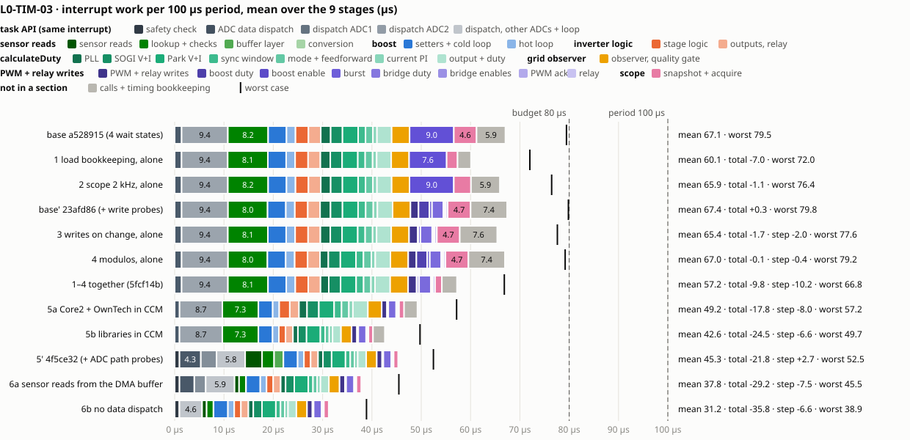
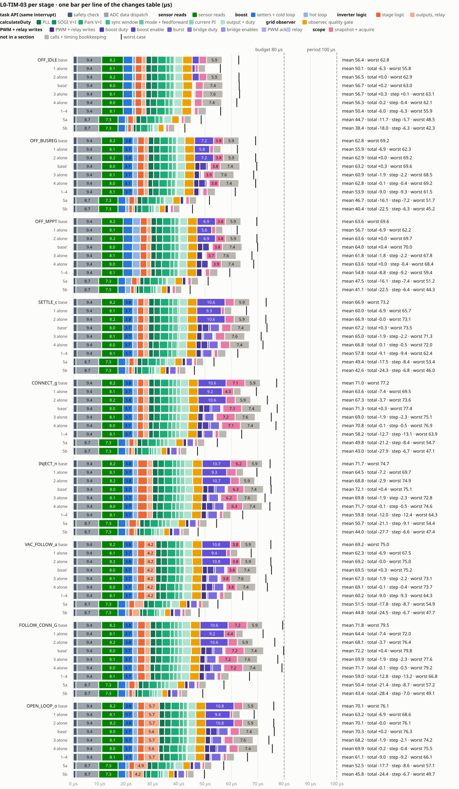

# Critical task timing: optimizations, one change at a time

Tracks the changes that bring the critical task's time down, measured with the on-target timing tests (L0-TIM-01/02/03, [ADR 0005](../adr/0005-on-target-timing-tests.md), [tests/l0/timing/README.md](../../tests/l0/timing/README.md)) on the bare Spin. Each change goes on its own branch from the same base and is measured alone; then all are merged and measured together. Production changes also get a [worklog](worklog.md) entry.

## Method

| Item | Rule |
|---|---|
| Base | `a528915` (4 flash wait states, TIM-01/02/03 at TIM-03's detail), campaign `2026-11-12_6d00a25_150416_YU7So7`; from change 3 on, `23afd86` (same code plus TIMING-only probes inside the writes, +0.34 µs in the TIMING build), campaign `2026-11-12_23afd86_152108_EewYf2` |
| One change at a time | Branch `perf/timing-<n>-<name>` from the base; one TIMING run (`tests/l0/timing/run.sh --run`) |
| Comparison | `python3 tests/l0/timing/compare.py <base campaign> <change campaign> --rows <parts>` |
| Main figure | **Interrupt time per period** (mean, L0-TIM-03): the task API's safety check and ADC data dispatch plus the critical task tick, without the test harness |
| Noise | Two runs of the same code: means within 0.05 µs, worst tick within 0.1 µs, worst gap within about ±5 µs |
| Behaviour | Host L0 campaign: no new failure. The USB firmware builds and has no timing symbol |

## Base (a528915)

| Stage | Interrupt / period (mean) | Task tick worst | Lost |
|---|---|---|---|
| OFF_IDLE | 56.4 µs | 52.0 µs | 0 |
| OFF_BUSREG | 62.8 µs | 58.4 µs | 0 |
| OFF_MPPT | 63.6 µs | 58.9 µs | 0 |
| SETTLE_c | 66.9 µs | 62.4 µs | 0 |
| CONNECT_g | 71.0 µs | 66.4 µs | 0 |
| INJECT_n | 71.7 µs | 63.8 µs | 0 |
| VAC_FOLLOW_a | 69.2 µs | 64.2 µs | 0 |
| FOLLOW_CONN_G | 71.8 µs | 68.7 µs | 0 |
| OPEN_LOOP_o | 70.1 µs | 65.3 µs | 0 |

## Changes

| # | Change | Where | Status |
|---|---|---|---|
| 1 | `load` bookkeeping: cycle counter read directly, raw cycles in the task, µs conversion in the telemetry thread | `src/main.cpp` | Measured alone: **−6.97 µs** (branch `perf/timing-1-bookkeeping`, `527e36d`) |
| 2 | Scope: 10 kHz around the relay only on request (2 kHz by default) | `src/main.cpp` | Measured alone: **−3.7 µs in g and G, −2.9 µs in n**, 0 elsewhere (branch `perf/timing-2-scope`, `c96d94f`) |
| 3 | PWM and relay writes: probe each call, then send the state commands only on change | `src/main.cpp` | Measured alone: **−2.1 to −2.3 µs with the boost running**, 0 in OFF_IDLE (branch `perf/timing-3-writes`, `fb07a70`); bridge duty API: proposal 3b below |
| 4 | Modulos (Jean Alinei's feedback): `fmodf` of θ every tick → conditional subtraction; integer `%` of the sync window → conditional wrap | `single_phase_inverter` fork `ac3dbc6` | Measured alone: **−0.4 to −0.5 µs** in every stage (branch `perf/timing-4-modulo`, `c664d8d`) |
| All | 1–4 together: final verdict | merge `5fcf14b` | **−10.15 µs** mean over the stages (−6.3 to −13.2 µs per stage), every test passes |
| 5 | Hot path executed from CCM SRAM (0 wait states, I-bus): 5a own sources and OwnTech modules, 5b library forks | `spin.dts`, `src/`, `zephyr/modules/`, library forks | 5a **−8.02 µs** (`2b3a893`), 5b **−6.62 µs** more (`6de51b9`); together **−14.64 µs** mean against `5fcf14b`, every test passes (branch `perf/timing-5-ccm`). [Section 5](#5--hot-path-in-ccm-sram) |

Then: the ADC path (data dispatch 9.4 µs + sensor reads 8.2 µs per period), with Jean.

### Recap (L0-TIM-03)

One L0-TIM-03 bar per line of the table: the interrupt's mean work per 100 µs period, split as in the review page (task API, sensor reads, controlStep sections, PWM and relay writes, scope, unprobed rest). The black mark is the worst case.

How to read the right-hand column:
- **total**: the gain against the base `a528915`.
- **step**: the gain against the code the change was measured on.
- **base'** (`23afd86`) is the base plus the TIMING-only write probes (+0.34 µs), against which changes 3 and 4 and the 1–4 merge were measured.
- Bars marked *alone* hold that one change on the base; the others are cumulative.



<details><summary>Per stage</summary>



</details>

To regenerate after a new change, add its line and campaign to [tests/l0/timing/recap.json](../../tests/l0/timing/recap.json), then run `python3 tests/l0/timing/recap.py`. The campaigns are read from `tests/out/`, which is local to this machine, and the SVGs are committed.


## Results

(one section per change, filled as it is measured)

### 1 · Load bookkeeping (`527e36d`, campaign `2026-11-12_527e36d_151613_MrgUHA`)

The task called `k_cycle_get_32()` five times per tick and converted five intervals with `k_cyc_to_us_floor32()` (a 64-bit division). It now reads the cycle counter (`DWT->CYCCNT`, one load, enabled in `setup_routine`) and keeps cycle counts; the telemetry thread divides by 170. Same telemetry fields, same lost-tick rule.

| Stage | Interrupt / period (mean) | Task tick worst | Lost | Writes (mean) | Scope (mean) |
|---|---|---|---|---|---|
| OFF_IDLE | 56.4 → 50.1 (−6.3) | 52.0 → 45.0 | 0 → 0 | 2.57 → 1.18 | 2.86 → 1.16 |
| OFF_BUSREG | 62.8 → 55.9 (−6.9) | 58.4 → 51.5 | 0 → 0 | 7.21 → 5.82 | 3.75 → 1.47 |
| OFF_MPPT | 63.6 → 56.7 (−6.9) | 58.9 → 51.4 | 0 → 0 | 6.95 → 5.59 | 3.77 → 1.47 |
| SETTLE_c | 66.9 → 60.0 (−6.9) | 62.4 → 55.0 | 0 → 0 | 10.65 → 9.29 | 3.47 → 1.15 |
| CONNECT_g | 71.0 → 63.6 (−7.4) | 66.4 → 58.7 | 0 → 0 | 10.59 → 9.24 | 7.13 → 4.30 |
| INJECT_n | 71.7 → 64.5 (−7.2) | 63.8 → 58.9 | 0 → 0 | 10.71 → 9.35 | 6.21 → 3.59 |
| VAC_FOLLOW_a | 69.2 → 62.3 (−6.9) | 64.2 → 56.8 | 0 → 0 | 10.78 → 9.41 | 3.77 → 1.45 |
| FOLLOW_CONN_G | 71.8 → 64.4 (−7.4) | 68.7 → 61.3 | 0 → 0 | 10.60 → 9.24 | 7.19 → 4.36 |
| OPEN_LOOP_o | 70.1 → 63.2 (−6.9) | 65.3 → 57.8 | 0 → 0 | 10.77 → 9.41 | 3.31 → 1.00 |

Each tick part loses about 1.4 µs (its closing `k_cycle_get_32()` and conversion), the sensor reads 0.04 µs; the controlStep sections do not change. More than the 4 µs estimated from the grey segment, because part of the bookkeeping sat inside the measured parts. L0-TIM-01/02/03 all pass; background tasks served.

### 2 · Scope at 2 kHz by default (`c96d94f`, campaign `2026-11-12_c96d94f_151814_LKQXmD`)

`scope_fast_connect` now starts false: the scope samples every 5th tick in every stage; key `v` still switches CONNECT, INJECT and FOLLOW_CONNECT to every tick.

| Stage | Interrupt / period (mean) | Task tick worst | Lost | Scope (mean) |
|---|---|---|---|---|
| CONNECT_g | 71.0 → 67.3 (−3.7) | 66.4 → 62.9 | 0 → 0 | 7.13 → 3.48 |
| INJECT_n | 71.7 → 68.8 (−2.9) | 63.8 → 64.1 | 0 → 0 | 6.21 → 3.30 |
| FOLLOW_CONN_G | 71.8 → 68.1 (−3.7) | 68.7 → 65.7 | 0 → 0 | 7.19 → 3.51 |
| other stages | unchanged (within 0.05 µs) | unchanged | 0 → 0 | unchanged |

The average load drops, not the worst tick: every 5th tick still takes the full scope sample (about 7 µs), and in INJECT that sampled tick is the worst one (64.1 µs). Mean over the 9 stages: −1.13 µs.

### 3 · PWM and relay writes (`fb07a70`, campaign `2026-11-12_fb07a70_152338_MMmrUV`, against `23afd86`)

First the writes were split by call (TIMING-only probes, `23afd86`). Mean per tick in CONNECT `g`:

| Call | µs | Every tick needed? |
|---|---|---|
| Boost duty `setDutyCycle(LEG1_LOW)` | 1.82 | yes (value changes) |
| Boost enable `start(LEG1_LOW)` | 2.48 | no: the leg was already on |
| Burst `setBurstMode` | 0.61 | only when skip/period change |
| Bridge duty `setInverterDutyCycle` | 3.38–3.50 | yes (value changes); the cost is the API's validation |
| Bridge enables | 0.15 | already on change |
| PWM acknowledgement | 0.34 | — |
| Relay | 0.37–0.40 | already on change |

Change: boost leg 1 `start`/`stop` and `setBurstMode` are sent when the command changes. **Behaviour change:** a stop from the safety API (`safety_action()` stops ALL legs) is no longer undone by the next tick for boost leg 1; it holds until the next mode change, as it already did for the bridge.

| Stage | Interrupt / period (mean) | Task tick worst | Lost | Boost enable (mean) | Writes (mean) |
|---|---|---|---|---|---|
| OFF_IDLE | 56.7 → 56.7 (+0.1) | 52.1 → 52.3 | 0 → 0 | 0.02 → 0.02 | 2.76 → 2.85 |
| OFF_BUSREG | 63.2 → 60.9 (−2.2) | 58.8 → 57.7 | 0 → 0 | 2.48 → 0.14 | 7.44 → 5.27 |
| OFF_MPPT | 64.0 → 61.8 (−2.2) | 59.2 → 57.0 | 0 → 0 | 2.48 → 0.14 | 7.26 → 5.22 |
| SETTLE_c | 67.2 → 65.0 (−2.2) | 62.7 → 60.5 | 0 → 0 | 2.48 → 0.14 | 10.83 → 8.73 |
| CONNECT_g | 71.3 → 69.0 (−2.3) | 66.6 → 64.3 | 0 → 0 | 2.48 → 0.14 | 10.81 → 8.64 |
| INJECT_n | 72.1 → 69.8 (−2.3) | 64.2 → 61.9 | 0 → 0 | 2.48 → 0.14 | 10.93 → 8.76 |
| VAC_FOLLOW_a | 69.5 → 67.3 (−2.2) | 64.4 → 62.3 | 0 → 0 | 2.48 → 0.14 | 10.95 → 8.84 |
| FOLLOW_CONN_G | 72.2 → 69.9 (−2.3) | 69.0 → 66.8 | 0 → 0 | 2.48 → 0.14 | 10.81 → 8.65 |
| OPEN_LOOP_o | 70.3 → 68.2 (−2.1) | 65.4 → 63.4 | 0 → 0 | 2.49 → 0.14 | 10.97 → 8.85 |

On the bench the boost is idle, so this change shows only when the boost runs. The burst check saves 0.13 µs (`setBurstMode` was cheap).

**Proposal 3b (not done, shield API):** `setInverterDutyCycle()` re-validates the whole pair on every call (periods, prescalers, frequencies, modulation, mode, phase shifts, switch conventions) and recomputes the duty limits before two register writes. Caching the validated pair and its raw limits when the configuration changes (`initInverter`, duty min/max, frequency, convention) would leave clamp, convert and write: most of 3.4 µs per tick in every bridge stage. It changes the OwnTech shield API (cache invalidation), so it needs Jean's and Clément's agreement.

### 4 · Modulos (library `ac3dbc6`, Core2 `c664d8d`, campaign `2026-11-12_c664d8d_152708_cxhv2o`, against `23afd86`)

Audit of the critical path: the inverter library wrapped θ with `fmodf` every tick and indexed the sync window with two integer `%` per tick; the relay-timing `fmodf` in `control_step.cpp` runs only while waiting for the zero crossing; the scope and the data dispatch use integer `%` per sample. Change in the library fork: θ wraps with one conditional step (`fmodf` kept as a fallback if θ is still out of range, never in normal operation); the window position and the leaving sample's index wrap with a comparison. Host L0-GFL unchanged (52 pass).

| Stage | Interrupt / period (mean) | Task tick worst | Lost | PLL section (mean) | Sync window (mean) |
|---|---|---|---|---|---|
| OFF_IDLE | 56.7 → 56.3 (−0.4) | 52.1 → 51.2 | 0 → 0 | 2.12 → 1.71 | 1.54 → 1.52 |
| CONNECT_g | 71.3 → 70.8 (−0.5) | 66.6 → 66.1 | 0 → 0 | 2.11 → 1.70 | 1.54 → 1.52 |
| FOLLOW_CONN_G | 72.2 → 71.7 (−0.5) | 69.0 → 68.4 | 0 → 0 | 2.11 → 1.70 | 1.54 → 1.52 |
| other stages | −0.4 to −0.5 | −0.4 to −1.6 | 0 → 0 | −0.41 | −0.02 |

The float modulo is worth replacing (0.41 µs); the integer ones are not worth much (0.02 µs: the M4 divides in hardware).

### All four together (`5fcf14b`, campaign `2026-11-12_5fcf14b_153135_NtCZxW`, against `23afd86`)

| Stage | Interrupt / period (mean) | Task tick worst | Gap worst | Lost | Writes (mean) | Scope (mean) |
|---|---|---|---|---|---|---|
| OFF_IDLE | 56.7 → 50.4 (−6.3) | 52.1 → 45.1 | 117.6 → 121.1 | 0 → 0 | 2.76 → 1.44 | 2.91 → 1.32 |
| OFF_BUSREG | 63.2 → 53.9 (−9.3) | 58.8 → 50.7 | 111.6 → 111.5 | 0 → 0 | 7.44 → 3.71 | 3.82 → 1.61 |
| OFF_MPPT | 64.0 → 54.8 (−9.2) | 59.2 → 48.6 | 111.7 → 110.0 | 0 → 0 | 7.26 → 3.66 | 3.84 → 1.61 |
| SETTLE_c | 67.2 → 57.8 (−9.4) | 62.7 → 51.6 | 113.6 → 112.7 | 0 → 0 | 10.83 → 7.14 | 3.52 → 1.27 |
| CONNECT_g | 71.3 → 58.2 (−13.1) | 66.6 → 53.1 | 120.6 → 111.9 | 0 → 0 | 10.81 → 7.11 | 7.13 → 1.31 |
| INJECT_n | 72.1 → 59.8 (−12.4) | 64.2 → 53.5 | 115.6 → 116.3 | 0 → 0 | 10.93 → 7.23 | 6.26 → 1.19 |
| VAC_FOLLOW_a | 69.5 → 60.2 (−9.3) | 64.4 → 53.5 | 115.6 → 113.5 | 0 → 0 | 10.95 → 7.26 | 3.81 → 1.58 |
| FOLLOW_CONN_G | 72.2 → 59.0 (−13.2) | 69.0 → 56.1 | 114.5 → 112.4 | 0 → 0 | 10.81 → 7.11 | 7.22 → 1.34 |
| OPEN_LOOP_o | 70.3 → 61.1 (−9.2) | 65.4 → 55.3 | 117.5 → 121.3 | 0 → 0 | 10.97 → 7.27 | 3.37 → 1.12 |

**Verdict.** The four gains add up: alone they sum to about −10.5 µs on average, together −10.15 µs (changes 1 and 2 both shorten the scope part, so they overlap a little). The worst task tick is 45.1–56.1 µs (budget 80 µs: 24 µs of margin in the worst stage, G). With the task API's mean 10.8 µs in the same interrupt, the interrupt's worst is about 56–67 µs per period, so the 80 µs budget holds even if it is read as the whole interrupt. No period lost, background tasks served (telemetry every 102 ms). Against the code before any change (`a528915`, without the write probes): −9.82 µs.

| Change | Alone (mean over stages) | Where it shows |
|---|---|---|
| 1 Load bookkeeping | −6.97 µs | every stage |
| 2 Scope 2 kHz by default | −1.13 µs | g, n, G (−2.9 to −3.7 µs); mean only, not the worst tick |
| 3 Boost start / burst on change | −1.99 µs | stages with the boost running (−2.2 µs); 0 on the bench (boost idle) |
| 4 Modulos | −0.44 µs | every stage |
| **All** | **−10.15 µs** | |

**Next, by size:** the ADC path (task API data dispatch 9.4 µs + sensor reads 8.1 µs per period), with Jean; proposal 3b (bridge duty API, about 3 µs in every bridge stage), with Jean and Clément; change 5 done (hot path in CCM SRAM, −14.64 µs); left in flash: CMSIS `arm_sin_f32`/`arm_cos_f32` and their table (Park section), `ScopeMimicry::acquire` (upstream library).

### 5 · Hot path in CCM SRAM

Investigation from the USB ELF and link map at `5fcf14b` and the Zephyr 4.0 tree in PlatformIO; result of 5a at the end of the section.

**Why.** The flash wait states 8 → 4 shortened every part of the tick by about 38 %: the tick is still bound by flash fetches. The ART cache holds 1 KB of instructions; the per-tick path is about 18 KB of mostly straight-line code, so it misses on every tick. A linear extrapolation of the 8 WS and 4 WS figures to 0 WS gives `controlStep` about 11 µs instead of 32 µs and `calculateDuty` about 6 µs instead of 16 µs. This is a ceiling, not an estimate: peripheral register accesses and constants left in flash do not speed up.

**Where.** CCM SRAM (32 KB) is the only memory that fetches code on the I-bus with 0 wait states.

| Memory | Bus | Code execution |
|---|---|---|
| Flash, 4 WS + ART (1 KB I-cache) | I-bus | today |
| SRAM1/SRAM2 at `0x20000000` | S-bus, shared with data | 0 WS, fetches compete with data accesses |
| **CCM SRAM at `0x10000000`** | **I-bus / D-bus** | **0 WS, data stays on the S-bus** |

- `sram0` in [spin.dts](../../zephyr/boards/owntech/spin/spin.dts) is `0x20000000`, 128 KB − 1: it already contains the CCM through its S-bus alias (`0x20018000`–`0x2001FFFF`). Static RAM ends at `0x20009B00` (about 39 KB), so nothing lives in the CCM today and taking 32 KB away costs nothing.
- The retained boot-mode byte that MCUboot reads is at `0x2001FFFF`, the last byte of the CCM. It must not move: the code area stops below it (`0x10000000`, 31 KB).

**How RAM functions are made in this Zephyr.**

| Mechanism | What it does | Verdict |
|---|---|---|
| `__ramfunc` | Section `.ramfunc`, copied at boot (`kernel/xip.c`), MPU region opened for it | Lands in `sram0` (S-bus): the slow RAM path |
| `zephyr_code_relocate(FILES … LOCATION <region>_TEXT)` + `CONFIG_CODE_DATA_RELOCATION` | Moves whole source files | Sees only CMake sources: the `lib_deps` are built by PlatformIO into separate `.a`; moves init code too |
| **CCM declared as `zephyr,itcm`** | The Cortex-M linker script places `.itcm` / `.itcm.*` in region `ITCM`, loaded from flash; `z_data_copy` copies it at boot; tag `__itcm_section` (`zephyr/linker/section_tags.h`) | **Chosen.** Zephyr's Apollo3 boards declare their `0x10000000` TCM the same way |

```dts
/ {
	chosen { zephyr,itcm = &ccm_code; };
	ccm_code: memory@10000000 {
		compatible = "zephyr,memory-region";
		reg = <0x10000000 0x7C00>;      /* below the retained byte */
		zephyr,memory-region = "ITCM";
	};
};
&sram0 { reg = <0x20000000 0x18000>; }; /* SRAM1 + SRAM2, 96 KB */
```

Functions are tagged one by one: `__itcm_section` in Core2 and the OwnTech modules; in the library forks a macro (`OT_FAST_CODE`) that is empty on the host and `__attribute__((section(".itcm.<name>")))` on target. Tagging at the source is required: Zephyr's `.text` output section comes first in the linker script and would claim the library code otherwise.

**What to move** (static call graph from the HRTIM interrupt, init and background paths removed):

| Group | Functions | Code | Time per tick (measured) |
|---|---|---|---|
| Inverter library | `calculateDuty`, `updateSyncWindow`, `updateMode`, `getSync`, `synchronizationAligned` | ~3.7 KB | ~16 µs |
| Application | `controlStep`, `GridObserver::update/updateEstimates`, `BoostConverter::hotLoop/Mppt/runLeg1/…` | ~4 KB | rest of controlStep |
| Critical tick | `loop_critical_task` (tick body and scope sample inlined), `ScopeMimicry::acquire` | ~1.8 KB | bookkeeping + scope |
| ADC path | `data_dispatch_do_dispatch`, `data_dispatch_get_acquired_values`, `DataAPI::getChannelLatest`, `data_conversion_convert_raw_value`, `SensorsAPI::getLatestValue` | ~1 KB | 9.4 + 8.1 µs |
| PWM writes | `PowerAPI::setDutyCycle/setInverterDutyCycle/start`, `hrtim_duty_cycle_*`, `hrtim_output_hot_swap` | ~1.3 KB | ~7 µs |
| control_library | `Pid::calculate`, `Sogi::calc`, `Transform::rotation_*`, `ot_sin/ot_cos` | ~0.7 KB | inside the above |
| Interrupt entry | `_hrtim_callback`, `user_task_proxy`, `safety_watch` | ~0.6 KB | ~2 µs |

Total 16–18 KB: it fits in 31 KB. Init, telemetry, console, USB, logging, NVS and the kernel stay in flash.

**Points to check.**

| Point | Detail |
|---|---|
| Veneers | Flash and CCM are 128 MB apart, beyond the ±16 MB reach of `BL`: the linker adds a long-branch stub per crossing call. Move whole call chains; look for `*_veneer` in the map |
| newlib / CMSIS | `hypotf`, `sinf`, `arm_sin_f32` and its 2 KB `sinTable_f32` cannot be tagged at the source; small, left in flash for now |
| MPU | On (`CONFIG_ARM_MPU`). `0x10000000` is outside Zephyr's static FLASH and SRAM regions, so the background map applies: executable for privileged code (no userspace). Confirm on target |
| Stray writes | Code in RAM can be overwritten; `SYSCFG_SWPR` can write-protect the CCM pages after boot |
| ADC conversion | `data_conversion_convert_raw_value` can call the double `log` (thermistor type); check that no per-tick channel uses it |
| Host L0 | The tag macros expand to nothing on the host: no change to the L0 builds |

**Plan.** Branch `perf/timing-5-ccm` from `5fcf14b`, measured with L0-TIM-01/02/03 as changes 1–4:
- **5a:** device tree, plus tags on Core2 and the OwnTech modules. Proves the method, the boot copy and the MPU behaviour.
- **5b:** tags in the single_phase_inverter and control_library forks.

#### 5a · Core2 and OwnTech modules (`2b3a893`, campaign `2026-11-12_2b3a893_162602_cYRLm5`, against `5fcf14b`)

What was done:
- **Device tree** ([spin.dts](../../zephyr/boards/owntech/spin/spin.dts)): `ccm_code` at `0x10000000`, 31 KB, chosen `zephyr,itcm`; `sram0` reduced to 96 KB.
- **Tag macros:** `OWNTECH_FAST_CODE` ([owntech_fast_code.h](../../zephyr/modules/owntech_spin_api/zephyr/public_api/owntech_fast_code.h), empty without the chosen node) and `FAST_CODE` ([src/fast_code.h](../../src/fast_code.h), empty on the host).
- **Tagged:** `loop_critical_task` (tick body inlined), `scopeSample`, `scope_trigger`, `controlStep`, `GridObserver::update/updateEstimates`, the boost per-tick functions; in the OwnTech modules, `_hrtim_callback`, `user_task_proxy`, `safety_task/safety_watch`, the data dispatch and conversion, `DataAPI` and `SensorsAPI` reads, `dma_get_retrieved_data_count`, `PowerAPI`/`PwmHAL` duty, start/stop and burst, the `hrtim_*` they call, `GpioHAL::setPin/resetPin`.

Link: ITCM 11.2 KB of 31 KB, RAM 39.7 KB of 96 KB. 58 veneers, almost all calls into the library forks (5b) and newlib (`fmodf`, `hypotf`, `sinf`, `fminf/fmaxf`, `memset`). On target the boot copy and the execution from `0x10000000` work without an MPU change (L0-TIM-03 ran to its end, no fault). Two runs (`d9cfc91-dirty`, `2b3a893`) agree within 0.1 µs.

| Stage | Interrupt / period (mean) | Task tick worst | Gap worst | Lost | Sensors | Control | Apply | Scope | Dispatch | Safety | inv_duty (flash) | Observer |
|---|---|---|---|---|---|---|---|---|---|---|---|---|
| OFF_IDLE | 50.4 → 44.7 (−5.7) | 45.1 → 38.8 | 121.1 → 117.3 | 0 → 0 | 8.13 → 7.31 | 27.76 → 24.70 | 1.44 → 1.06 | 1.32 → 0.99 | 9.39 → 8.68 | 1.42 → 1.00 | 14.54 → 14.40 | 3.62 → 2.79 |
| OFF_BUSREG | 53.9 → 46.7 (−7.2) | 50.7 → 42.0 | 111.5 → 111.0 | 0 → 0 | 8.12 → 7.30 | 28.66 → 25.17 | 3.71 → 2.35 | 1.61 → 1.23 | 9.39 → 8.68 | 1.40 → 0.98 | 14.53 → 14.37 | 3.62 → 2.79 |
| OFF_MPPT | 54.8 → 47.5 (−7.4) | 48.6 → 41.5 | 110.0 → 106.6 | 0 → 0 | 8.12 → 7.31 | 29.66 → 25.98 | 3.66 → 2.29 | 1.61 → 1.23 | 9.39 → 8.68 | 1.40 → 0.98 | 14.49 → 14.18 | 3.62 → 2.79 |
| SETTLE_c | 57.8 → 49.4 (−8.4) | 51.6 → 43.7 | 112.7 → 113.6 | 0 → 0 | 8.12 → 7.30 | 29.53 → 25.89 | 7.14 → 4.63 | 1.27 → 0.93 | 9.39 → 8.68 | 1.40 → 0.98 | 15.24 → 15.08 | 3.62 → 2.79 |
| CONNECT_g | 58.2 → 49.8 (−8.4) | 53.1 → 45.0 | 111.9 → 117.5 | 0 → 0 | 8.13 → 7.30 | 29.92 → 26.26 | 7.11 → 4.62 | 1.31 → 0.94 | 9.39 → 8.68 | 1.41 → 0.99 | 15.63 → 15.46 | 3.62 → 2.79 |
| INJECT_n | 59.8 → 50.7 (−9.1) | 53.5 → 44.7 | 116.3 → 116.0 | 0 → 0 | 8.13 → 7.31 | 31.44 → 27.15 | 7.23 → 4.69 | 1.19 → 0.85 | 9.38 → 8.68 | 1.43 → 1.01 | 15.76 → 15.42 | 3.62 → 2.79 |
| VAC_FOLLOW_a | 60.2 → 51.5 (−8.7) | 53.5 → 45.2 | 113.5 → 112.3 | 0 → 0 | 8.12 → 7.31 | 31.49 → 27.60 | 7.26 → 4.71 | 1.58 → 1.23 | 9.39 → 8.68 | 1.40 → 0.98 | 14.53 → 14.37 | 3.62 → 2.79 |
| FOLLOW_CONN_G | 59.0 → 50.4 (−8.7) | 56.1 → 47.5 | 112.4 → 112.0 | 0 → 0 | 8.12 → 7.31 | 30.70 → 26.84 | 7.11 → 4.62 | 1.34 → 0.96 | 9.39 → 8.68 | 1.40 → 0.98 | 15.80 → 15.64 | 3.62 → 2.79 |
| OPEN_LOOP_o | 61.1 → 52.5 (−8.6) | 55.3 → 47.4 | 121.3 → 115.3 | 0 → 0 | 8.13 → 7.31 | 32.79 → 28.92 | 7.27 → 4.71 | 1.12 → 0.87 | 9.38 → 8.68 | 1.44 → 1.02 | 14.53 → 14.37 | 3.62 → 2.79 |

Parts in µs (mean, L0-TIM-03): tick sensors, control (controlStep), apply (PWM and relay), scope; task API dispatch and safety; `calculateDuty` (`inv_duty`, still in flash); grid observer.

**Reading.**
- The moved code gains about 25–35 % per part: PWM writes −2.5 µs with the bridge on, controlStep's own code −3 to −4 µs, observer −0.8 µs, safety −0.4 µs.
- `inv_duty` does not move (14.4–15.6 µs): it is the largest part left, and it is 5b.
- The ADC path gains least (sensors −0.8 µs, dispatch −0.7 µs): its time is mostly peripheral and memory accesses, not instruction fetches. A cheaper path there is still Jean's topic.
- Worst task tick 38.8–47.5 µs (budget 80 µs). L0-TIM-01/02/03 pass. Host L0: 125 pass, 7 known, 0 new (campaign `2026-11-12_2b3a893_162801_p1MFbA`). The USB ELF builds and has no timing symbol.

#### 5b · Library forks (`6de51b9`, campaign `2026-11-12_6de51b9_164042_B0kRJZ`, against `2b3a893`)

What was done:
- **single_phase_inverter** `5662004` (branch `fix/sync-period-average`): `INV_FAST_CODE` (`inverterFastCode.h`) on `calculateDuty`, `updateSyncWindow`, `updateMode`, `synchronizationAligned`, `Sogi::calc` and the getters and setters called every period. The fault and init paths stay in flash.
- **control_library** `d1449a4` (new branch `perf/fast-code`, so `PID_update` is untouched): `CTL_FAST_CODE` (`ctlFastCode.h`) on `Pid::calculate`, `Pid::setKp`, `Transform::rotation_to_dqo/rotation_to_clarke`, `ot_sin/ot_cos`.
- **Macros:** both are empty unless the Core provides `owntech_fast_code.h` (`__has_include`), so the libraries still build on an older Core and on the host.
- **Pins:** Core2 now pins both libraries by commit hash (`app.ini`, `tests/l1/dependencies.lock.json`). Before, control_library followed its branch.

Link: ITCM 16.5 KB of 31 KB (43 library functions added). Still in flash: CMSIS `arm_sin_f32`/`arm_cos_f32` and their 2 KB table, `lroundf`, `ScopeMimicry::acquire` (upstream scopemimicry, not a fork).

| Stage | Interrupt / period (mean) | Task tick worst | Lost | Control | inv_duty | PLL | SOGI | Park | Output | Observer |
|---|---|---|---|---|---|---|---|---|---|---|
| OFF_IDLE | 44.7 → 38.4 (−6.3) | 38.8 → 32.7 | 0 → 0 | 24.70 → 18.63 | 14.40 → 10.04 | 1.68 → 1.01 | 2.41 → 1.75 | 3.10 → 2.81 | 3.02 → 1.70 | 2.79 → 2.15 |
| OFF_BUSREG | 46.7 → 40.4 (−6.3) | 42.0 → 35.6 | 0 → 0 | 25.17 → 19.10 | 14.37 → 10.03 | 1.66 → 1.00 | 2.41 → 1.75 | 3.10 → 2.81 | 3.03 → 1.70 | 2.79 → 2.15 |
| OFF_MPPT | 47.5 → 41.1 (−6.4) | 41.5 → 34.7 | 0 → 0 | 25.98 → 19.83 | 14.18 → 10.07 | 1.47 → 0.98 | 2.40 → 1.75 | 3.10 → 2.81 | 3.02 → 1.70 | 2.79 → 2.15 |
| SETTLE_c | 49.4 → 42.6 (−6.8) | 43.7 → 36.3 | 0 → 0 | 25.89 → 19.38 | 15.08 → 10.31 | 1.66 → 1.00 | 2.41 → 1.75 | 3.10 → 2.81 | 2.99 → 1.70 | 2.79 → 2.15 |
| CONNECT_g | 49.8 → 43.0 (−6.8) | 45.0 → 37.5 | 0 → 0 | 26.26 → 19.77 | 15.46 → 10.69 | 1.66 → 1.00 | 2.41 → 1.75 | 3.10 → 2.81 | 3.01 → 1.70 | 2.79 → 2.15 |
| INJECT_n | 50.7 → 44.0 (−6.6) | 44.7 → 37.6 | 0 → 0 | 27.15 → 20.75 | 15.42 → 10.75 | 1.66 → 1.00 | 2.23 → 1.75 | 3.10 → 2.81 | 3.00 → 1.70 | 2.79 → 2.15 |
| VAC_FOLLOW_a | 51.5 → 44.8 (−6.7) | 45.2 → 38.0 | 0 → 0 | 27.60 → 21.13 | 14.37 → 10.03 | 1.66 → 1.00 | 2.41 → 1.75 | 3.10 → 2.81 | 3.03 → 1.70 | 2.79 → 2.15 |
| FOLLOW_CONN_G | 50.4 → 43.4 (−7.0) | 47.5 → 39.5 | 0 → 0 | 26.84 → 20.09 | 15.64 → 10.80 | 1.65 → 1.00 | 2.40 → 1.75 | 3.10 → 2.81 | 3.19 → 1.81 | 2.79 → 2.15 |
| OPEN_LOOP_o | 52.5 → 45.8 (−6.7) | 47.4 → 40.1 | 0 → 0 | 28.92 → 22.47 | 14.37 → 10.03 | 1.66 → 1.00 | 2.41 → 1.75 | 3.10 → 2.81 | 3.02 → 1.70 | 2.79 → 2.15 |

Parts in µs (mean, L0-TIM-03): controlStep, `calculateDuty` and its sections, grid observer (its PI and filters come from control_library).

**Reading.**
- `calculateDuty` loses about 30 % (−4.4 to −4.8 µs).
- Park gains only 0.3 µs: its rotations still call `arm_sin_f32`/`arm_cos_f32`, which stay in flash with their table. Computing sine and cosine once per tick (lead of 2026-11-12), or moving CMSIS into RAM, is what is left there.
- The run with the libraries edited locally and the run with the pushed, pinned commits agree to 0.00 µs.

#### 5 · Verdict (5a + 5b, `6de51b9`, against `5fcf14b`)

| Stage | Interrupt / period (mean) | Task tick worst | Gap worst | Lost |
|---|---|---|---|---|
| OFF_IDLE | 50.4 → 38.4 (−12.0) | 45.1 → 32.7 | 121.1 → 118.1 | 0 → 0 |
| OFF_BUSREG | 53.9 → 40.4 (−13.5) | 50.7 → 35.6 | 111.5 → 113.4 | 0 → 0 |
| OFF_MPPT | 54.8 → 41.1 (−13.7) | 48.6 → 34.7 | 110.0 → 109.7 | 0 → 0 |
| SETTLE_c | 57.8 → 42.6 (−15.2) | 51.6 → 36.3 | 112.7 → 112.1 | 0 → 0 |
| CONNECT_g | 58.2 → 43.0 (−15.2) | 53.1 → 37.5 | 111.9 → 116.5 | 0 → 0 |
| INJECT_n | 59.8 → 44.0 (−15.7) | 53.5 → 37.7 | 116.3 → 117.7 | 0 → 0 |
| VAC_FOLLOW_a | 60.2 → 44.8 (−15.4) | 53.5 → 38.0 | 113.5 → 112.8 | 0 → 0 |
| FOLLOW_CONN_G | 59.0 → 43.4 (−15.7) | 56.1 → 39.5 | 112.4 → 111.3 | 0 → 0 |
| OPEN_LOOP_o | 61.1 → 45.8 (−15.3) | 55.3 → 40.1 | 121.3 → 123.3 | 0 → 0 |

**Verdict.**
- **−14.64 µs** mean interrupt time per period, more than optimizations 1–4 together (−10.15 µs).
- The interrupt now takes 38–46 % of the period. The worst task tick is 32.7–40.1 µs: 40 µs of margin against the 80 µs budget.
- L0-TIM-01/02/03 pass, with no lost period and the background tasks served. Host L0: 125 pass, 7 known, 0 new (campaign `2026-11-12_6de51b9_164326_JtuLVr`).
- Baseline rewritten from `6de51b9` (campaign `2026-11-12_6de51b9-dirty_164438_apsFEg`; dirty only through the `baseline.json` that run wrote).
- Against the 8-wait-state code of the start of the day: L0-TIM-02 whole tick in OFF_IDLE, mean 71.0 µs then, 28.6 µs now (worst 80.3 → 32.3 µs).

| Change | Alone (mean over stages) | Where it shows |
|---|---|---|
| 5a Core2 and OwnTech modules in CCM | −8.02 µs | every part moved (writes −2.5 µs with the bridge on, controlStep −3 to −4 µs) |
| 5b Library forks in CCM | −6.62 µs | `calculateDuty` −4.4 to −4.8 µs, observer −0.6 µs |
| **5** | **−14.64 µs** | |

