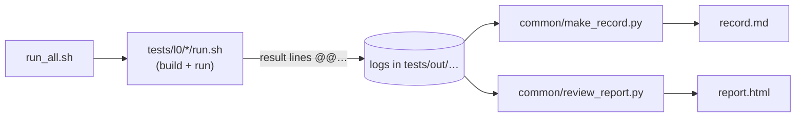

# Tests

Host tests of the uSolarVerter firmware. They implement the [test procedure](../docs/testing/test-procedure.md); terms are defined in the [glossary](../GLOSSARY.md).

## Run

```bash
tests/run_all.sh          # every level
tests/run_all.sh --l0     # L0 only, a few seconds
tests/run_all.sh --l1     # L1 only
tests/run_all.sh --l0 --target   # also the on-target timing tests (reflashes the Spin over an ST-Link)
tests/run_all.sh --help
```

The script prints one line per criterion, writes the test record to `tests/out/<campaign>/record.md` with one log per test script, then the review page `report.html` (open this one; [procedure §8.5](../docs/testing/test-procedure.md#85-reviewing-a-campaign)), and exits non-zero if any criterion is `FAIL`. `tests/out/` is not versioned: a record is regenerated from its commit.



Failures already tracked in the procedure's [findings register](../docs/testing/test-procedure.md#11-findings-register) are marked *known* in the record; only **new** failures need an issue. To test a library fix before it is merged:

```bash
SINGLE_PHASE_INVERTER_DIR=~/code/single_phase_inverter tests/run_all.sh --l0
```

## Requirements

| Item | Needed for |
|---|---|
| `g++` with C++17 and UBSan | L0 |
| `python3` ≥ 3.10 (standard library only) | Writing the record |
| A PlatformIO build of the USB environment, once | Fetches `control_library` and `single_phase_inverter` into `owntech/lib/USB/` |
| ST-Link, powered Spin with MCUboot, PlatformIO's OpenOCD: run `tests/l0/timing/preflight.sh` | L0-TIM only ([l0/timing/README.md](l0/timing/README.md)) |
| Pulsim (`pulsim==2.0.0`) and GUI (`pulsimgui==1.1.1`) in `.venv` | L1 integration; see `tests/l1/setup.sh` |

## Layout

| Path | Content |
|---|---|
| [`run_all.sh`](run_all.sh) | Campaign runner |
| [`common/`](common/README.md) | Shared check helper, build helper, hardware stand-ins, record writer |
| [`l0/boost/`](l0/boost/README.md) | L0-BST: boost converter controller |
| [`l0/grid_observer/`](l0/grid_observer/README.md) | L0-GOB: grid observer |
| [`l0/inverter_following/`](l0/inverter_following/README.md) | L0-GFL: grid-following inverter library |
| [`l0/timing/`](l0/timing/README.md) | L0-TIM: cycle cost on the Spin (on target, `--target` only; requirements and `preflight.sh` there) |
| [`l1/`](l1/README.md) | Native Core C-Block integration checks; formal L1 cases explicitly BLOCKED where prerequisites remain |
| `catalogue.json` | Every test, defined once: procedure §6 and the control center are generated from it |
| `out/` | Generated test records (git-ignored); `out/control-center.html` shows where the validation stands |

## Adding a test

1. Add the test case to [`catalogue.json`](catalogue.json) (its tab, criterion, conditions, source, status), then run `python3 tests/common/catalogue.py --procedure` to regenerate procedure §6. Never edit §6 by hand.
2. Write it in the matching folder, one `tc::Criterion` per criterion ID (see [common/README.md](common/README.md)).
3. Follow the documentation rules in procedure §7.3: README, license header, Doxygen comments, `@test` tag.
4. A new test folder needs `run.sh` and `README.md`; `run_all.sh` picks it up automatically. Add its object code to `object_code()` in `run_all.sh`.

Repeated campaigns now receive unique timestamped folders so earlier evidence is
not overwritten. L1 records stamp the imported plant, contract/profile and exact
source/dependency hashes. Production control source is unchanged.
