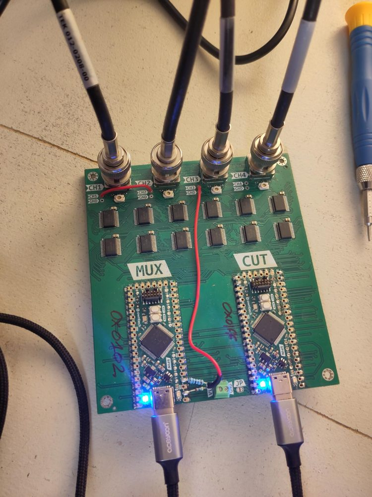
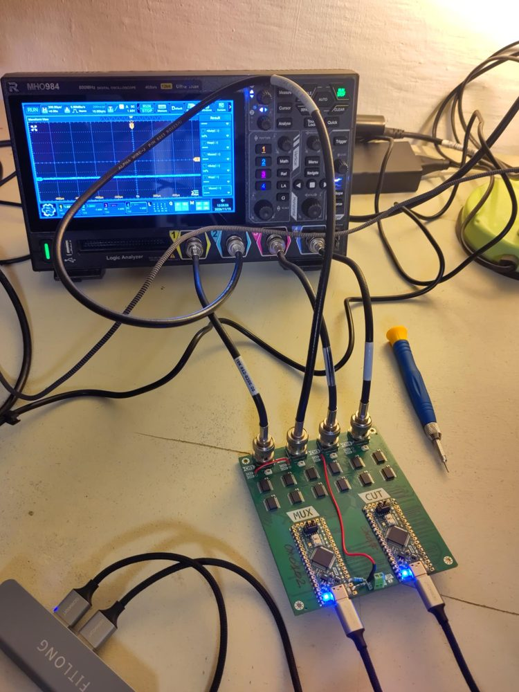

# L0-CAL · SPOC bench calibration

Checks the SPOC bench before any L0 safety case is judged on it (ADR 0009, issue luizvilla/Core#26), and records the four channels' gain and skew for the campaign (`calibration.json` in the test-case folder).

```bash
bash tests/common/spoc_preflight.sh                       # CUT, MUX and scope answer
.venv/bin/python tests/l0/spoc_cal/trim.py                # compensation of each channel, routed alone
.venv/bin/python tests/l0/spoc_cal/trim.py --live --ch 3  # live reading while turning CH3's trimmer
bash tests/l0/spoc_cal/run.sh --run                       # the calibration, as a campaign of its own
```

## Bench

| Item | Setting |
|---|---|
| CUT Spin | the safety test firmware (`/Cal`, TIM1) or Core-CUT (SPOC_Software `Core-CUT`, USB 2fe3:01ff); drives PA8 (Spin pin 12) at 1 kHz, 0.5 |
| MUX Spin | Core-MUX with the injector (SPOC_Software `mux-injector`, `b500a4e`), USB 2fe3:0100 |
| Scope | Rigol MHO984 on USB, ×10 probe setting on all four channels (9 MΩ divider into 1 MΩ) |
| Cables | **30 cm BNC.** With 1 m cables the scope's own FREQuency and PDUTy missed edges |
| Injection wiring | TP1–TP3 (self-injection); MUX Spin pins 2 and 4 to TP5 through their resistors |



*The SPOC board (2026-11-19).* Top: BNC1–BNC4 to the scope's CH1–CH4, each with its trimmer below it and its signal/ground test points beside it (TP1/TP2 marked CH1/GND, and so on). Short red wire: TP1 to TP3 (wire 1, self-injection). Long red wire: TP5 (CH3's signal test point) down to the two resistors on MUX Spin pins 2 (PB12, DAC level) and 4 (PB13, GPIO step) (wires 2 and 3). Bottom left: MUX Spin; bottom right: CUT Spin; each on its own USB cable. The "0x0102" written on the MUX Spin is the product ID of the firmware first found on it; Core-MUX from the branch reports 0x0100.



*The bench.* MHO984 CH1–CH4 to SPOC BNC1–BNC4. Use 30 cm BNC cables (CH2 here is longer and still passes L0-CAL).

While TP1 and TP3 are wired, SPOC CH1 and CH2 share one node: routing either shows the signal on both scope channels. **Never route two different CUT outputs to CH1 and CH2 while the wire is in** (it would short them), except the intended self-injection source and target.

Keep both Spins powered together: a CUT output routed to CH3 while the MUX Spin is off could back-feed its injector pins through TP5 (ADR 0009).

`MuxController.route()` disables every other route first; use `route_pair()` for two channels at once.

## Criteria

| ID | What | Limit |
|---|---|---|
| L0-CAL-01 | CUT, MUX and scope answer | — |
| L0-CAL-02.a–d | divider compensation per channel, routed alone (Core4 `compensation_pct`, from the waveform) | 95–105 % |
| L0-CAL-03.a–d | scope FREQuency, median and spread of 5 | 1000 Hz ±0.1 %, spread ≤ 0.1 % |
| L0-CAL-04.a–d | scope PDUTy, median and spread of 5 | 0.5 ±0.005, spread ≤ 0.005 |
| L0-CAL-05.a–d | VTOP − VBASe, level spreads | 3.3 V ±5 %, ≤ 50 mV |
| L0-CAL-06.a–d | gain against CH1 | INFO, recorded |
| L0-CAL-07/08.b–d | skew CH1 → CHn, rising / falling: 50 % crossings from 5 single captures at 20 ns/div | INFO, recorded |

The skew comes from the waveforms because the scope's RRDelay read invalid and FFDelay a constant −0.2 ns on this bench. Samples are 1 ns apart (1 GSa/s): sub-nanosecond skews are interpolated. Absolute gain against a reference instrument is not covered.

History and findings: [docs/safety/spoc_bench.md](../../../docs/safety/spoc_bench.md).
