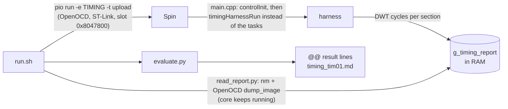

# L0-TIM: on-target timing tests

Cycle cost of the control code **on the Spin**, so that a change that saturates the 100 µs critical task is caught before the bench. Decision and limits: [ADR 0005](../../../docs/adr/0005-on-target-timing-tests.md). Criteria: procedure §6, tab Timing.

Unlike the other L0 folders, these tests **reflash the board**. They run only when asked:

```bash
bash tests/l0/timing/preflight.sh            # check everything below; --install fixes what it can
bash tests/l0/timing/run.sh --run            # build, flash, measure, compare with baseline.json
tests/run_all.sh --l0 --target               # the same inside an L0 campaign
```

Every run is a campaign under `tests/out/<date>_<commit>_…/` like the other tests: `record.md`, the review page `report.html` (the L0-TIM-01 test case with its four parts: purpose, conditions and objectives, target snapshot, results with the section table, figure) and the run folder `l0_tim01/` (`target_manifest.json`, `timing_report.json`, `timing_tim01.md`, build log). The control center (`tests/out/control-center.html`, tab Timing) shows the newest result. Without `--run` / `--target` the test reports `BLOCKED` and leaves the board alone. **After a run the board holds the TIMING firmware** (no tasks, no PWM): flash the USB env again (`pio run -e USB -t upload`) before a bench session.

## What is needed to reproduce

`preflight.sh` checks each row and prints `OK <item>` or `MISSING <item>: <why>. Fix: <command>`. An AI assistant should run it first and act on the `MISSING` lines: the fixes marked *no sudo* can be run directly (or with `--install`); the ones marked *sudo* must be handed to the user.

| Item | Version used | Check | Fix |
|---|---|---|---|
| Spin board | 1.2.0 (uSolarVerter shield optional; it is not powered or switched) | OpenOCD reads `0x08000000` | Power the Spin from its USB-C (or the shield) |
| ST-Link probe | STLINK-V3 (V2 and V2-1 also work with `interface/stlink.cfg`) | `lsusb` shows `0483:374f` (V3), `3748` (V2), `374b` (V2-1) | Plug it in; SWD cable to the Spin's SWD header (SWDIO, SWCLK, GND, VTref) |
| USB access to the probe (Linux) | PlatformIO udev rules | OpenOCD does not report `LIBUSB_ERROR_ACCESS` | *sudo*: `curl -fsSL https://raw.githubusercontent.com/platformio/platformio-core/develop/platformio/assets/system/99-platformio-udev.rules \| sudo tee /etc/udev/rules.d/99-platformio-udev.rules && sudo udevadm control --reload-rules && sudo udevadm trigger`, then replug |
| PlatformIO Core | 6.x, user install in `~/.platformio/penv` (not the distribution package) | `~/.platformio/penv/bin/pio --version` | *no sudo*: `curl -fsSL -o /tmp/get-platformio.py https://raw.githubusercontent.com/platformio/platformio-core-installer/master/get-platformio.py && python3 /tmp/get-platformio.py` |
| OpenOCD | PlatformIO `tool-openocd` (xPack 0.12.0), declared in `owntech/pio_extra.ini` | `~/.platformio/packages/tool-openocd/bin/openocd --version` | *no sudo*: `pio pkg install -e TIMING` (or `preflight.sh --install`) |
| ARM toolchain | PlatformIO `toolchain-gccarmnoneeabi` 12.3.1 | `arm-none-eabi-nm` in that package | *no sudo*: `pio pkg install -e TIMING` |
| MCUboot bootloader on the Spin | owntech-foundation/bootloader v1.1.0 | first word at `0x08000000` is not `ffffffff` | *no sudo*: `preflight.sh --install` downloads it and flashes it at `0x08000000` over the ST-Link |
| Firmware libraries | pinned in `src/app.ini` | `owntech/lib/TIMING/` exists | First `pio run -e TIMING` clones them (network needed once) |
| Python | ≥ 3.8, standard library only | `python3 --version` | System package manager |

A distribution `openocd` is not used: the scripts call PlatformIO's copy so that every machine runs the same version. `PIO` and `PLATFORMIO_PACKAGES_DIR` override the default paths.

## How it works



| File | Role |
|---|---|
| [`src/timing/timing_probe.h`](../../../src/timing/timing_probe.h) | `TIMING_PROBE(i)` in `controlStep`; empty unless `TIMING_HARNESS` |
| [`src/timing/timing_report.h`](../../../src/timing/timing_report.h) | RAM layout read by the host (layout version 3) |
| [`src/timing/timing_harness.cpp`](../../../src/timing/timing_harness.cpp) | Scenario and measurement on the target |
| [`preflight.sh`](preflight.sh) | Checks tools, probe, board, bootloader; `--install` |
| [`run.sh`](run.sh) | Build, flash, read, evaluate; `--update-baseline`, `--no-flash` |
| [`read_report.py`](read_report.py) | Finds `g_timing_report` in the ELF, waits for DONE, dumps it over SWD |
| [`evaluate.py`](evaluate.py) | Verdicts, the table and `target_manifest.json` (conditions and target snapshot for the review page) |
| [`baseline.json`](baseline.json) | Committed worst case per section, in cycles |

Env `TIMING` (in `src/app.ini`) is the USB image plus `-DTIMING_HARNESS`, uploaded by OpenOCD into the MCUboot slot. The bootloader is left in place. The console stays on USB CDC (`pre_usb.py`), so the harness also prints its start and end there.

## L0-TIM-01: cycle cost per section

The harness runs `controlStep()` on the production `ControlState` (after `controlInit()`), with synthetic measurements (230 V / 50 Hz grid, 400 V bus, 36 V / 2 A input, 50 mA AC current) and the critical task's relay and PWM-acknowledgement models. It walks through the stages in buckets: OFF with the boost in IDLE, BUSREG and MPPT, then c, g, n, a, G and o with the boost in BUSREG; 225 000 ticks in all. Each tick runs with **interrupts locked** and back to back, so a row is the code's own cost, without ISRs. The numbers are deterministic: two runs agree to the cycle.

| Section | Between |
|---|---|
| `boost_cold` | setters, mode change, cold loop (every 10th tick: the worst case is a cold tick) |
| `boost_hot` | boost hot loop |
| `inv_stage` | stage logic before `calculateDuty` |
| `inv_duty` | `singlePhaseInverterFollowing::calculateDuty` |
| `observer` | grid observer and quality gate |
| `outputs` | outputs, open loop, VAC follower, protection, relay timing |
| `controlStep` | the whole call |
| `scope` | the critical task's scope snapshot and `acquire`, run on every tick (the 10 kHz case) |
| `duty_pll` | inside `calculateDuty` (library probes, `inverterTiming.h`): PLL PI or connection freeze, angle update and wrap |
| `duty_sogi` | voltage and current SOGIs |
| `duty_park` | Park transforms of V and I, finite checks |
| `duty_syncwin` | one-period sync averaging window |
| `duty_mode_ff` | mode state machine, connection bookkeeping, feedforward |
| `duty_current_pi` | current d/q PIs (or their reset) |
| `duty_output` | output rotation, external feedforward, duty, power, finite checks, PWM_WAIT |

The seven `duty_*` sections add up to `inv_duty`, apart from a few probe cycles. They come from probes in the `single_phase_inverter` fork (`luizvilla/single_phase_inverter` `f98cfac`, `src/inverterTiming.h`), which compile only under `TIMING_HARNESS`; the harness records them only when `calculateDuty` ran to its end (`inv_timing_seq` advanced).

Criteria: `.a` the scenario reached PWM_SETTLE, GRID_CONNECTED and RUN without a fault (otherwise the rows don't mean what their names say); `.b-<bucket>` no section exceeds the baseline by more than 10 % + 50 cycles; `.c-<bucket>` INFO, controlStep + scope against the 80 µs budget.

**Updating the baseline.** When a change legitimately costs more (or less), run `run.sh --run --update-baseline` and commit `baseline.json` with that change, saying why in the commit message.

## L0-TIM-02: whole critical tick per stage and per event

After L0-TIM-01, the same firmware starts the **critical task** on `timingTim02Tick` and runs the same stage sequence again, in real time at 10 kHz: each tick calls the production tick body (`criticalTickBody` in `main.cpp`, also called by `loop_critical_task`). The ADC acquisition and the PWM run on the bare Spin; the sensors are read, then replaced by the synthetic signals, so the read cost stays in the tick. The relay feedback and the bridge acknowledgement come from the task's own models, and the scope samples as in production (2 kHz, 10 kHz around the relay), re-armed at each stage start as a bench key does. The application and communication tasks are not started (that is L0-TIM-03). At the end every output is stopped and the relay pin reset.

**Only on a bare Spin** (no shield, or an unpowered one): this firmware switches the PWM outputs.

| Row | What |
|---|---|
| `tick` | whole tick body |
| `tick_sensors`, `tick_control`, `tick_apply`, `tick_scope` | its parts: sensor reads, `controlStep`, PWM and relay writes, scope |
| `ev:<event>` | the whole tick on which an event happened, one row per event and bucket: `entry`, `boost mode`, `vsi a>b`, `relay cmd on/off`, `relay fb on/off`, `bridge on/off` |

Criteria: `.a` the scenario ran to its end and reached PWM_SETTLE, GRID_CONNECTED and RUN without a fault; `.b-<bucket>` whole tick ≤ 80 µs, with the events of the worst tick named; `.c-<bucket>` every event tick ≤ 80 µs; `.d` no tick part or event slower than the baseline + 10 % + 50 cycles. The review page shows its own test case (`l0_tim02/`): conditions, target snapshot, the tick and event tables, a tick-composition figure and an event figure.

## Not yet implemented

| ID | What |
|---|---|
| L0-TIM-03 | The full critical task in the running firmware with synthetic inputs, console and scope download active: worst case ≤ 80 µs, no lost ticks, gap ≤ 150 µs |
| L0-TIM-04 | Start delay of the critical task (other threads' interrupt locks) |

Sensor reads (`getLatestValue`) need the ADC acquisition running, so they are measured in L0-TIM-03, not in L0-TIM-01.
