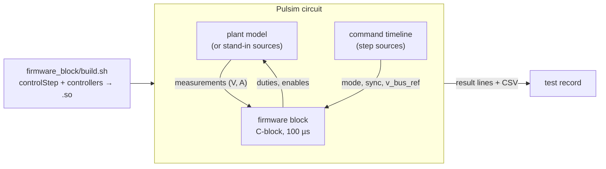

# L1: firmware in the loop (Pulsim)

The application's real control code (`controlStep()` and its controllers) runs inside the Pulsim circuit simulator against a model of the uSolarVerter, closed loop. Why it is done this way: [ADR 0001](../../docs/adr/0001-firmware-in-the-loop-via-pulsim.md). Signals exchanged: [procedure §3](../../docs/testing/test-procedure.md#3-model--firmware-block-contract-v1).

## Setup (once)

```bash
python3 -m venv .venv
.venv/bin/pip install -r tests/l1/requirements.txt     # pulsim==2.0.0, numpy, matplotlib
```

PlatformIO must have fetched `control_library` and `single_phase_inverter` once (a firmware build does it).

## Run

```bash
tests/run_all.sh --l1      # with the test record
bash tests/l1/run.sh       # result lines only
```

Without `.venv` or with another Pulsim version, every L1 case is reported `BLOCKED` with the command to fix it; nothing fails.



## Layout

| Path | Content |
|---|---|
| [`run.sh`](run.sh) | Checks the environment, builds the firmware block, runs every L1 case |
| [`requirements.txt`](requirements.txt) | Pinned Python environment |
| [`firmware_block/`](firmware_block/README.md) | The firmware block, the contract helpers, and L1-FWB-01 |
| `plant/` | Plant model (commit 9, from the colleague's Pulsim model) |
| `cases/` | L1-APP and L1-GFL case scripts (commit 8) |

## Pulsim 2.0.0 rules learned the hard way

| Rule | What happens otherwise |
|---|---|
| Load every C-block output (`contract.add_firmware_block` adds 1 MΩ) | Singular matrix: node voltages diverge to 1e300 or NaN, with only a warning |
| Only one C-block per circuit; drive commands with step sources (`contract.add_command_timeline`) | `IndexError` in Pulsim when it sums the blocks' outputs |
| Add C-blocks after every other component | Same `IndexError` |
| Ground node is `gnd` | Node `0` is an ordinary node: the circuit floats |
| The first block call at t = 0 sees all inputs at 0 (circuit not yet solved) | The firmware block skips it; see `firmware_block.cpp` |
